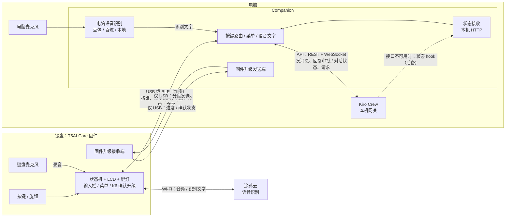

# Ki-board 架构概览（v0.3）

> 本文描述 v0.3 硬件与固件 0.3.x 的整体结构。线上协议的权威定义在
> [`shared/protocol/protocol.md`](../shared/protocol/protocol.md)；用户可见的按键、灯光和菜单行为见
> [`docs/user-manual.md`](user-manual.md)（[English](user-manual.en.md)）。

## 1. 产品定位

Ki-board 是一款面向 Kiro Crew 使用者的 AI 键盘：它把 Kiro Crew 的 agent 控制从屏幕“搬”到指尖，让开发者
无需电脑本身的键盘或鼠标、不打断心流，就能高效地发起任务、检查会话状态。

它处在“传统键盘输入”与“AI agent 协作”的交叉点上：对用 Kiro Crew 进行开发的人来说，它既是日常高效输入提示
信息的键盘，也可以是驱动 agent 执行其他任务的物理入口，包括控制 IoT 智能家电等。

目前它做两件事：

- **把语音送进 Kiro Crew**：按住语音键说话，识别出的文字先显示在键盘屏幕上，确认后再发出去。
- **把 agent 的状态放到手边**：三个对话槽的工作状态用屏幕图标和键灯颜色显示；需要用户做决定的事
  （权限审批、提问、回复选项、模型切换）直接在键盘屏幕上弹菜单，用按键回答。

键盘本身不直接连接 Kiro Crew。电脑上运行一个桌面程序 **Companion**，它一边经 USB 或蓝牙连接键盘，
一边连接本机的 Kiro Crew 网关。目前只支持 Kiro Crew。

## 2. 硬件组成

| 部件 | 说明 |
|---|---|
| 主控板 | Tuya **T5AI-Core** 开发板（T5-E1 模组，Cortex-M33F @ 480 MHz，8 MB flash，2.4 GHz Wi-Fi + BLE 5.4，板载麦克风与扬声器、USB 串口、电池充电） |
| 扩展底板 | 无源板，经 44P 排针接在开发板上，只带输入、显示和灯光；USB、供电、充电、音频都由开发板提供 |
| 按键 | 6 个机械键 K1–K6，热插拔轴座 |
| 旋钮 | EC11 旋转编码器（旋转 + 按压） |
| 屏幕 | 2.8" IPS LCD，ST7789 驱动，320×240，SPI |
| 灯光 | 7 颗 WS2812 RGB：LED1–LED6 在 K1–K6 下，LED7 在旋钮旁；灯链电源可由固件关断 |

引脚分配、网表、BOM 和引脚冲突检查脚本在 [`hardware/pinmap/`](../hardware/pinmap/)（v0.3 见
[`pinmap-v0.3.md`](../hardware/pinmap/pinmap-v0.3.md)）。原理图、PCB 和 BOM 导出文件在
[`hardware/exports/`](../hardware/exports/)。

## 3. 软件架构

图中“文字”指识别结果：键盘云端识别的文字在键盘内部直接进输入栏，电脑识别的文字由
Companion 发回键盘再进输入栏；设了 Alt+N 的槽，Companion 把文字打进 Crew 输入框。固件升级只走 USB，键盘上按 K6 确认后才写入。

### 3.1 固件（`firmware/app/`）

基于 [TuyaOpen](https://github.com/tuya/TuyaOpen)，C 语言。一个应用、两个构建配置（profile）：release 和 debug，都是 USB + BLE 双载体加板端云端语音识别。
共享核心模块，传输和语音识别后端由编译开关选择。

| 模块（`firmware/app/common/`） | 作用 |
|---|---|
| `ak_input` / `ak_input_fsm` / `ak_keymap` | 按键与旋钮扫描、去抖、单击 / 双击 / 长按识别，按 keymap 把手势映射成动作 |
| `ak_ui` / `ak_menu` / `ak_statuslcd` / `ak_gfx` / `ak_font*` / `ak_text` / `ak_i18n` | 七个工作状态、LCD 菜单与状态栏、绘图和中英文字体、界面语言 |
| `ak_leds` / `ak_led_policy` / `ak_led_power` | 键灯颜色与动画、灯链电源（关 / 开 / 自动断电） |
| `ak_protocol` / `ak_rx` / `ak_validate` / `ak_uart` / `ak_ble_gatt` | 帧编解码、严格的入站校验、按来源（USB / BLE）门控命令 |
| `ak_ble_sec` | BLE 应用层安全通道（配对密钥、握手、加密帧） |
| `ak_asr` / `ak_voice_route` / `ak_voice_mode` / `ak_cloud` | 板端云语音识别、语音路由（云端 / 电脑识别）、语音模式（识别 / 对话） |
| `ak_wifi` / `ak_wifi_store` / `ak_provision` / `ak_cred` / `ak_reset_netcfg` | Wi-Fi 连接与已保存网络（最多 8 个，加密存在 KV；断线 25 s 后按信号强弱依次重连已保存的网络）、配网窗口、设备授权状态、重置配网 |
| `ak_ota` / `ak_ota_link` | 本地固件升级：验签、版本检查、写分区、确认 |
| `ak_settings` / `ak_kv` | 设备设置页（音量、亮度、语言、语音模式、灯光）；语言、语音模式和灯光设置重启后保留 |
| `ak_battery` / `ak_bat_gauge` | 电池电压采样与电量估算 |

版本号以 `firmware/app/VERSION` 为准。`firmware/bringup/` 是一组独立的硬件验证小程序
（按键、旋钮、屏幕、灯链、无线），新板子焊好后逐个烧录，检查硬件是否正常。

### 3.2 Companion（`companion/`）

Windows 桌面程序，Tauri 2：Rust 后端 + React / TypeScript 界面。

| 部分 | 作用 |
|---|---|
| 传输层（`src-tauri/src/transport/`） | USB 串口与 BLE GATT 连接；BLE 端实现与固件相同的安全通道（`ble_sec.rs`） |
| 协议（`protocol.rs`、`menu_wire.rs`、`lcd_text.rs`） | 与固件共用的帧定义；生成发往键盘屏幕的菜单和提示文字 |
| 路由（`kirocrew_control.rs`、`crew_menus.rs`、`voice_send.rs`、`inject.rs`） | 把键盘手势变成对 Kiro Crew 的操作；把需要决定的请求排队并变成键盘菜单；把确认后的语音文字发给选中的对话 |
| 状态（`crew_api.rs`、`status_sink.rs`、`hook_install.rs`） | 主路径：Companion 经 Kiro Crew 本机接口（REST + `/api/ws`，只走本机回环）读取对话状态、请求和模型，发送提示词、审批和回答。后备：Kiro Crew 的四条状态 hook 调用 Companion，本机 HTTP 端口接收，接口连不上时仍能显示状态。合成三个槽位的状态发给键盘 |
| 电脑识别（`stream_asr/`、`secrets.rs`） | 电脑端流式语音识别：豆包、阿里云百炼（云端），sherpa-onnx（本地离线，模型按需下载并校验）；云端失败可自动回退本地；API Key 只存在系统凭据管理器 |
| 网关校验（`crew_identity.rs`） | 连接本机 Kiro Crew 网关前确认对方身份（见第 5 节） |
| 升级（`ota.rs`） | 校验签名包，只经 USB 分段发给键盘，并显示键盘回报的进度和结果 |
| 界面（`src/`） | 连接与设备状态、键位、键盘设置（与键盘设置页的每一项对应）、电脑识别设置、配网与授权、固件升级 |

### 3.3 协议

键盘与 Companion 之间是 UTF-8 **JSON Lines**：一行一个 JSON 对象，字段为 `v` / `seq` / `type` / `payload`，
接收方忽略不认识的 `type`。同一套协议跑在 USB 串口和 BLE GATT 上；BLE 上每一行先经过加密通道。
完整定义：[`shared/protocol/protocol.md`](../shared/protocol/protocol.md)。

## 4. 数据流

### 4.1 连接（USB / BLE）

- **USB**：T5AI-Core 开发板自带的 USB 口（板上的 USB 串口芯片），插线后即可通信。所有敏感操作只走 USB。
- **BLE**：键盘先插 USB 和 Companion 配对一次（配对密钥只经 USB 交付），之后可以拔掉 USB 线，经蓝牙使用。
  未配对或认证失败的 BLE 连接，键盘一行都不处理。
- 连接建立后双方握手（`hello` / `hello_ack`），键盘报告固件版本和支持的能力，Companion 据此决定发哪些帧。

### 4.2 语音

1. 按住语音键（默认 K5）说话，松开结束。
2. 识别由键盘的语音路由决定：
   - **键盘云端识别**：键盘麦克风录音，经 Wi-Fi 发到涂鸦云识别，识别文字回到键盘。
   - **电脑识别**：Companion 用电脑麦克风录音，流式送到所选引擎（豆包、阿里云百炼或本地 sherpa-onnx）。
     松开语音键后键盘停在 ②，状态栏显示「识别中…」；最终文字由 Companion 送回键盘。等待中按 K1 取消；
     15 s 没有结果时键盘回到 ① 并提示超时。取消或超时后迟到的结果不会再出现。
3. 两种识别的文字都进键盘屏幕底部的输入栏（键盘模式）。K4 删字（长按清空），按住语音键接着说。设了 Alt+N 的对话走电脑模式：
   Companion 切到那个对话，把文字打进输入框，不发送，由你按 K6 或 Enter 发送。键盘模式下识别结果不会打进任何窗口。
   电脑识别的引擎、Key 保存和本地模型见 [`docs/pc-asr.md`](pc-asr.md)。
4. 键盘模式下按 K6，Companion 把文字经网关 API 发到 K1–K3 选中的对话，不管电脑上开着哪个对话。

语音模式还有一种「对话」模式：键盘直接与涂鸦云上的对话 agent 对话，回复只显示在键盘上，不发给 Kiro Crew。

### 4.3 状态上屏与请求

- Companion 跟踪 K1–K3 绑定的三个 Kiro Crew 对话，把每个对话的状态（空闲 / 忙碌 / 等待操作 / 有新信息 / 未绑定）
  发给键盘，键盘用屏幕左侧卡片上的状态圆点和键灯显示。
- 对话需要用户决定时（权限审批、提问、回复选项），Companion 按优先级排队，同一时刻只给键盘发一个菜单。
  用户在键盘上按键回答，键盘回传选择结果，Companion 校验后回复给对应对话。

### 4.4 键盘设置

键盘设置页的每一项都能在 Companion 里查看或修改：音量、亮度、语音模式、灯光电源（关 / 开 / 自动，自动时空闲
30 s、1 min、5 min 或 15 min 后断开灯链电源，有活动时恢复）、界面语言。键盘是这些值的权威来源，任一边修改后
以键盘回报的值为准，最后一次修改生效。敏感项（设备授权、蓝牙配对、配网窗口、Wi-Fi 与已保存网络的删除、重置配网）在 Companion 里
只经 USB 操作，并且都要在键盘上物理确认；BLE 连接时 Companion 只显示状态。

### 4.5 固件升级（OTA）

只经 USB。发布方生成签名包 `.akota`；Companion 校验后分段发给
键盘；键盘再次验签、检查版本（只升不降），在屏幕上弹出确认框，用户按 K6 后才写入并重启安装。
开始升级前和写完、重启前各检查一次供电：USB 供电，或电量读数可信且不低于 30%；不满足就报错，不写入、不重启。

## 5. 安全模型概要

| 方面 | 规则 |
|---|---|
| 敏感操作只走 USB | 新增或修改 Wi-Fi、写设备授权、生成 BLE 配对密钥、重置配网、固件升级、打开配网窗口、清除 BLE 配对，都只接受 USB 来源；经 BLE 收到的这些命令即使已认证也拒绝 |
| 已保存的 Wi-Fi | 新增或修改网络只经 USB 且在配网窗口内；删除只经 USB 或在键盘设置页上操作；BLE 只能读取已保存网络的 SSID 列表。密码不出键盘，协议和日志里都没有密码 |
| 键盘上物理确认 | 打开配网窗口、重置配网、清除配对、固件升级都要在键盘上按 K6 确认（K1 或 10 s 无操作取消）；写 Wi-Fi、授权和配对密钥只在配网窗口（180 s）内有效 |
| BLE 加密 | 应用层安全通道：USB 交付的 32 字节配对密钥，每次连接用随机数派生两个方向不同的会话密钥，每帧 AES-128-CCM 加密并认证，计数器防重放 |
| 严格解析 | 每一行入站帧先过格式、长度、字段范围校验，不合格整行丢弃 |
| OTA 签名 | 升级包用 ECDSA P-256 签名，Companion 和键盘各验一次；正式固件只接受正式密钥签的正式包；版本只升不降；升级前在键盘上确认 |
| 回复只来自键盘按键 | 审批、提问、模型的回复只由键盘物理按键产生的选择结果触发；Companion 核对菜单编号、有效期和请求未变后才回复 |
| 本机网关校验 | Companion 向本机 Kiro Crew 网关发送本地密钥或会话凭据之前，先确认监听该端口的进程属于当前用户、且是 Kiro Crew 网关本身；任何一项不符或无法确认就不发送（失败即拒绝），并在键盘上提示一次 |
| 电脑识别的 Key | 云端识别的 API Key 只存在系统凭据管理器，不写配置文件、不进日志、不回传界面 |
| 凭据不入库 | 设备授权（UUID / AuthKey）写在设备里，不进源码；产品 ID 由使用者自己配置（见 `firmware/app/README.md`） |

## 6. 目录导览

| 路径 | 内容 |
|---|---|
| [`firmware/app/`](../firmware/app/) | 产品固件（TuyaOpen，C） |
| [`firmware/bringup/`](../firmware/bringup/) | 硬件上电验证程序 |
| [`companion/`](../companion/) | 桌面 Companion（Tauri：Rust + React / TypeScript） |
| [`shared/protocol/protocol.md`](../shared/protocol/protocol.md) | 键盘与 Companion 的协议权威定义 |
| [`docs/`](./) | 架构（本文）、用户手册 |
| [`hardware/pinmap/`](../hardware/pinmap/) | 引脚映射、网表、BOM、元件说明、引脚检查脚本 |
| [`hardware/exports/`](../hardware/exports/) | 原理图、PCB、BOM、坐标文件等设计导出 |
