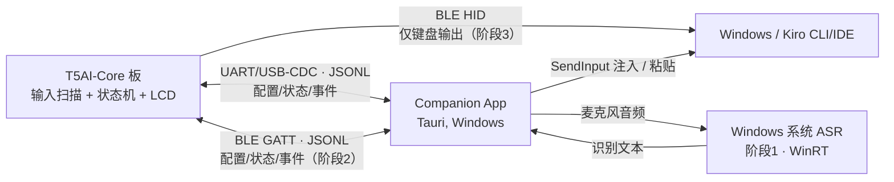

# 板级通信协议 v1（Agentic Keyboard for Kiro）

> 本文件是**跨固件/上位机共享**的协议权威定义（源）。
> `docs/protocol.md` 是面向阅读的说明版，内容以本文件为准。
> 设计参照 ki-board 的 `shared/protocol/serial-protocol.md`，并针对本项目
> （T5AI-Core + 5 键 + 5 向摇杆 + Windows 上位机）做了裁剪与调整。

## 载体（Transports）

- **阶段 1**：UART / USB-CDC，115200 8N1
- **阶段 2**：BLE GATT（自定义服务）
- **阶段 3**：BLE HID（仅键盘输出，不走本 JSONL 协议）

消息为 UTF-8 **JSON Lines**：每个 JSON 对象后紧跟 `\n`。
接收方**必须忽略**无法识别的 `type`。协议内容跨载体保持一致。

## 通信模型



职责划分：

- **BLE HID**：仅负责像键盘一样输出（阶段 3）。
- **UART/USB-CDC / BLE GATT**：双向 JSONL，负责配置、按键/摇杆事件、Agent 状态、
  语音状态、配对/鉴权。
- **Companion**：拥有 Windows 系统 ASR、按键映射、SendInput 注入 / 剪贴板粘贴。
- **固件**：拥有输入状态机、LCD 渲染。

## 帧结构

统一字段：

| 字段 | 类型 | 说明 |
|------|------|------|
| `v` | int | 协议版本，当前为 `1` |
| `seq` | int | 递增序号（板→PC 事件用于去重/ack，可选） |
| `type` | string | 消息类型 |
| `payload` | object | 类型相关的负载 |

示例：

```json
{"v":1,"seq":12,"type":"key","payload":{"id":"k1","action":"down"}}
```

## 握手 / 心跳

Companion 发：

```json
{"v":1,"type":"hello","payload":{"client":"companion","version":"0.1.0"}}
```

板回：

```json
{"v":1,"type":"hello_ack","payload":{"fw":"0.1.0","capabilities":["uart","ble_gatt","keymap","voice_state"]}}
```

心跳：

```json
{"v":1,"type":"ping"}
{"v":1,"type":"pong"}
```

## 板 → PC 事件

### key（机械按键）

```json
{"v":1,"seq":1,"type":"key","payload":{"id":"k1","action":"down","held_ms":0}}
```

- `id`：`k1`..`k5`（5 个茶轴按键）
- `action`：`down` / `up` / `long`
- `held_ms`：按下时长（`up`/`long` 时有意义）

### nav（5 向摇杆）

```json
{"v":1,"seq":2,"type":"nav","payload":{"dir":"up","action":"down","held_ms":0}}
```

- `dir`：`up` / `down` / `left` / `right` / `center`
- `action`：`down` / `up` / `long`

### voice（语音触发）

```json
{"v":1,"seq":3,"type":"voice","payload":{"state":"start"}}
```

- `state`：`start` / `stop`
- 阶段 1：板发出 `voice:start` 后，Companion 调用 Windows 系统 ASR 听写。

### macro（宏，可选）

```json
{"v":1,"seq":4,"type":"macro","payload":{"name":"send"}}
```

## PC → 板 命令

### led

```json
{"v":1,"type":"led","payload":{"state":"on","color":"green"}}
```

### display（Agent 状态 / 文本上屏）

```json
{"v":1,"type":"display","payload":{"agent_name":"planner","state":"running","text":"..."}}
```

- `state`：`idle` / `running` / `error`
- 对应 Kiro CLI hook 的 `agentSpawn` / `userPromptSubmit` / `stop` / `postToolUse`

### config

```json
{"v":1,"type":"config","payload":{"voice_engine":"system"}}
```

- `voice_engine`：`system`（阶段 1，Windows 系统 ASR）/ `third_party`（阶段 2 在线 ASR）

### ack

```json
{"v":1,"type":"ack","payload":{"seq":12}}
```

### status / log（探针反馈，board → PC）

Bring-up / feature-probe 固件用这两种帧在 **UART0 (COM6)** 上报告自身状态与事件，
便于在串口监控 / Companion 里判断行为（不依赖 LCD 或 UART1 调试日志）。

```json
{"v":1,"type":"status","payload":{"probe":"ble_gatt_link","state":"ready"}}
{"v":1,"seq":5,"type":"log","payload":{"tag":"ble","msg":"central connected"}}
```

- `status`：探针生命周期状态（如 `ready` / `advertising` / `connected`）。
- `log`：探针自定义事件；`msg` 为纯文本，发送方需避免内嵌 `"` / 换行以保持单行 JSON。

## Kiro CLI Hook → Companion

Hook 脚本把 `agentSpawn` / `userPromptSubmit` / `stop` / `postToolUse` 转成
`display` 语义的 JSON，优先交给 Companion；Companion 经当前载体下发到板。
Companion 不可用时，回退直连 UART/USB-CDC 写入板子。

## 配对与鉴权（阶段 2 起）

信任按载体划分：

- **UART/USB-CDC 物理可信**：插线即授权，无需配对/鉴权。保证 hook 直连回退可用。
- **BLE GATT 需授权**：无线可被邻近设备连接，命令需经配对建立的共享 token 门控。

> 阶段 1（有线）不涉及配对；BLE 配对/鉴权流程细节在阶段 2 实现时补充，
> 可直接对照 ki-board 的方案（USB 免确认配对 + BLE 数字比对 + 板上确认）。

## 与 ki-board 的主要差异

| 维度 | ki-board | 本项目 |
|------|----------|--------|
| 输入 | 3 屏幕按键 | 5 茶轴按键 + 5 向摇杆 |
| 事件类型 | `button_event` | 拆为 `key` / `nav` / `voice` / `macro` |
| 语音 | macOS 系统听写 / 3P ASR | 阶段1 Windows 系统 ASR |
| 直连 | USB HID | BLE HID（T5 无 USB HID Device） |
| 帧字段 | `type` 顶层 | `v`/`seq`/`type`/`payload` 规范化 |
