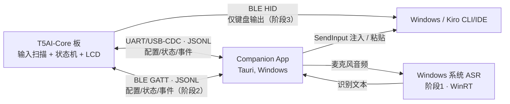

# 板级通信协议 v1（Agentic Keyboard for Kiro）

> 本文件是**跨固件/上位机共享**的协议权威定义（源）。
> `docs/protocol.md` 是面向阅读的说明版，内容以本文件为准。
> 设计参照 ki-board 的 `shared/protocol/serial-protocol.md`，并针对本项目
> （T5AI-Core + 6 键 + EC11 编码器 + Windows 上位机，v0.3）做了裁剪与调整。

## 载体（Transports）

- **阶段 1**：UART / USB-CDC，115200 8N1
- **阶段 2**：BLE GATT（自定义服务）
- **阶段 3**：BLE HID（仅键盘输出，不走本 JSONL 协议）

消息为 UTF-8 **JSON Lines**：每个 JSON 对象后紧跟 `\n`。
接收方**必须忽略**无法识别的 `type`。协议内容跨载体保持一致。

## 通信模型



职责划分：

- **BLE HID**：仅负责像键盘一样输出（阶段 3）。
- **UART/USB-CDC / BLE GATT**：双向 JSONL，负责配置、按键/编码器事件、Agent 状态、
  语音状态、配对/鉴权。
- **Companion**：拥有 Windows 系统 ASR、按键映射、SendInput 注入 / 剪贴板粘贴。
- **固件**：拥有输入状态机、LCD 渲染。

## 帧结构

统一字段：

| 字段 | 类型 | 说明 |
|------|------|------|
| `v` | int | 协议版本，当前为 `1` |
| `seq` | int | 递增序号（板→PC 事件用于去重/ack，可选） |
| `type` | string | 消息类型 |
| `payload` | object | 类型相关的负载 |

示例：

```json
{"v":1,"seq":12,"type":"key","payload":{"id":"k1","action":"down"}}
```

### 板端接收规则（PC → 板）

固件对每一行入站帧做严格校验，不符合即整行丢弃（不回 NACK，UART1 日志记一条警告）：

- 每条载体（UART、BLE）各自拼行，行在哪条载体上收齐就属于哪条载体；不同载体的字节不会拼成一行。
  BLE 断开、或 USB `hello` 接管后，BLE 侧未完成的半行被丢弃。
- 一行最长 511 字节（不含 `\n`）；超长行或含 NUL 字节的行整行丢弃。
- 一行必须恰好是一个 JSON 对象：`v` 必须为 `1`；`type` 必须是顶层字符串、只含 `[a-z0-9_]`、最长 23 字节；
  `seq` 可选，为 0..4294967295 的整数；`payload` 可选，存在时必须是对象。嵌套在 `payload` 里的 `type`
  只是普通数据。重复键视为格式错误。
- 字符串转义完整解码（含 `\uXXXX` 与代理对，`\u0000` 拒绝）。
- 标识类与凭据类字段超出缓冲即拒绝，不截断；只供 LCD 显示的文本（`display` 的 `agent_name`/`state`/`text`、
  `bindings` 别名）按 UTF-8 字符边界截短。
- 数值只接受十进制非负整数，超出该字段范围即拒绝（`volume`/`brightness` 0..100，`chat_slot` 1..3）。
- `wifi`、`license`、`license_read`、`reset_netcfg`、`ble_pair` 只接受整行来自 UART 的帧；BLE 来源一律拒绝。
  固件升级的 `ota_*` 命令同样只收 UART（见“固件升级（仅 USB）”），但不受配网窗口限制。
- 上述五条命令还要求键盘的配网窗口处于打开状态（见下文 `prov_status`）；窗口关闭时 AK 不执行，回 `prov_status`
  并带 `rejected`/`reason`。
- BLE 上的每一行先经过“BLE 安全通道”（见下文）：未配对、未完成握手或认证失败的 BLE 连接，任何一行都不处理。
- `keymap` 帧原子生效：任一字段格式错误则整帧不生效；未知的动作名仍然跳过，便于新版 Companion 增加动作。

## 握手 / 心跳

Companion 发：

```json
{"v":1,"type":"hello","payload":{"client":"companion","version":"0.1.0"}}
```

板回：

```json
{"v":1,"type":"hello_ack","payload":{"fw":"0.1.0","capabilities":["uart","ble_gatt","keymap","voice_state","device_settings","system_info"]}}
```

心跳：

```json
{"v":1,"type":"ping"}
{"v":1,"type":"pong"}
```

## 板 → PC 事件

### key（机械按键与 EC11 按压）

一个 `key` 帧有两种用法：普通键和 EC11 按压上报**手势**；语音键上报**原始边沿**。

```json
{"v":1,"seq":7,"type":"key","payload":{"id":"k1","action":"single","bind":"chat1","held_ms":0}}
{"v":1,"seq":8,"type":"key","payload":{"id":"k2","action":"long","held_ms":0}}
{"v":1,"seq":9,"type":"key","payload":{"id":"k5","action":"down","held_ms":0}}
```

字段：

- `id`：`k1`..`k6`（6 个热插拔按键）或 `enc`（EC11 按压）。
- `action`：
  - 普通键和 `enc`：`single` / `double` / `long`（手势，见下）。
  - 语音键（keymap 里 `kind=voice`，默认 K5）：`down` / `up` / `long`。这是按住说话的原始边沿，不是手势：
    `down` 立即开始录音，`up` 结束；`long` 只表示已按住超过长按阈值。
- `bind`：可选。这个手势在固件 keymap 里绑定、且固件已经执行（或交给 PC 执行）的动作名：
  `chat1`..`chat9` / `instance1`..`instance9` / `cancel_char` / `cancel_all` / `confirm` / `model_menu` /
  `model_toggle` / `settings` / `menu_recall`（① 时 K4 单击、有被 ESC 的请求，见 `menu_parked`）。
  手势未绑定动作时**不带** `bind`，手势照样上报。
- `held_ms`：语音键 `up`/`long` 时为按下时长；手势帧固定为 `0`。

手势语义（K1–K6 普通键与 `enc` 通用；EC11 旋转走 `encoder` 帧，另计）：

| 手势 | 何时成立 | 何时上报 |
|---|---|---|
| `single` | 按下后在长按阈值前松开，且松开后双击窗口内没有第二次按下 | 双击窗口到期时（比松开晚最多一个窗口） |
| `double` | 第一次松开后、双击窗口内开始第二次按下，并在长按阈值前松开 | 第二次松开时；这一对按键不再上报 `single` |
| `long` | 按住达到长按阈值 | 达到阈值时立即上报一次，不等松开；之后的松开不再上报 |

- 固件参数：去抖 20 ms（`AK_FSM_DEBOUNCE_MS`），长按阈值 800 ms（`AK_FSM_LONG_PRESS_MS`），
  双击窗口 250 ms（`AK_GESTURE_DOUBLE_WINDOW_MS`，从第一次松开算到第二次按下）。
- 互斥：每次物理操作只产生一帧，`single` / `double` / `long` 三选一。
- 时序：短按后在窗口内又按住不放，是两次操作，先报 `single`（第一下），再报 `long`（第二下）。
  第二次按下晚于窗口时，第一下按 `single` 报出，第二下重新开始判定。
- 设置页打开期间（本地模态），按键不上报。`enc` 的 `long` 在主页面打开设置页，上报为
  `{"id":"enc","action":"long","bind":"settings"}`（本地动作，Companion 忽略）。

Companion 路由（先 `bind`，再默认规则）：

| 帧 | Companion 动作 |
|---|---|
| `bind: chatN` | K1–K3 且 N=1..3：已连 Crew API 时选中 Chat A/B/C 稳定槽位（该槽设了 Alt+N 时再跳转）；否则注入 `Alt+N` |
| `bind: instanceN` | 先把 Crew 窗口拉到前台，再注入 `Ctrl+N`（切 Local / Remote Crew）；前置失败时发 `notice` |
| `bind: model_menu` / `model_toggle` / `menu_recall` | 见“LCD 菜单与按键灯光” |
| `bind: cancel_char` / `cancel_all` / `confirm` | ③ 输入确认：默认（直接发送）不注入，`confirm` 带的 `text` 经 Crew API 发到选中对话；注入模式下 `Backspace` / `Ctrl+A` 后 `Backspace` / `Enter`（见“语音文字的去向”） |
| 无 bind，K1–K3 `single` | 已连 Crew API 时选中该键对应的 A/B/C 槽位 |
| 无 bind，K1–K3 `long` | 长按自动绑定：把 Companion 里选中的对话绑定到该键的槽位 |
| 无 bind，`enc` `single` | `Enter` |
| 其他 | 忽略 |

- v0.2 的 `nav` 帧和 `click` / `dclick` 名称不属于 v0.3 协议；接收方按未知值忽略。
  v0.2 协议见 tag `v0.2-final`。

### encoder（EC11 旋转编码器，v0.3）

```json
{"v":1,"seq":2,"type":"encoder","payload":{"detents":1}}
```

- `detents`：有符号整数步进计数（一个物理卡点 = ±1）。**正 = 顺时针**，**负 = 逆时针**。
  固件按正交解码累计净步进，可在一帧内上报多步（如快速连转上报 `2` / `-3`），接收方按步进滚动。
- 该帧**替代 v0.2 的 `nav`（5 向摇杆）**。v0.3 硬件用 EC11 旋钮替换摇杆：旋转 → `encoder`，
  旋钮**按下** → `key`（`id:"enc"`）。接收方按协议忽略未识别 `type`，故旧 Companion 收到 `encoder`
  会安全忽略；新 Companion 仍容忍（但不会再收到）历史 `nav` 帧。

### voice（语音触发）

```json
{"v":1,"seq":3,"type":"voice","payload":{"state":"start"}}
```

- `state`：`start` / `stop`
- 阶段 1：板发出 `voice:start` 后，Companion 调用 Windows 系统 ASR 听写。

### macro（宏，可选）

```json
{"v":1,"seq":4,"type":"macro","payload":{"name":"send"}}
```

### system_info（UART0 系统反馈）

```json
{"v":1,"seq":5,"type":"system_info","payload":{"fw":"0.1.1","transport":"dual","wifi_name":"MyAP","wifi_state":"connected","ble_name":"Agentic Keyboard-A1B2C3","ble_state":"advertising","cloud":"ready","license":"present"}}
```

- 该帧专门写入 UART0；DUAL 模式下不镜像到 BLE。
- 启动/握手时发送完整快照；Wi-Fi、BLE、云 ASR 或 License 状态变化时刷新。
- `wifi_state`：`connecting` / `connected` / `failed` / `disconnected`。
- `ble_state`：`disabled` / `advertising` / `connected` / `live`。
- `cloud`：`disabled` / `unavailable` / `ready`。
- `license`：`missing` / `present`；绝不包含 UUID 或 AuthKey。
- `system_info` 带 `seq`，Companion 按普通板端事件回 `ack`。

## PC → 板 命令

### led

```json
{"v":1,"type":"led","payload":{"state":"on","color":"green"}}
```

当前固件还没有由 Companion 驱动的灯效；收到 `led` 帧只把它当作一次活动，用来唤醒「自动」模式下已断电的灯链。

### display（指定 Chat 的 Agent 状态 / 文本上屏）

```json
{"v":1,"type":"display","payload":{"chat_slot":1,"agent_name":"planner","state":"running","text":"..."}}
```

- `chat_slot`：必填，`1` / `2` / `3` 分别对应 Chat A / B / C（物理键 K1 / K2 / K3）。
- AK 必须把 `agent_name`、`state` 和 `text` 写入 `chat_slot` 指定槽位的独立状态与历史；不得写入当前选中的其他槽位。缺失或超出 `1..3` 的帧必须拒绝。
- Companion 根据持久化的 Crew session 关联解析目标槽位；未绑定 Chat A/B/C 的 session 只保留在 Companion 列表，不发送到 AK。
- `state`：驱动 AK 左侧三块槽位图标的背景色：
  - `unbound`（或空字符串 / `-`）→ 紫色：未绑定/默认。未识别状态也按此兜底。
  - `idle` → 绿色：空闲。
  - `running` → 红色：忙碌。
  - `waiting` → 橙色：提示，等待操作。
  - `info` → 蓝色：有信息反馈，无需操作。
  - `error`：协议保留，暂不单独着色（当前并入忙碌/红）。
- Companion 的状态来源与映射：
  - hook：`agentSpawn`/`userPromptSubmit`/`postToolUse` → `running`；
    `stop` 有回复文本 → `info`、无文本 → `idle`。
  - crew API 投影：`pending_approval`/`needs_input`/`waiting_for_input` → `waiting`；
    `running`/`stopping`/`subagents_running` → `running`；有 `last_message` 的空闲 → `info`；否则 `idle`。
  - 解绑某 Chat A/B/C 槽位时，Companion 向该 `chat_slot` 发一帧 `state:"unbound"`，使图标回紫色。

### config

```json
{"v":1,"type":"config","payload":{"voice_engine":"system"}}
```

- `voice_engine`：`system`（Windows 系统 ASR）/ `cloud`（板端 Tuya ASR）
- 语音模式（ASR / Chat）**不能**通过 `config` 或任何 PC 命令切换，只能在键盘 Settings > Voice mode 切换。

### voice_source（AK → Companion）

```json
{"v":1,"seq":4,"type":"voice_source","payload":{"source":"cloud","mode":"chat"}}
```

- `source`：当前生效的识别路由 `cloud` / `system`。
- `mode`：键盘的语音模式，`asr`（识别文字进 Kiro Crew，现有行为）/ `chat`（键盘与涂鸦云 agent 对话）。只读；
  重启后沿用上次的模式，开机在状态栏提示一次。

### tuya_chat（Chat 模式对话，AK → Companion，仅 UART0，只显示）

```json
{"v":1,"seq":31,"type":"tuya_chat","payload":{"role":"user","text":"how should I split the parser change","final":true}}
{"v":1,"seq":32,"type":"tuya_chat","payload":{"role":"agent","text":"Start with the source tag on each line...","final":true}}
```

- 每轮一条 `user`（识别出的话）和一条 `agent`（回复全文，最长 1024 字节，超长以 `...` 结尾）。
- **只显示**：Companion 不得把它注入 Kiro Crew 输入框或转成任何按键（companion-review CP-01）。
- Chat 模式下 AK 不发 `asr` 帧、不进入待确认态；K5 的 `key` 帧不发；K4 只在本地打断回复；EC11 旋转滚动 LCD 聊天页、
  单击本地消费，都不发给 PC。K1–K3、K6 仍按 keymap 控制 Kiro Crew（Q12）。云不可用时 K5 只提示，不回退到 Windows 听写。
- BLE 不镜像该帧（BLE 链路尚无加密）。

### keymap（按键手势→动作下发，方案 A，v0.3 stage 乙）

Companion 下发每键的**手势→动作**绑定，覆盖固件 keymap。固件把生效的表缓存进 TAL KV，断开后保留上次配置；重启先读 KV，无记录则用 v0.3 默认表。字段用**扁平点号键**（一个字段对应一个 (键, 手势)），以适配固件的扁平 JSON 提取器：

```json
{"v":1,"type":"keymap","payload":{"k1.single":"chat1","k1.double":"instance1","k1.long":"none","k4.single":"cancel_char","k4.long":"cancel_all","k5.kind":"voice","k6.single":"confirm"}}
```

- `<键>.kind`：`voice`（按住说话键，发原始边沿，没有手势槽）/ `normal`（普通键，走 single/double/long 分类器）。
- `<键>.single` / `<键>.double` / `<键>.long`：该手势槽绑定的**动作**。省略的字段保留固件当前绑定（部分更新）。
- 动作取值：`none`（不绑）/ `cancel_char` / `cancel_all` / `confirm`（只在待确认态生效）/ `chat1`..`chat9`（Alt+N）/ `instance1`..`instance9`（Ctrl+N）/ `model_menu` / `model_toggle`（见“LCD 菜单与按键灯光”）。未知动作被忽略（保留原绑定）。
- v0.3 默认表：K1–K3 `single=chatN`、`double=instanceN`、`long=none`（N=1..3）；K4 `single=cancel_char`、`long=cancel_all`；K5 `kind=voice`；K6 `single=confirm`、`double=model_toggle`、`long=model_menu`；`enc` 无绑定（`long` 固定打开设置页）。K6 的 `double`/`long` 两项需要支持 `menu` 能力的固件。
- `enc.long` 保留给设备设置页，固件忽略对它的绑定；`enc.kind` 不能设为 `voice`（否则长按无法进入设置页）。Companion 的 keymap 面板不提供这两项。
- 固件据此在 `key` 帧里上报手势和 `bind`（见上节）。固件应答 `ack`（带 `seq` 时）。载体 USB / BLE 均可（纯配置）。

### device_settings / device_settings_state（音量、屏幕亮度与界面语言）

Companion 修改当前运行值（字段都可省略，只改带了的）：

```json
{"v":1,"type":"device_settings","payload":{"volume":70,"brightness":90,"language":"zh"}}
```

AK 在握手、本地调节或应用 Companion 命令后回报实际值：

```json
{"v":1,"seq":15,"type":"device_settings_state","payload":{"volume":70,"brightness":90,"led_power":"auto","led_auto_off_s":60,"language":"zh"}}
```

- `volume`：`0..100`；`brightness`：`10..100`，AK 设置页和 Companion 均以 10% 为步进。
- `language`：界面语言 `zh`（中文，默认）/ `en`（English）。键盘 LCD 全部界面文字、Companion 界面、
  Companion 生成后发给键盘的 LCD 文本（`menu` 标签、notice）以及 Chat 模式涂鸦 agent 的回复语言都跟随它。
  AK 存 KV（`ak_lang`），重启保留。可经 USB 或已配对的加密 BLE 修改（普通配置，不属于敏感命令）。
  两边谁最后改以谁为准：AK 设置页改完立即发 `device_settings_state`；Companion 改时发 `device_settings`，
  以 AK 回的 `device_settings_state` 为准更新自己的界面语言。其他取值整帧拒绝（不改任何字段）。
  旧固件不回 `language`：Companion 不同步语言，只用自己的界面语言。
- `led_power`：灯光电源设置 `off` / `on` / `auto`（AK 设置页 LED power，存 KV，重启保留）；`led_auto_off_s`：
  `auto` 时的空闲断电时长，取值 `30` / `60` / `300` / `900`。目前只读：AK 在本地修改后回报一次，
  `device_settings` 还不接受这两个字段（以后由 Companion 覆盖时再加，且只经 USB 或已认证的 BLE 安全通道）。
  旧版 Companion 忽略这两个字段。
- AK 是当前运行值的权威来源；Companion 只在收到 `device_settings_state` 后更新显示。
- `device_settings_state` 带 `seq`，Companion 按普通板端事件回 `ack`。
- 音量与亮度只同步当前运行值，不承诺断电或重启后保留；`language` 与 `led_power` 重启保留。

#### 界面语言与 Chat 模式 agent

- 键盘每次开始一轮云端语音（K5 按住）前调用 `tuya_ai_agent_set_event_param`，在本轮 event start 的
  `sessionAttributes` 里带 `"custom.param": {"lang":"zh","lang_name":"Simplified Chinese"}`（English 为
  `{"lang":"en","lang_name":"English"}`）。这是 TuyaOpen 公开接口，固件不改 SDK。
- 云端 agent 是否按它回复，取决于涂鸦控制台上该 agent 的提示词是否读取这个参数（例如提示词里写明
  “用 custom.param 里 lang 指定的语言回复”），需要在控制台配置并实板验证。ASR 识别语言由控制台 agent
  角色的语言决定，设备侧不能切换。

### bindings（A/B/C 显示别名）

```json
{"v":1,"type":"bindings","payload":{"alias_a":"Plan","alias_b":"","alias_c":"Code"}}
```

- Companion 连接 AK 时发送全部三个别名，修改别名后再次发送。
- `alias_a` / `alias_b` / `alias_c` 分别对应 K1 / K2 / K3（槽位 A / B / C）。
- 每个别名最多 7 个可显示 ASCII 字符；空字符串表示在 AK 上使用默认名 A、B 或 C。

### wifi（仅 USB）

```json
{"v":1,"type":"wifi","payload":{"ssid":"MyAP","pass":"secret"}}
```

- 仅允许通过当前 USB/UART 连接发送；Companion 和 AK 固件都必须拒绝 BLE 来源。
- 设备只支持 2.4GHz Wi-Fi。密码仅发往 AK，不由 Companion 持久化。
- 格式：`ssid` 1..32 字节且不含控制字符；`pass` 为空（开放网络）或 8..63 个可打印 ASCII 字符。不符合时 AK 不写入，回 `wifi_status` 的 `failed`。
- 回滚：设备之前连过的网络会被保留。新配置 30 s 内没有连上时，AK 写回旧配置并重连，回 `wifi_status` 的 `restored`（`ssid` 为旧网络）。
- 对未激活设备，WiFi `connected` 后还必须完成下面的 SmartLife QR 激活；只有收到
  `cloud_ready` 后 activation data 才能在重启时恢复。

### activation_status（AK → Companion，仅 UART0）

```json
{"v":1,"seq":21,"type":"activation_status","payload":{"state":"scan_qr","qr_url":"https://smartapp.tuya.com/s/p?p=<PID>&uuid=<UUID>&v=2.0"}}
```

`state` 生命周期：

- `pairing`：未激活，等待网络/绑定。
- `scan_qr`：Direct MQTT 已连接；Companion 动态生成二维码并自动展开激活卡片。
- `token_received`：SmartLife 已下发 region/token/regist_key，设备正在云端激活。
- `activated`：DeviceID/schema/activation data 已保存。
- `cloud_ready`：正常 Tuya MQTT 已上线；Companion 自动折叠为成功摘要。
- `cloud_disconnected`：activation 仍保留，仅云连接暂不可用。
- `resetting`：正在清除网络与 activation data。

`qr_url` 仅在 `scan_qr` 非空，包含 PID 和 UUID，不包含 AuthKey。只有配网窗口打开时 AK 才会发出非空
`qr_url`（窗口外为空串，窗口打开时补发一次）。Companion 只接受
`https://smartapp.tuya.com/s/p?` 前缀，并仅在二维码展开时动态加载 QR 生成模块。

### prov_status（配网窗口，AK → Companion，仅 UART0）

```json
{"v":1,"seq":31,"type":"prov_status","payload":{"state":"open","remaining_s":172}}
{"v":1,"seq":32,"type":"prov_status","payload":{"state":"closed","remaining_s":0,"rejected":"wifi","reason":"closed"}}
```

- 用户在键盘上打开窗口：长按旋钮进入 Settings → `Pairing mode` → 确认框里按 K6（或旋到 Confirm 再按旋钮）。
  确认框默认选中 Cancel，10 s 无操作视为取消。窗口时长 180 s，LCD 状态栏倒计时；收到 `cloud_ready`
  后 5 s 自动关闭；在 Settings 里再次点击 `Pairing mode` 立即关闭。
- 三连快速上电、或窗口内接受的 `reset_netcfg` 引起的重启之后，开机自动再开 180 s 窗口（这两种重置都已在设备上物理确认）。
- 键盘确认打开窗口（Pairing mode 的 K6 或旋钮确认）：有 License 时，键盘先写下开窗标记并重启（LCD 显示 `Restarting into pairing mode`）；启动时读到标记即清除它、开 180 s 窗口，并只在这一次开机启用涂鸦 BLE 与 SoftAP 配网。没有 License 时不重启，窗口直接打开（USB 在窗口内写入 License）。
- 标记是一次性的：开机读取后立即删除，异常重启不会让窗口永久打开。标记内容为 4 字节 `AKW1`，其他长度或内容一律视为不存在。
- 窗口关闭（超时、cloud_ready 后 5 s、或手动退出）时，涂鸦 BLE 与 SoftAP 配网同时停止；窗口外涂鸦 BLE 不广播（固件每次循环停止广播，见 `ak_ble_gatt_stop_adv`）。
- 未激活的新机首次开机不自动开窗口，需要用户在键盘上确认（实现选择，待用户确认是否改为默认开窗）。
- `state`：`closed` / `confirming` / `open`；`remaining_s` 为当前状态剩余秒数。
- AK 在状态变化时、每次 USB `hello` 后、以及拒绝 `wifi`/`license`/`license_read`/`reset_netcfg` 时发送。
  `reason`：`closed`（窗口未开）、`exists`（已有 License 且未在设备上允许覆盖）、`confirm_on_device`（`reset_netcfg`
  已受理，等待设备上 K6 确认）、`cancelled`（设备上取消或 10 s 未确认）、`busy`（已有一个重置在等确认）。
  BLE 来源的这些命令直接丢弃，不回帧。
- Companion 在窗口关闭时提示“请先在键盘上进入配网模式”，不发送这些命令。

### license（UUID / AuthKey，仅 USB）

```json
{"v":1,"type":"license","payload":{"uuid":"...","authkey":"..."}}
```

- 仅允许通过当前 USB/UART 连接发送；Companion 和 AK 固件都必须拒绝 BLE 来源。
- UUID/AuthKey 写入 AK 持久存储；PID 为产品级编译时配置。
- 格式：`uuid` 为 20（或旧版 16）个 `[A-Za-z0-9]` 字符，`authkey` 为 32 个 `[A-Za-z0-9]` 字符。不符合时 AK 不写入，回 `license_status` 的 `failed`。
- Companion 不持久化或回显 AuthKey，AK 只回报写入状态。
- 设备上已有 License 时默认拒绝覆盖（`license_status` 的 `rejected`，`prov_status` 的 `reason: exists`）。用户须在
  Settings > Credentials 按 K6 允许覆盖一次（60 s 内、仅一次）；覆盖前旧 License 备份到 KV `ak_lic_bak`。
- `license_status.state`：`written_reboot_required`（已写入，重启后生效；运行中的云连接仍用开机时的身份）/
  `rejected` / `failed`。

### license_read / license_info（开发调试，仅 USB）

```json
{"v":1,"type":"license_read"}
{"v":1,"seq":20,"type":"license_info","payload":{"source":"flashed","uuid":"...","authkey_tail":"ABCD"}}
```

- 请求和响应都只允许物理 USB/UART0；DUAL 固件不得将响应镜像到 BLE。
- `source`：`flashed` / `compile_time` / `missing` / `disabled` / `unavailable`。
- UUID 完整返回；AuthKey 永远只返回最后四个字符。Companion 不持久化返回值。
- 该命令只存在于 debug profile（`TUYA_T5AI_CORE_dual_cloudasr_debug.config`，`CONFIG_AK_LICENSE_DEBUG_READ=y`）。
  发布 profile 不编译该功能，收到 `license_read` 不回 `license_info`；发布 profile 也不带编译期 UUID/AuthKey 回退。

### reset_netcfg（一键进入配网，仅 USB）

```json
{"v":1,"type":"reset_netcfg"}
```

- Companion 的「Enter pairing mode」按钮发送该命令，等效于设备端连续三次快速上电重启。
- 仅允许通过物理 USB/UART 发送；AK 固件对 BLE 来源拒绝（与 wifi/license 相同门控）。
- 还要求配网窗口打开；AK 收到后先在 LCD 弹出“Reset network?”，回 `prov_status`（`reason: confirm_on_device`）。
  用户按 K6 后才执行，K1 或 10 s 未操作则取消（`reason: cancelled`）；与所有系统确认（⑦）一致。
- 确认后 AK 先回 `ack`（在重启断链前让 Companion 确认已受理），再调 `tuya_iot_reset()`：
  清除 Wi-Fi 凭据 + 云绑定/激活，**保留 License（UUID/AuthKey）**，随后重启进入 Tuya SoftAP/BLE 配网。
- 仅在 cloud profile（`AK_ASR_BOARD_CLOUD=1`）生效；非 cloud profile 为 stub，返回 `OPRT_NOT_SUPPORTED` 且不动作。
- 进入配网后，LCD 底部状态栏显示 `Pairing mode: use Tuya app`（橙色）。

### ack

```json
{"v":1,"type":"ack","payload":{"seq":12}}
```

### status / log（探针反馈，board → PC）

Bring-up / feature-probe 固件用这两种帧在 **UART0 (COM6)** 上报告自身状态与事件，
便于在串口监控 / Companion 里判断行为（不依赖 LCD 或 UART1 调试日志）。

```json
{"v":1,"type":"status","payload":{"probe":"ble_gatt_link","state":"ready"}}
{"v":1,"seq":5,"type":"log","payload":{"tag":"ble","msg":"central connected"}}
```

- `status`：探针生命周期状态（如 `ready` / `advertising` / `connected`）。
- `log`：探针自定义事件；`msg` 为纯文本，发送方需避免内嵌 `"` / 换行以保持单行 JSON。

## 固件升级（仅 USB）

本地 OTA（`docs/ota.md`）。Companion 把签名包 `.akota`（256 字节头 + UG 文件）经 UART0 分段发给键盘；
键盘验签、在设备上确认、写入 ota 分区、写管理块后重启，由 tuyaboot 安装。

- 只接受整行来自 UART 的帧：`ota_begin`、`ota_data`、`ota_end`、`ota_abort`（以及 debug 固件的 `ota_probe`、`probe_line`）。
  BLE 来源一律丢弃（不回帧）。与 `wifi`/`license` 不同，这些命令**不需要**配网窗口：键盘自己要求 K6 确认。
- 键盘回帧只走 UART0，不镜像到 BLE。
- 支持本节的固件在每次 USB `hello` 后（`hello_ack` 之后）发一帧 `ota_status`（`state:"idle"`）。Companion 以此判断能否升级；
  `key` 为 `release` / `test` / `none`（`none` = 正式公钥仍是占位，任何包都会被拒）。

### ota_begin（Companion → 键盘）

```json
{"v":1,"type":"ota_begin","payload":{"h":"<base64，包的前 256 字节：manifest 192 + 签名 64>"}}
```

键盘检查：签名、产品/硬件、profile（release 固件只收 release 包）、版本严格高于当前和 KV 记录的最高版本、大小、UG 包头、电量规则
（插 USB 放行；不插线时只认电量模块标为可信且 ≥ 30% 的读数）。通过后回 `ota_status` `confirm`，键盘进入系统确认 ⑦，LCD 整屏显示 `Firmware update` 对话框：
K6 安装 / K1 取消，默认取消，10 s 无操作视为取消。确认后回 `erasing`，擦完回 `ready`，Companion 从偏移 0 开始发数据。

### ota_data / ota_ack

```json
{"v":1,"type":"ota_data","payload":{"o":0,"d":"<base64，1..256 字节>"}}
{"v":1,"type":"ota_ack","payload":{"next":256}}
```

- `o` 是该段在 UG 文件中的偏移。键盘只接受 `o == next` 的段，其他段（重发、丢行后的后续段）忽略，但每段都回 `ota_ack`。
- `next` = 键盘已写入的字节数。Companion 最多领先 `next` 4 段（1 KB）；收到不前进的 `ota_ack` 说明有行丢了，从 `next` 重发。
- 前 64 字节必须与签名头里的 UG 包头一致。30 s 收不到数据，键盘放弃（`failed`/`timeout`）。

### ota_end / ota_abort

```json
{"v":1,"type":"ota_end"}
{"v":1,"type":"ota_abort"}
```

`ota_end`：键盘核对收到的数据和从闪存回读的数据的 SHA-256，再查一次电量，通过后回 `installing`，约 0.3 s 后重启。
`ota_abort`：放弃，回 `failed`/`aborted`。管理块只在 `installing` 之前一刻写入，之前的任何失败都不影响当前固件。

### ota_status（键盘 → Companion）

```json
{"v":1,"type":"ota_status","payload":{"state":"receiving","version":"0.3.60","next":0,"fw":"0.3.54"}}
{"v":1,"type":"ota_status","payload":{"state":"failed","reason":"downgrade","fw":"0.3.54"}}
{"v":1,"type":"ota_status","payload":{"state":"installed","version":"0.3.60","fw":"0.3.60","key":"release"}}
```

- `state`：`idle` / `confirm` / `erasing` / `ready` / `installing` / `failed` / `installed`（新固件首次启动后第一次 USB `hello`，只发一次；LCD 同时显示 `Updated to x.y.z`）。
- `reason`（仅 `failed`）：`format` `product` `no_key` `key` `bad_sig` `profile` `downgrade` `too_large` `image` `busy` `power`
  `cancelled` `timeout` `sequence` `hash` `flash` `incomplete` `aborted` `state`。
- 升级期间键盘的按键和旋钮全部不响应（确认阶段只有 K6 / K1）。

### ota_probe / probe_line（仅 debug 固件，`CONFIG_AK_DEBUG_PROBES=y`）

实板试验用，发布固件不编译。

```json
{"v":1,"type":"ota_probe","payload":{"op":"flash"}}
{"v":1,"type":"ota_probe","payload":{"op":"baud","baud":460800,"secs":20}}
{"v":1,"type":"probe_line","payload":{"i":0,"d":"<hex>","c":<crc32(d)>}}
```

- `flash`：在 ota 分区中段擦/写/读 64 KB 并计时，回 `probe_result`。不碰管理块。
- `forget`：把防降级记录（KV `ak_ota_hi`）重置为当前版本，便于用 tyutool 刷回旧版本后重复试验。
- `baud`：回 `probe_result` `switching` 后把 UART0 切到 `baud`，`secs` 秒内每收到一条 CRC 正确的 `probe_line` 回 `probe_echo {"i":N}`；
  到时切回 115200 并回 `probe_result` `done`（`good`/`bad` 计数）。

## LCD 菜单与按键灯光（v0.3，FR-04/06/07/08/09/10）

Companion 把需要用户在键盘上做决定的事（权限审批、回复选项、提问卡、模型、权限模式）发成一个 **菜单**；
键盘在 LCD 上画出来、接管按键并点亮对应键灯，用户按键后回一帧 `menu_result`。菜单的内容、排队和
回复 Crew 由 Companion 负责；按键映射、灯光、二次确认、超时和口述作答的确认由键盘本地负责。
定稿：2026-11-17。

能力协商：支持本节的固件在 `hello_ack.capabilities` 里带 `"menu"`。Companion 只向带 `menu` 的键盘发
`menu` / `menu_close` / `notice` / `menu_parked`；不带时退回只点灯（旧行为）。载体：USB 与 BLE 都允许（BLE 必须已通过
“BLE 安全通道”，未配对不收不发的规则不变）。

### 工作状态机

键盘任何时刻处于下面 7 个状态之一（固件 `ak_ui.h` 的 `ak_ui_state_t`，主机单测覆盖状态转换和排队）。
⑥⑦ 是盖在其他状态上的模态，优先级 ⑦ > ⑥ > 其余。

| 状态 | 进入 | 离开 | K1 | K2–K5 | K6 | EC11 | 灯光 |
|---|---|---|---|---|---|---|---|
| ① 待命 | 开机；其他状态结束 | 按语音键 → ②；菜单到达 → ④/⑤；EC11 长按 → ⑥；系统确认 → ⑦ | keymap（默认 single=chat1、double=instance1） | keymap（K2/K3 同 K1；K4 single：有 ESC 过的请求时 = 重新弹出，否则 keymap；K5 = 语音键） | keymap（single=confirm 只在 ③ 生效、double=model_toggle、long=model_menu） | 旋转 `encoder`；单击 keymap；长按 → ⑥ | K1–K3：对话 `waiting` 黄色呼吸；K4：有 ESC 过或排队的请求时黄色呼吸 |
| ② 语音输入 | ① 或 ③ 按住语音键；④ 选“口述回答” | 云端识别出文字 → ③；无文字 / 失败 / 超时 / PC 听写松键 → ①（口述作答时留在 ② 可重说）；口述作答按 K1 → ④ | 口述作答：回菜单 | — | — | — | 同 ①（排队时 K4 黄呼吸）；口述作答：K1 红、语音键紫 |
| ③ 输入确认 | ② 识别出文字（Chat 模式除外）；Companion `input_restore`（直发失败，只从 ①） | K6 确认 / K1 取消 / K4 长按全删或删到空 / 20 s 无操作 → ①；口述作答：K6 发送 → ①，K1 或 20 s → ④ | 取消（上报 `bind:"cancel_all"`）；口述作答：回菜单 | K4 single 删一字、long 全删（键盘上的文字；注入模式下 PC 输入框同步删）；语音键再说一遍（替换文字） | 确认，`key` 帧带 `text`（口述作答：把文字作为答案发出） | — | K4 红呼吸、K6 绿闪；口述作答：K1 红、语音键紫、K6 绿。排队的请求只在状态栏提示（K4 留给删除） |
| ④ 菜单 | 审批 / 问题卡片 / 回复选项到达且处于 ① | 选中 / ESC / `menu_close` / `timeout_s` → ①；更高优先级菜单替换 → ④ | ESC（请求保留，K4 找回） | 当前页第 1–4 项（见“按键映射”） | 确认高亮项 / 多选提交；审批菜单无效 | 旋转移动高亮并跨页；单击 = 高亮项 | 见“灯光” |
| ⑤ 模型/模式菜单 | K6 长按（Companion 发 `kind:model`/`mode` 菜单） | 同 ④ | ESC | 同 ④ | 同 ④ | 同 ④ | 同 ④ |
| ⑥ 设置 / 测试 | ①–③ 时 EC11 长按（结束 ②③） | 设置页 Exit | 设置页自定（见下） | 设置页自定 | 设置页自定 | 设置页导航 | 测试页自控；其余同前一状态 |
| ⑦ 系统确认 | 配网窗口确认（设置页里）、Companion `reset_netcfg`、固件升级（`ota_begin`，见“固件升级（仅 USB）”） | 确认 / 取消 / 超时 | 取消 | — | 确认 | 配网窗口确认框：旋转选、单击执行 | — |

- **排队**：键盘不在 ① 时到达的菜单不抢屏，先挂起（② 时 K4 黄呼吸；③ 时 K4 保持红色删字/取消，只在状态栏显示
  `Request waiting`；K4 黄呼吸只在 ①② 出现），回到 ① 后自动弹出，
  带新的 300 ms 防误触。挂起时新到的菜单替换旧的（Companion 已按优先级排好，只发当前最该显示的一个）。
- **优先级**：系统确认 > 审批 > 问题卡片 > 回复选项。系统确认由键盘本地判定（⑦ 盖住一切）；后三者由 Companion 排队（见下）。
- **设置页**：目前只用 EC11（旋转选项/改值、单击进入/确认、Exit 项退出），K1–K6 不起作用；方向键 K2↑ K4← K5↓ K6→
  预留给设置页，当前设置页只用旋钮。设置页里的“凭证”子页例外：K4 / 单击返回，K6 允许覆盖一次 License，K1 连按两次清除 BLE 配对。
- Chat 语音模式下没有 ③（回复留在键盘上）；菜单照常显示。

### 语音文字的去向（③ 之后）

③ 的文字始终留在键盘上（LCD 的 `Confirm input` 页，K4 在本地删字），Companion 按自己的设置（`binds.json` 的
`voice_inject`，界面“语音文字”）决定怎么用它，固件行为两种模式相同：

- **直接发送（默认）**：Companion 不注入任何按键，也不要求 Crew 窗口在前台。`asr` 帧和 K4 / K1 的编辑帧只用于显示；
  K6 的 `confirm` 帧带 `text`（键盘上当时显示的文字），Companion 用 `POST /api/chat?ws=1` 发到 K1–K3 选中的对话，
  成功后发 `notice`（`Sent`）。失败（Crew 未运行、401/403、没有选中的对话、文字为空或超长）**不退回注入**：
  发 `notice`（错误）并发 `input_restore`，键盘回到 ③，文字可以再按 K6 重发或按 K1 取消。
- **送进 Crew 输入框（注入）**：原有行为。`asr` 文字注入输入框，`cancel_char` / `cancel_all` / `confirm` 分别注入
  Backspace / Ctrl+A Backspace / Enter（窗口校验等加固不变），`text` 字段忽略。
- 发送只由键盘物理按键产生的 `confirm` 帧触发；文字按注入同样的规则过滤控制字符、限制长度（1000 字符）。

```json
{"v":1,"seq":61,"type":"key","payload":{"id":"k6","action":"single","bind":"confirm","text":"run the tests again","held_ms":0}}
{"v":1,"type":"input_restore","payload":{"text":"run the tests again","msg":"Crew not running"}}
```

- `key.text`：只在 ③ 的 `bind:"confirm"` 帧上出现，UTF-8，最多 255 字节（键盘缓冲）。旧固件不带该字段，
  直接发送模式下 Companion 提示 `Update keyboard firmware`，不发送。
- `input_restore`（Companion → 键盘）：`text` 必填（显示文本，键盘按 UTF-8 边界截到 255 字节），`msg` 可选（状态栏，最多 48 字节）。
  只在键盘处于 ① 时生效（进入 ③ 并重新开始 20 s 计时），其他状态忽略。Companion 截短 `text` 使整帧不超过 511 字节。
  USB 与已认证的 BLE 都允许。

### menu（Companion → 键盘）

一个菜单由 1..12 **页**组成，每页 1..4 项（对应 K2–K5），每页一帧，`id` 相同。Companion 连续发出全部页，第 1 页最先；
键盘收到第 1 页就显示，其余页到达后补齐（翻到未到达的页时显示 `...`）。同一 `id`、同一 `page` 的新帧替换该页。

```json
{"v":1,"type":"menu","payload":{"id":"a1b2c3","kind":"approval","title":"Run shell?","ctx":"git push origin feat/x","queue":"1/3","items":[{"label":"Approve once","role":"confirm"},{"label":"Reject","role":"cancel"},{"label":"Reject once","role":"danger"}]}}
{"v":1,"type":"menu","payload":{"id":"a1b2c5","kind":"approval","title":"write","more":true,"items":[{"label":"Approve once","role":"confirm"},{"label":"Reject","role":"cancel"},{"label":"Reject once","role":"danger"}]}}
{"v":1,"type":"menu","payload":{"id":"a1b2c4","kind":"model","title":"Model","page":1,"pages":2,"items":[{"label":"Auto","checked":true},{"label":"claude-sonnet-4.5"},{"label":"claude-opus-4.1"}]}}
{"v":1,"type":"menu","payload":{"id":"a1b2c4","kind":"mode","title":"Mode","page":2,"pages":2,"items":[{"label":"Normal","checked":true},{"label":"Reads"},{"label":"Trust","role":"attention","needs_double_confirm":true}]}}
```

| 字段 | 类型 | 必填 | 说明 |
|---|---|---|---|
| `id` | string | 是 | 1..15 字节 `[a-z0-9_]`。Companion 生成，每个菜单实例唯一（内容换了一个请求就换新 `id`）。标识字段，不合规整帧丢弃 |
| `kind` | string | 是 | `approval` / `options` / `question` / `model` / `mode`。影响 LCD 标题、状态（`model`/`mode` = ⑤）和审批的 K6 规则；未知值按 `options` |
| `title` | string | 否 | 标题，显示文本，键盘按 UTF-8 边界截到 40 字节 |
| `ctx` | string | 否 | 一行短上下文（命令等），显示文本，最多 120 字节，LCD 折行最多 3 行 |
| `more` | bool | 否 | `true`：完整内容（diff、代码、长问题）只在电脑屏幕上，LCD 显示 `See screen`；缺省 `false` |
| `page` / `pages` | int | 否 | 1-based 页号 / 总页数，1..12，缺省都为 1，`page` ≤ `pages` |
| `queue` | string | 否 | 排队位置，如 `"1/3"`，最多 7 字节，显示文本；缺省不显示 |
| `select` | string | 否 | `single`（缺省）/ `multi` |
| `default` | int | 否 | 初始高亮项的**全局**下标（跨页从 0 起算），缺省 0 |
| `timeout_s` | int | 否 | 0..900。键盘本地超时，到时关闭菜单并回 `dismissed`/`timeout`；0（缺省）= 不超时 |
| `items` | array | 是 | 本页选项，1..4 项；全菜单最多 48 项 |

`items[]` 每项：

| 字段 | 类型 | 必填 | 说明 |
|---|---|---|---|
| `label` | string | 是 | 显示文本（短句），最多 24 字节。只用于显示；Companion 用下标找回完整文本，不依赖 label |
| `role` | string | 否 | `normal`（缺省，可选择项）/ `confirm` / `cancel` / `danger` / `attention` / `voice`（口述回答），决定键灯颜色；未知值按 `normal` |
| `needs_double_confirm` | bool | 否 | `true` 时需要二次确认（见下）；缺省 `false` |
| `checked` | bool | 否 | 当前项打勾（模型/模式的当前值；多选的初始勾选）；缺省 `false` |

固件解析：`items` 是对象数组，`needs_double_confirm`/`checked`/`more` 是 JSON 布尔；字段缺省值见上表，缺省字段不发。

**LCD 不显示长内容**：菜单只显示标题和标签短句。Companion 只在上下文是一行且不超过 80 字节时发 `ctx`（如 shell 命令）；
多行或更长的内容（diff、代码、长问题）不发，改发 `more:true`，LCD 提示 `See screen`。选了“先看 diff”一类的选项
（标签含 diff / review / show / view / look / open / inspect / 查看 / 先看 / 预览）后，Companion 只发出这个选择并把 Crew 窗口拉到前台。

#### 帧长与截断（Companion 负责）

一帧（不含 `\n`）最多 **511 字节**（UART 与 BLE 密封帧的明文同此上限）。Companion 在发送前按顺序：

1. 省略取缺省值的字段（`role:"normal"`、`false` 布尔、`select:"single"`、`default:0`、`timeout_s:0`、`page`/`pages` 为 1、空 `queue`）。
2. `label` 截到 24 字节、`title` 40 字节、`ctx` 120 字节，都在 UTF-8 字符边界处截，被截的末尾换成 `...`。
3. 单页菜单（≤4 项）仍超长：`ctx` 每次再缩 16 字节直到为空，仍超长再把 `label` 缩到 12 字节。
   多页菜单逐页装填：每页从最多 4 项开始，超长就把本页最后一项挪到下一页；单独一项仍放不下时才缩 `ctx`（每次 16 字节）。
   每个分段（如模型 / 模式）各自从新的一页开始。
4. 仍超长或超过 12 页：不发这个菜单（日志记一条），只点灯。

键盘侧仍按“板端接收规则”校验：超过 511 字节整行丢弃；显示文本字段超限按字符边界截短；标识字段（`id`、
`kind`、`role`、`select`）不合规整帧丢弃；数值越界或一页超过 4 项整帧丢弃。

### menu_close（Companion → 键盘）

```json
{"v":1,"type":"menu_close","payload":{"id":"a1b2c3","msg":"Approved"}}
```

- 撤销：请求已在别处处理（dashboard 上点了）、Crew 侧过期、Companion 侧超时、或被更高优先级菜单替换前都发这一帧。
- `msg` 可选，最多 32 字节显示文本；键盘关闭菜单后在状态栏显示 2 s（如 `Approved`、`Model: next turn`、`Expired`）。
- `id` 不是当前菜单时忽略（不回帧）。挂起（未显示）的菜单同样可被关闭。

### menu_parked（Companion → 键盘）

```json
{"v":1,"type":"menu_parked","payload":{"count":2}}
```

- 被 K1（ESC）关掉、仍在等待的请求个数，0..99。数量变化时、以及每次（重新）连接后发送。
- `count > 0` 时键盘在 ①② 让 K4 黄色呼吸；① 单击 K4 上报 `{"id":"k4","action":"single","bind":"menu_recall"}`，
  Companion 把这些请求重新排进队列并显示最优先的一个。

### notice（Companion → 键盘）

```json
{"v":1,"type":"notice","payload":{"text":"Crew window not found","level":"warn"}}
```

- 与菜单无关的一次性提示（如 FR-05 切实例失败），状态栏显示 3 s。`text` 最多 48 字节显示文本；
  `level`：`info`（缺省）/ `warn` / `error`，`warn` 黄、`error` 红。不改按键接管状态。

### menu_result（键盘 → Companion）

```json
{"v":1,"seq":51,"type":"menu_result","payload":{"id":"a1b2c3","selected":[0]}}
{"v":1,"seq":52,"type":"menu_result","payload":{"id":"q9","selected":[0,2]}}
{"v":1,"seq":53,"type":"menu_result","payload":{"id":"a1b2c3","dismissed":true,"reason":"esc"}}
{"v":1,"seq":54,"type":"menu_result","payload":{"id":"q9","selected":[3],"text":"use the release branch"}}
```

- `selected`：选中项的**全局**下标数组，升序。单选恰好 1 个；多选 0..n 个（0 个按 `dismissed` 处理）。
- `text`：只随 `role:"voice"` 项出现，是用户口述并在键盘上按 K6 确认的答案（UTF-8，≤255 字节）。voice 项没有 `text`
  时 Companion 丢弃结果（`menu_close` `Invalid`）；其他项带的 `text` 被忽略。
- `dismissed:true` + `reason`：`esc`（K1）/ `timeout`（`timeout_s` 到）。**ESC 只关掉 LCD 菜单，不对请求做任何决定**，
  请求在电脑上继续等待，并计入 `menu_parked`。
- 每个 `id` 键盘最多回一次结果，回完立即本地关闭菜单、恢复会话灯，LCD 显示 `...` 直到收到 `menu_close`/新菜单或 3 s。
- 被替换（收到新 `id`）或被 `menu_close` 关掉的菜单不回结果。
- 带 `seq`，Companion 按普通板端事件回 `ack`。
- v0.3.53 的 `menu_voice` 帧已取消（Companion 按未知类型忽略）。

### 按键映射（FR-08）

菜单显示期间（④⑤）键盘接管 K1–K6 和 EC11：这些输入不再上报 `key`/`encoder`，也不走 keymap 绑定，**K5 不是语音键**。
菜单内的按键**按下松开即生效**，不做单击/双击/长按分类。菜单出现（或从挂起中重新出现）后的前 300 ms 内按键忽略，
防止用户正要按键时误选。所有菜单同一种布局：

| 输入 | 单选 | 多选 |
|---|---|---|
| K2 / K3 / K4 / K5 | 当前页第 1–4 项，按下即选中；LCD 把 K2–K5 标在对应行。没有项的键熄灭、按下无效 | 勾选 / 取消勾选当前页对应项 |
| EC11 旋转 | 移动高亮（顺时针 = 下）；越过页尾 / 页首自动翻到下一页首项 / 上一页末项，不循环 | 同左 |
| EC11 单击 | 选中高亮项（审批菜单无效） | 勾选 / 取消勾选高亮项 |
| K6 | 确认高亮项（初始为 `default`；审批菜单无效） | 提交全部已勾选项 |
| K1 | ESC：`dismissed`/`esc`，请求保留，K4 找回 | 同左 |

- **审批菜单**（`kind:"approval"`）K6 和 EC11 单击都不起作用，必须按标着“Approve once”等的那个键（固件常量 `AK_MENU_APPROVAL_ENTER 0`）。
- LCD 标题栏显示 `page/pages` 和 `queue`；`more:true` 时上下文区显示 `See screen`。
- **口述回答**（`role:"voice"`，紫色，Companion 只在单选问题卡片且语音路由为 `cloud` 时追加，标签 `Dictate answer`）：
  选中它（对应键、或高亮后 K6 / EC11 单击）不回结果，键盘进入 ② 等待口述：按住语音键说话 → ③ LCD 显示识别文字 →
  K6 把文字作为答案发出（`menu_result` 带 `text`），按住语音键重说，K1 回到菜单。识别文字不发 `asr` 帧、不进 PC 输入框。
  语音路由不是 `cloud`、或 Chat 语音模式时，选中它只提示 `Dictation needs Tuya cloud ASR`。

**二次确认**（`needs_double_confirm:true`，判定在键盘本地完成）：第一次选中该项不回结果，按下的键和该项的键黄色快闪，
LCD 提示 `Press again to confirm`；3 s 内再次按同一个键才回 `menu_result`。期间按其他键、转动 EC11、或 3 s 到，
取消这次二次确认、回到菜单。Companion 对需要二次确认的选项（Trust 模式、各类长期信任）一律置此标志。

### 灯光（FR-09）

LED1..LED6 在 K1..K6 下，LED7 在 EC11。菜单显示时**只点亮当前可按的键**，其余熄灭；菜单关闭后恢复会话状态色。

| 颜色 | 含义 | 用在 |
|---|---|---|
| 蓝 | 可选择 | `role:"normal"` 的项：普通选项、问题卡片答案、回复快捷选项、模型名 |
| 绿 | 确认 | `role:"confirm"` 的项；非审批菜单的 K6 |
| 红 | 取消 / 拒绝 | K1（ESC）；`role` 为 `cancel`、`danger` 的项 |
| 黄 | 注意 / 二次确认 / 等待 | `role:"attention"` 常亮；二次确认等待中快闪（约 4 Hz）；等待处理的对话与被 ESC 的请求呼吸（约 0.5 Hz） |
| 紫 | 语音 / 口述 | `role:"voice"` 的项；口述作答中的语音键 |

- K2–K5：当前高亮项（和多选已勾选项）用全亮度，其余项约 40%。LED7 显示 EC11 单击会选中的高亮项的颜色（审批菜单熄灭）。
- 会话“等待处理”（`display` 的 `waiting`）的 K1–K3 键灯为**黄色呼吸**；K4 黄色呼吸 = 有被 ESC 的请求或排队的菜单。
- 菜单弹出（含挂起的菜单到达、`menu_parked` 数量增加）算 LED 电源“自动”模式的唤醒事件。

### 优先级与排队（Companion 负责）

- 范围：只处理 K1–K3 绑定的 3 个对话加 Companion 当前选中的对话；其余对话的请求不上键盘。
- 优先级：权限审批 > 提问卡（`ask_question`）> 普通选项（`[OPTIONS:]`、后续建议）。同级按到达先后。
- 键盘同一时刻只有一个菜单。更高优先级的请求到达时，Companion 先 `menu_close` 当前菜单（它回到队列），再发新菜单。
  用户主动打开的模型/模式菜单不被打断，挂起的请求在它关闭后再显示。
- `queue` 为当前菜单在待处理请求中的位置，如 `1/3`。
- ESC 关掉的请求保留、不会自动再弹，计入 `menu_parked`；用户在 ① 单击 K4（`menu_recall`）后全部重新排队。
  请求在别处处理掉或内容变化（新请求）时自动从计数里去掉。

### 动作名（keymap）

| 动作 | 默认绑定 | Companion 行为 |
|---|---|---|
| `model_menu` | K6 `long` | 打开模型菜单（第 1 页起为模型列表，Auto 在首位；最后一页为权限模式 Normal / Reads / Trust） |
| `model_toggle` | K6 `double` | 当前对话在 Auto 与上次手选的模型之间切换，结果用 `notice` 显示 |

`menu_recall` 不是 keymap 动作：只在 ① 且 `menu_parked.count > 0` 时由固件加在 K4 `single` 上。YOLO 不出现在键盘的任何菜单或动作里。

### 安全

- 审批、提问、模型、模式的回复只由 `menu_result` 触发，`menu_result` 只来自键盘物理按键（USB，或已认证的 BLE 安全通道）。
- Companion 为每个菜单记一条记录（`id` → 对话、请求 ID、`request_mid`、创建时间、过期时间），收到 `menu_result` 时校验：
  `id` 是当前菜单、未过期、下标在范围内、请求在最新 `slots` 帧里仍待处理且 `request_id`/`request_mid` 未变；记录用一次即作废。
  任一不符就丢弃结果，发 `menu_close`（`msg:"Expired"`）。口述答案先过 `sanitize_device_text`。
- 菜单帧不含 Crew 令牌或任何凭据。

### Companion 侧实现说明（Crew 0.12.2）

- 审批菜单固定三项：`Approve once`（`approved`）、`Reject`（`rejected`）、`Reject once`（`rejected_once`），不设默认项。
  Companion 只能用绑定 `request_mid` 的 `origin:"native"` 形式回复，该形式不接受任何 trust 类动作，所以键盘上没有
  “信任只读/信任命令”等选项。`origin:"coordinator"` 的后台审批不上键盘。
- 选项菜单：`[OPTIONS:]` 选中项的**完整文字**作为普通消息发出；后续建议发该项的 `prompt`。
- 提问卡：一题一个菜单，多题依次显示，最后一次提交；多选答案按 dashboard 的格式用 `", "` 连接；口述答案原样作为该题答案。
  阻塞卡走 `/api/ask-question/{ask_id}/answer`，原生卡走 `/question/steer`（没有正在运行的轮次时退回普通消息），其他卡走普通消息。
- 模型菜单：`GET /api/models` 的列表，Auto 在首位，不含 `auto:jev`；最后一页为 Normal / Reads / Trust。
  `model_toggle` 记住每个对话最后一次手选的模型，存在 Companion 配置文件 `~/.ak-companion/binds.json`
  的 `last_models`（最多 64 个对话），重启后保留。
- 单击 K1–K3 选对话时（该槽没设 Alt+N 跳转），Companion 默认把 Crew 窗口拉到前台，不注入任何按键（连前台锁的
  Alt 也不发，所以前台锁严格时可能失败，只记日志）；Companion 输入页可关闭（`focus_on_select`）。选对话不再重新调出被 ESC 的菜单（改由 K4）。

## Kiro CLI Hook → Companion

Hook 脚本把 `agentSpawn` / `userPromptSubmit` / `stop` / `postToolUse` 转成
`display` 语义的 JSON，优先交给 Companion；Companion 经当前载体下发到板。
Companion 不可用时，回退直连 UART/USB-CDC 写入板子。

## 配对与鉴权

信任按载体划分：

- **UART/USB-CDC 物理可信**：插线即授权，无需配对/鉴权。保证 hook 直连回退可用。敏感命令
  （`wifi`/`license`/`license_read`/`reset_netcfg`/`ble_pair`）还要求配网窗口打开。
- **BLE GATT 需配对**：TuyaOpen 的 BLE 协议栈没有 SMP/绑定（链路层不加密），所以在应用层做
  “BLE 安全通道”：配对密钥只经 USB 交付，每帧 AES-128-CCM 加密并认证。

涂鸦配网用的 BLE（Tuya 自己的服务）不受影响；下文只针对 AK 的 GATT 服务。

### 传输门控清单（USB-only、窗口与 BLE）

`ak_rx.c` 的 `ak_rx_type_is_sensitive` 列出的五条命令，只接受物理 UART/USB 来源；BLE 来源一律丢弃，即使已认证。
其中前五条还要求配网窗口打开（`ak_provision_check`，180 s，见 `prov_status`）。

| 命令 | 来源 | 窗口 | 说明 |
|---|---|---|---|
| `wifi` | 仅 USB | 需要 | 写 Wi-Fi 凭据 |
| `license` | 仅 USB | 需要 | 写 UUID/AuthKey；已有 License 时需设备上 K6 允许覆盖一次 |
| `license_read` | 仅 USB | 需要 | 仅 debug profile |
| `reset_netcfg` | 仅 USB | 需要 | 另需设备上 K6 确认 |
| `ble_pair` | 仅 USB | 需要 | 生成 BLE 配对密钥，K 只经 UART0 回送 |
| `keymap`、`config`（语音路由）、`device_settings`、`bindings`、`led`、`menu`、`menu_close`、`notice`、`display`、`ping`、`bye` | USB 或已认证 BLE | 不需要 | 经 BLE 时必须先通过 BLE 安全通道（见下文） |
| `hello` | USB 或已认证 BLE | 不需要 | 只有 USB 的 `hello` 锁定本次开机为 USB；BLE 的 `hello` 不点亮 USB 图标 |

License 写入顺序（release 固件没有编译期 UUID/AuthKey）：

1. 键盘上打开配网窗口（Settings → Pairing mode，K6 确认）。LCD 状态栏显示 `Write License via USB m:ss`。
2. 经 USB 用 Companion 写入 `license`。
3. 再用涂鸦 App 配网。涂鸦 SDK 用 License 中的 AuthKey 派生设备信息中的 register_key，缺少 License 时手机配网很可能失败。

涂鸦 BLE 与 AK BLE 的关系：

- 激活前：涂鸦 BLE 独占回调，AK BLE 不接管。
- 激活后：AK 接管涂鸦 BLE 的 TAL/TKL 回调，涂鸦 BLE 不再收到 GATT/GAP 事件。涂鸦的 `ble_mgr` 仍会在 IoT 连接/断开时改写并重启广播，固件在 MQTT 连接事件后 4 s 把 AK 的广播数据写回（`ak_ble_gatt_adv_settle`）。
- 涂鸦 BLE 配网入口只在配网窗口内开放：窗口外不广播，配网通道未启动。键盘确认后经一次重启打开窗口（见上文 `prov_status`）。

### BLE 安全通道

所有密码学都用现成库：固件用 TuyaOpen 自带的 mbedTLS（AES-CCM、HKDF-SHA256、SHA-256、base64、
CTR_DRBG），Companion 用 RustCrypto（`aes`/`ccm`/`hkdf`/`sha2`）与 `base64`。实现：
`firmware/app/common/src/ak_ble_sec.c`、`companion/src-tauri/src/ble_sec.rs`，两边共用一组已知答案测试向量。

#### 配对密钥 K 的生命周期

| 阶段 | 规则 |
|------|------|
| 生成 | Companion 经 USB 发 `ble_pair`（仅 UART、配网窗口须打开，否则回 `prov_status` 拒绝）。键盘用 CTR_DRBG（种子来自 T5 TRNG）生成 32 字节 K。随机源失败时回 `prov_status`（`rejected: ble_pair`、`reason: no_random`），不生成弱密钥。 |
| 存储（键盘） | KV `ak_ble_key`，值 = 版本字节 `1` + K（33 字节）。写入失败回 `reason: storage`。新 K 立即替换旧 K，旧 K 下的 BLE 会话结束。 |
| 交付 | 键盘只在 UART0 上回一次 `ble_pair_key`，绝不经 BLE 发送。 |
| 存储（Companion） | 只接受从 USB 链路收到的 `ble_pair_key`，并校验 `key_id`。存 `ble_pairing.json`（Companion 目录）：Windows 用 DPAPI（`CryptProtectData`，当前用户）加密；其他系统为 0600 权限文件。K 不进日志、诊断、前端；UI 只看到 `key_id`。 |
| 标识 | `key_id` = SHA-256(K) 前 4 字节的小写 hex（8 字符），只用于识别，不泄露 K。 |
| 清除（键盘） | 键盘 Settings → Credentials 页连按两次 K1：删除 KV 中的 K，当前 BLE 会话立即失效（之后该连接上的一切都被忽略）。该页显示 `BLE pairing SET / NOT SET`。 |
| 清除（Companion） | ConnectionView “蓝牙配对”卡片的“在本机忘记”删除本机的 `ble_pairing.json`；键盘侧需单独清除。 |

```json
{"v":1,"seq":5,"type":"ble_pair"}
{"v":1,"seq":40,"type":"ble_pair_key","payload":{"key":"<64 位小写 hex>","key_id":"02d449a3"}}
```

限制：只有 USB + BLE 双载体固件（`TUYA_T5AI_CORE_dual*`）能执行 `ble_pair`。纯 BLE 固件（`TUYA_T5AI_CORE_ble`）
没有 USB 链路，无法在该固件上配对；KV 里没有 K 时它的 AK BLE 不处理任何帧（若此前的双载体固件留下了 K，则继续使用）。

#### 握手（每次 BLE 连接一次）

握手两行是明文，其余一律是密封帧。

```json
C→B {"v":1,"type":"sec_hello","payload":{"key_id":"02d449a3","nonce":"<Nc，32 位小写 hex>"}}
B→C {"v":1,"type":"sec_hello_ack","payload":{"nonce":"<Nb，32 位小写 hex>"}}
```

- Nc 由 Companion 用系统随机源生成，Nb 由键盘用 CTR_DRBG 生成，每次连接都新取。
- 会话密钥 = HKDF-SHA256(IKM = K, salt = Nc ‖ Nb, info = `"AK-BLE-v1"`)，输出 32 字节：
  `[0..16)` 为 Companion→键盘 密钥，`[16..32)` 为 键盘→Companion 密钥。两个方向密钥不同，帧不能反射回发送方。
- `sec_hello_ack` 之后，Companion 的第一条密封帧（计数器 0，内容是普通 `hello`）证明它持有 K。
  这条帧验证通过前，键盘除 `sec_hello_ack` 外不发送任何内容。Companion 5 秒内收不到 `sec_hello_ack` 即断开。

#### 密封帧格式

```text
'~' base64( ctr[8，大端] ‖ AES-128-CCM 密文 ‖ tag[16] ) '\n'
nonce[13] = dir ‖ 00 00 00 00 ‖ ctr[8]      dir: 0x01 = Companion→键盘，0x02 = 键盘→Companion
AAD       = ctr[8]
```

- 明文是一条普通 JSON 帧（不含结尾 `\n`），解密后按“板端接收规则”同样严格校验。
- 每个方向的计数器从 0 开始，每帧加 1。接收方只接受“下一个”计数器，重放、乱序、丢帧都会失败。
- BLE 方向的行长上限为 719 字符（`AK_RX_SEALED_LINE_MAX`），足够装下 511 字节的明文帧；UART 仍为 511。

#### 失败与未配对时的行为

- 键盘未配对：AK BLE 连接上的任何一行都丢弃，不回 `sec_hello_ack`，也不发送任何上行（status/asr/log 等）。
- 握手前收到其他内容、`key_id` 不符、nonce 格式错误、随机源失败、密封帧认证失败、计数器不对、明文含 NUL：
  会话进入 FAILED，键盘忽略这条连接直到断开，期间不发送任何上行。
- Companion 收到无法验证的帧即断开连接。
- 经 BLE 收到的 `wifi`/`license`/`license_read`/`reset_netcfg`/`ble_pair` 即使通过认证也拒绝执行（见“板端接收规则”）。

## 与 ki-board 的主要差异

| 维度 | ki-board | 本项目 |
|------|----------|--------|
| 输入 | 3 屏幕按键 | 6 茶轴按键 + EC11 编码器（v0.3） |
| 事件类型 | `button_event` | 拆为 `key` / `encoder` / `voice` / `macro` |
| 语音 | macOS 系统听写 / 3P ASR | 阶段1 Windows 系统 ASR |
| 直连 | USB HID | BLE HID（T5 无 USB HID Device） |
| 帧字段 | `type` 顶层 | `v`/`seq`/`type`/`payload` 规范化 |
