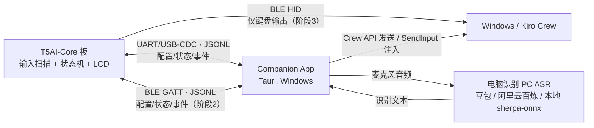

# 板级通信协议 v1（Agentic Keyboard for Kiro Crew）

> 本文件是**跨固件/上位机共享**的协议权威定义（源）。
> 设计参照外部参考项目（ki-board）的串口协议文档，并针对本项目
> （T5AI-Core + 6 键 + EC11 编码器 + Windows 上位机，v0.3）做了裁剪与调整。

## 载体（Transports）

- **阶段 1**：UART / USB-CDC，115200 8N1
- **阶段 2**：BLE GATT（自定义服务）
- **阶段 3**：BLE HID（仅键盘输出，不走本 JSONL 协议）

消息为 UTF-8 **JSON Lines**：每个 JSON 对象后紧跟 `\n`。
接收方**必须忽略**无法识别的 `type`。协议内容跨载体保持一致。

## 通信模型



职责划分：

- **BLE HID**：仅负责像键盘一样输出（阶段 3）。
- **UART/USB-CDC / BLE GATT**：双向 JSONL，负责配置、按键/编码器事件、Agent 状态、
  语音状态、配对/鉴权。
- **Companion**：拥有电脑识别（PC ASR，见 `docs/pc-asr.md`）、按键映射、Crew API 发送与 SendInput 注入。
- **固件**：拥有输入状态机、LCD 渲染。

## 帧结构

统一字段：

| 字段 | 类型 | 说明 |
|------|------|------|
| `v` | int | 协议版本，当前为 `1` |
| `seq` | int | 递增序号（板→PC 事件用于去重/ack，可选） |
| `type` | string | 消息类型 |
| `payload` | object | 类型相关的负载 |

示例：

```json
{"v":1,"seq":12,"type":"key","payload":{"id":"k1","action":"down"}}
```

### 板端接收规则（PC → 板）

固件对每一行入站帧做严格校验，不符合即整行丢弃（不回 NACK，UART1 日志记一条警告）：

- 每条载体（UART、BLE）各自拼行，行在哪条载体上收齐就属于哪条载体；不同载体的字节不会拼成一行。
  BLE 断开、或 USB `hello` 接管后，BLE 侧未完成的半行被丢弃。
- 一行最长 511 字节（不含 `\n`）；超长行或含 NUL 字节的行整行丢弃。
- 一行必须恰好是一个 JSON 对象：`v` 必须为 `1`；`type` 必须是顶层字符串、只含 `[a-z0-9_]`、最长 23 字节；
  `seq` 可选，为 0..4294967295 的整数；`payload` 可选，存在时必须是对象。嵌套在 `payload` 里的 `type`
  只是普通数据。重复键视为格式错误。
- 字符串转义完整解码（含 `\uXXXX` 与代理对，`\u0000` 拒绝）。
- 标识类与凭据类字段超出缓冲即拒绝，不截断；只供 LCD 显示的文本（`display` 的 `agent_name`/`state`/`text`、
  `bindings` 别名）按 UTF-8 字符边界截短。
- 数值只接受十进制非负整数，超出该字段范围即拒绝（`volume`/`brightness` 0..100，`chat_slot` 1..3）。
- `wifi`、`license`、`license_read`、`reset_netcfg`、`ble_pair` 只接受整行来自 UART 的帧；BLE 来源一律拒绝。
  固件升级的 `ota_*` 命令和 FR-02 的 `prov_open` / `ble_unpair` 同样只收 UART，但不受配网窗口限制（键盘自己弹⑦确认）。
- 上述五条命令还要求键盘的配网窗口处于打开状态（见下文 `prov_status`）；窗口关闭时 AK 不执行，回 `prov_status`
  并带 `rejected`/`reason`。
- BLE 上的每一行先经过“BLE 安全通道”（见下文）：未配对、未完成握手或认证失败的 BLE 连接，任何一行都不处理。
- `keymap` 帧原子生效：任一字段格式错误则整帧不生效；未知的动作名仍然跳过，便于新版 Companion 增加动作。

## 握手 / 心跳

Companion 发：

```json
{"v":1,"type":"hello","payload":{"client":"companion","version":"0.1.0","pc_asr":true}}
```

- `pc_asr`（可选，布尔）：`true` 表示这个 Companion 会把电脑识别结果用 `input_restore` 送回键盘（见 `voice`）。
  键盘每次收到 `hello` 时更新；缺省或 `bye` / USB 超时后视为 `false`。

板回：

```json
{"v":1,"type":"hello_ack","payload":{"fw":"0.1.0","capabilities":["uart","ble_gatt","keymap","voice_state","device_settings","system_info"]}}
```

- 带显示的固件还带 `menu`、`pc_asr_wait` 和 `bind_session`（设置页“绑定会话”，见“绑定会话”）。`pc_asr_wait`：路由为 `system` 时松开语音键后键盘停在 ② 等电脑识别结果，
  Companion 必须用 `input_restore`（`src:"pc"`）结束这次等待，没有文字时 `text` 为空串。

心跳：

```json
{"v":1,"type":"ping"}
{"v":1,"type":"pong"}
```

## 板 → PC 事件

### key（机械按键与 EC11 按压）

一个 `key` 帧有三种用法：普通键和 EC11 按压上报**手势**；所有键（语音键之外的普通键和 `enc`）另外上报**原始边沿**（`down` / `up`），
只供 Companion 的“实时按键”显示，不触发任何动作；语音键上报它自己的原始边沿，用来按住说话。

```json
{"v":1,"seq":7,"type":"key","payload":{"id":"k1","action":"single","bind":"chat1","held_ms":0}}
{"v":1,"seq":8,"type":"key","payload":{"id":"k2","action":"long","held_ms":0}}
{"v":1,"seq":9,"type":"key","payload":{"id":"k5","action":"down","held_ms":0}}
{"v":1,"seq":10,"type":"key","payload":{"id":"k1","action":"down","held_ms":0}}
```

字段：

- `id`：`k1`..`k6`（6 个热插拔按键）或 `enc`（EC11 按压）。
- `action`：
  - 普通键和 `enc`：`single` / `double` / `long`（手势，见下），以及 `down` / `up`（原始边沿，见下）。
  - 语音键（keymap 里 `kind=voice`，默认 K5）：`down` / `up` / `long`。这是按住说话的原始边沿，不是手势：
    `down` 立即开始录音，`up` 结束；`long` 只表示已按住超过长按阈值。
- `bind`：可选。这个手势在固件 keymap 里绑定、且固件已经执行（或交给 PC 执行）的动作名：
  `chat1`..`chat9` / `instance1`..`instance9` / `cancel_char` / `cancel_all` / `confirm` / `model_menu` /
  `model_toggle` / `settings` / `menu_recall`（① 时 K4 单击、有被 ESC 的请求，见 `menu_parked`）/ `scene_menu` / `key_*`（FR-03）。
  手势未绑定动作时**不带** `bind`，手势照样上报。
- `held_ms`：语音键 `up`/`long` 时为按下时长。手势帧里是决定这个手势的那次按下的时长（`long` 约等于长按阈值）；
  旧固件固定为 `0`。
- `wait_ms`：只在手势帧里出现，可选，缺省按 `0`。固件在决定手势的那次松开之后又等了多久才上报：`single` 等双击窗口时约为窗口长度，
  没有绑定双击的键、`double`、`long` 都是 `0`。Companion 的 `[KEY-TIMING]` 日志把它记成 `window=`，长按的 `held_ms` 记成 `hold=`。
- `text`、`slot`：只在输入栏的 `bind:"confirm"` 帧上出现（见“语音输入：键盘模式与电脑模式”）。

手势语义（K1–K6 普通键与 `enc` 通用；EC11 旋转走 `encoder` 帧，另计）：

| 手势 | 何时成立 | 何时上报 |
|---|---|---|
| `single` | 按下后在长按阈值前松开，且松开后双击窗口内没有第二次按下 | 该键在 keymap 里没有绑定 `double` 时：松开就立刻上报，不等窗口。绑定了 `double` 时：双击窗口到期时（比松开晚最多一个窗口） |
| `double` | 第一次松开后、双击窗口内开始第二次按下，并在长按阈值前松开 | 第二次松开时；这一对按键不再上报 `single` |
| `long` | 按住达到长按阈值 | 达到阈值时立即上报一次，不等松开；之后的松开不再上报 |

- 固件参数：去抖 20 ms（`AK_FSM_DEBOUNCE_MS`），长按阈值 800 ms（`AK_FSM_LONG_PRESS_MS`），
  K1–K3 的长按阈值 500 ms（`AK_FSM_LONG_PRESS_K13_MS`，其他键不变），
  双击窗口 250 ms（`AK_GESTURE_DOUBLE_WINDOW_MS`，从第一次松开算到第二次按下）。
- 要不要等双击窗口，由固件按当前 keymap 逐键判断（该键的 `double` 是否为 `none`），改了 keymap 立即生效。
- K1–K3 长按到 500 ms 时固件立即上报 `long`（`bind: instanceN`），同时本地给反馈：该键的灯变蓝约 1.2 s，状态栏显示“切换到实例 N”。
- 互斥：每次物理操作只产生一帧，`single` / `double` / `long` 三选一。
- 原始边沿（普通键和 `enc`）：去抖（20 ms）后按下立即上报 `down`，松开立即上报 `up`（`held_ms` 为按下时长），
  早于对应的手势帧，不等长按阈值，也不等双击窗口。手势帧仍然每次物理操作一帧；边沿帧是额外的，Companion 只用它点亮“实时按键”，
  忽略它做控制。旧 Companion 收到这些帧也无影响（记入日志，不触发动作）。设置页、菜单打开时照常上报（边沿是物理按键的镜像，只有手势帧受页面状态限制）；固件更新传输期间不上报。语音键不在此列，它的边沿见上。
- 时序：短按后在窗口内又按住不放，是两次操作，先报 `single`（第一下），再报 `long`（第二下）。
  第二次按下晚于窗口时，第一下按 `single` 报出，第二下重新开始判定。
- 设置页打开期间（本地模态），按键不上报。`enc` 的 `long` 在主页面打开设置页，上报为
  `{"id":"enc","action":"long","bind":"settings"}`（本地动作，Companion 忽略）。

Companion 路由（先 `bind`，再默认规则）：

| 帧 | Companion 动作 |
|---|---|
| `bind: chatN` | K1–K3 且 N=1..3：已连 Crew API 时选中 Chat A/B/C 稳定槽位（该槽设了 Alt+N 时再跳转）；否则注入 `Alt+N` |
| `bind: instanceN` | 先把 Crew 窗口拉到前台，再注入 `Ctrl+N`（切 Local / Remote Crew）；前置失败时发 `notice` |
| `bind: model_menu` / `model_toggle` / `menu_recall` | 见“LCD 菜单与按键灯光” |
| `bind: cancel_char` / `cancel_all` / `confirm` | 输入栏的编辑键（见“语音输入：键盘模式与电脑模式”）：键盘模式不注入，`confirm` 带的 `text` 经 Crew API 发到 `slot` 对应的对话；电脑已填入输入框时分别注入 `Backspace` / `Ctrl+A` 后 `Backspace` / `Enter` |
| 无 bind，K1–K3 `single` | 已连 Crew API 时选中该键对应的 A/B/C 槽位 |
| 无 bind，K1–K3 `long` | 不做任何事（保留；默认 keymap 里它绑 `instanceN`，所以只有用户把它解绑后才走到这一行）。绑定改在键盘设置页“绑定会话”或 Companion 里做 |
| 无 bind，`enc` `single` | `Enter` |
| 其他 | 忽略 |

- v0.2 的 `nav` 帧和 `click` / `dclick` 名称不属于 v0.3 协议；接收方按未知值忽略。
  v0.2 协议见 tag `v0.2-final`。

### encoder（EC11 旋转编码器，v0.3）

```json
{"v":1,"seq":2,"type":"encoder","payload":{"detents":1}}
```

- `detents`：有符号整数步进计数（一个物理卡点 = ±1）。**正 = 顺时针**，**负 = 逆时针**。
  固件按正交解码累计净步进，可在一帧内上报多步（如快速连转上报 `2` / `-3`），接收方按步进滚动。
- 该帧**替代 v0.2 的 `nav`（5 向摇杆）**。v0.3 硬件用 EC11 旋钮替换摇杆：旋转 → `encoder`，
  旋钮**按下** → `key`（`id:"enc"`）。接收方按协议忽略未识别 `type`，故旧 Companion 收到 `encoder`
  会安全忽略；新 Companion 仍容忍（但不会再收到）历史 `nav` 帧。

### voice（语音触发）

```json
{"v":1,"seq":3,"type":"voice","payload":{"state":"start"}}
```

- `state`：`start` / `stop`
- `state`：`start` / `stop` / `cancel`。
- `slot`（可选，1..3）：这次语音输入属于的槽（K1–K3 选中的那个）。键盘模式下输入栏已有文字时省略，文字继续追加到输入栏。
- 只在识别路由为 `system`（电脑识别）时发出：语音键按下发 `start`，松开发 `stop`。路由为 `system` 有两种原因：用户选了电脑识别，
  或键盘自己的云端识别用不了（没有 License、没激活或没配网、配网窗口开着、Wi-Fi / 涂鸦云没连上）时固件自动回退。
  回退时没有 Companion 连接，键盘不发 `voice`，只在状态栏提示“语音需要连接 Companion 或完成配网”。
  Companion 在两者之间用电脑麦克风
  录音并流式识别（豆包 / 阿里云百炼 / 本地 sherpa-onnx，见 `docs/pc-asr.md`），识别结果用
  `input_restore` 送回键盘（键盘模式：进输入栏；电脑模式：Companion 把文字填进 Crew 输入框，见“语音输入：键盘模式与电脑模式”），
  与键盘云端识别的文字走同一条流程。
- Companion 的 `hello` 带 `pc_asr:true` 且固件有 `pc_asr_wait` 时：松开后键盘停在 ②，状态栏 `识别中…`；
  - `input_restore` 带文字（`src:"pc"`）→ ①，文字追加到输入栏（状态栏绿色，显示 `msg`，如 `电脑识别:豆包`）；
  - `input_restore` 带 `filled:true` → ①，电脑已填入输入框（状态栏显示 `msg`，缺省为“已填入输入框”）；
  - `input_restore` 文字为空 → ①，状态栏橙色显示 `msg`（如 `没听清`、`电脑识别:没有 Key`）；
  - 15 s 没有结果 → ①，状态栏 `警告：语音识别超时`，并发 `voice` `cancel`；
  - K1 单击 → ①，状态栏 `已取消输入`，并发 `voice` `cancel`（K1 不再按 keymap 上报）；
  - 再按住语音键 → 重新录音（Companion 收到新的 `start` 时丢弃上一段）。
  Companion 收到 `cancel` 后丢弃这段识别，不再发 `input_restore`。
  “键盘控制电脑”关着时 Companion 不录音，对 `start` 立即回文字为空的 `input_restore`（`src:"pc"`，`msg` 为“语音需要打开键盘控制电脑”），松开时再回一次。
  这条路径只用已有的帧；它不改变任何帧的 USB-only / 配网窗口 / BLE 认证规则（见“传输门控清单”）。
- 旧 Companion（`hello` 不带 `pc_asr`）：松开后键盘直接回 ①，与以前相同。旧固件（无 `pc_asr_wait`）：
  Companion 在结果到达时发 `input_restore`（键盘在 ① 时文字进输入栏），失败时只发 `notice`；旧 Companion 忽略 `cancel`。


### macro（宏，可选）

```json
{"v":1,"seq":4,"type":"macro","payload":{"name":"send"}}
```

### system_info（UART0 系统反馈）

```json
{"v":1,"seq":5,"type":"system_info","payload":{"fw":"0.1.1","transport":"dual","wifi_name":"MyAP","wifi_state":"connected","ble_name":"Ki-board-A1B2C3","ble_state":"advertising","cloud":"ready","license":"present"}}
```

- 该帧专门写入 UART0；DUAL 模式下不镜像到 BLE。
- 启动/握手时发送完整快照；Wi-Fi、BLE、云 ASR 或 License 状态变化时刷新。
- `wifi_state`：`connecting` / `connected` / `failed` / `disconnected`。
- `ble_state`：`disabled` / `advertising` / `connected` / `live`。
- `ble_name`：AK BLE 的广播名 `Ki-board-XXXXXX`，`XXXXXX` 是 Wi-Fi STA MAC 后 3 字节的大写 hex（取不到用 BLE 地址，再取不到用本次开机的随机数）。旧固件为 `Agentic Keyboard-XXXXXX` 或 `AK-KB`，Companion 扫描时三种都认。配网窗口内涂鸦协议栈自己的广播名不变。AK BLE 未启用时为空。
- `cloud`：`disabled` / `unavailable` / `ready`。
- `license`：`missing` / `present`；绝不包含 UUID 或 AuthKey。
- `system_info` 带 `seq`，Companion 按普通板端事件回 `ack`。

### device_info（板 → PC，只读，USB 和已认证的 BLE 都有）

键盘「设置 → 设备信息」页的同一份快照，给 Companion 的“设备设置”显示用。**不含任何敏感值**：AuthKey、License、BLE 配对密钥、PID 都只是布尔。键盘屏幕上这三项叫“Tuya PID”“Tuya UUID”“Tuya AuthKey”（中英文相同），不再有单独的“License”行；帧里的 `license` 字段（`uuid` 且 `authkey`）保留给旧 Companion，字段名不变。

```json
{"v":1,"seq":9,"type":"device_info","payload":{"fw":"0.3.95","companion":"usb","handshake":true,"cloud":"active","wifi_ssid":"Office-5G","wifi_ip":"192.168.10.23","wifi_rssi":-61,"wifi_mac":"A0:B1:C2:D3:E4:F5","ble_mac":"A0:B1:C2:D3:E4:F6","ble_name":"Ki-board-D3E4F5","ble_paired":true,"pid":true,"uuid":true,"authkey":true,"license":true}}
```

- 时机：`hello_ack` 之后立即发一帧；之后键盘一侧的快照有变化时（Companion 连上或断开、Wi-Fi 连上或断开、IP、蓝牙配对、涂鸦云状态）再发。每秒最多检查一次；只有信号强度变化不发。没有 Companion 连着时不发。
- `companion`：`usb` / `ble` / `none`（这条链路上谁在和键盘说话）；`handshake`：该链路收到过 `hello`。
- `cloud`：`active`（已激活且云在线）/ `offline`（已激活，云连接断了）/ `inactive`（未激活：没有 License 或没配网）。
- `wifi_ssid`、`wifi_ip`：没连上 Wi-Fi 时是空串；`wifi_rssi`（dBm，整数）没连上时**不出现**；`wifi_mac`、`ble_mac`：大写冒号分隔，取不到时是空串。SSID 里的控制字符换成 `?`。
- `ble_name`：蓝牙广播名（`Ki-board-XXXXXX`，同 `system_info`）；`ble_paired`：键盘上存有 BLE 配对密钥（只是有没有，不含内容）。不带蓝牙的固件上 `ble_*` 为空串 / false。
- `pid` / `uuid` / `authkey`：是否已设置；`license` = `uuid` 且 `authkey`。
- 长度：最坏情况（32 个引号的 SSID、满长名字）426 字节，低于 BLE 的 511 字节上限；固件的 host 测试检查这个上限。
- 带 `seq`，Companion 回 `ack`。旧 Companion 按未知帧类型忽略。BLE 上只有通过“BLE 安全通道”认证的链路才会收到。

## PC → 板 命令

### led

```json
{"v":1,"type":"led","payload":{"state":"on","color":"green"}}
```

当前固件还没有由 Companion 驱动的灯效；收到 `led` 帧只把它当作一次活动，用来唤醒「自动」模式下已断电的灯链。

### display（指定 Chat 的 Agent 状态 / 文本上屏）

```json
{"v":1,"type":"display","payload":{"chat_slot":1,"agent_name":"planner","state":"running","text":"..."}}
```

- `chat_slot`：必填，`1` / `2` / `3` 分别对应 Chat A / B / C（物理键 K1 / K2 / K3）。
- AK 必须把 `agent_name`、`state` 和 `text` 写入 `chat_slot` 指定槽位的独立状态与历史；不得写入当前选中的其他槽位。缺失或超出 `1..3` 的帧必须拒绝。
- Companion 根据持久化的 Crew session 关联解析目标槽位；未绑定 Chat A/B/C 的 session 只保留在 Companion 列表，不发送到 AK。
- `state`：驱动 AK 左侧三块槽位图标的背景色：
  - `unbound`（或空字符串 / `-`）→ 紫色：未绑定/默认。未识别状态也按此兜底。
  - `idle` → 绿色：空闲。
  - `running` → 红色：忙碌。
  - `waiting` → 橙色：提示，等待操作。
  - `info` → 蓝色：有信息反馈，无需操作。
  - `error`：协议保留，暂不单独着色（当前并入忙碌/红）。
- Companion 的状态来源与映射：
  - hook：`agentSpawn`/`userPromptSubmit`/`postToolUse` → `running`；
    `stop` 有回复文本 → `info`、无文本 → `idle`。
  - crew API 投影：`pending_approval`/`needs_input`/`waiting_for_input` → `waiting`；
    `running`/`stopping`/`subagents_running` → `running`；有 `last_message` 的空闲 → `info`；否则 `idle`。
  - 解绑某 Chat A/B/C 槽位时，Companion 向该 `chat_slot` 发一帧 `state:"unbound"`，使图标回紫色。

### config

```json
{"v":1,"type":"config","payload":{"voice_engine":"system"}}
```

- `voice_engine`：`system`（电脑识别 PC ASR）/ `cloud`（板端 Tuya ASR）
- 语音模式（ASR / Chat）不能通过 `config` 切换；在键盘 Settings > Voice mode，或用 `device_settings` 的 `voice_mode`（FR-02，见下）切换。

### voice_source（AK → Companion）

```json
{"v":1,"seq":4,"type":"voice_source","payload":{"source":"cloud","mode":"chat"}}
```

- `source`：当前生效的识别路由 `cloud` / `system`。
- `mode`：键盘的语音模式，`asr`（识别文字进 Kiro Crew，现有行为）/ `chat`（键盘与涂鸦云 agent 对话）。由
  `device_settings` 的 `voice_mode` 修改；本帧只报告；
  重启后沿用上次的模式，开机在状态栏提示一次。

### tuya_chat（Chat 模式对话，AK → Companion，仅 UART0，只显示）

```json
{"v":1,"seq":31,"type":"tuya_chat","payload":{"role":"user","text":"how should I split the parser change","final":true}}
{"v":1,"seq":32,"type":"tuya_chat","payload":{"role":"agent","text":"Start with the source tag on each line...","final":true}}
```

- 每轮一条 `user`（识别出的话）和一条 `agent`（回复全文，最长 1024 字节，超长以 `...` 结尾）。
- **只显示**：Companion 不得把它注入 Kiro Crew 输入框或转成任何按键（companion-review CP-01）。
- Chat 模式下 AK 不发 `asr` 帧、不进入待确认态；K5 的 `key` 帧不发；K4 只在本地打断回复；EC11 旋转滚动 LCD 聊天页、
  单击本地消费，都不发给 PC。K1–K3、K6 仍按 keymap 控制 Kiro Crew（Q12）。云不可用时 K5 只提示，不回退到 Windows 语音输入。
- BLE 不镜像该帧（BLE 链路尚无加密）。

### keymap（按键手势→动作下发，方案 A，v0.3 stage 乙）

Companion 下发每键的**手势→动作**绑定，覆盖固件 keymap。固件把生效的表缓存进 TAL KV，断开后保留上次配置；重启先读 KV，无记录则用 v0.3 默认表。字段用**扁平点号键**（一个字段对应一个 (键, 手势)），以适配固件的扁平 JSON 提取器：

```json
{"v":1,"type":"keymap","payload":{"k1.single":"chat1","k1.double":"none","k1.long":"instance1","k4.single":"cancel_char","k4.long":"cancel_all","k5.kind":"voice","k6.single":"confirm"}}
```

- `<键>.kind`：`voice`（按住说话键，发原始边沿，没有手势槽）/ `normal`（普通键，走 single/double/long 分类器）。
- `<键>.single` / `<键>.double` / `<键>.long`：该手势槽绑定的**动作**。省略的字段保留固件当前绑定（部分更新）。
- 动作取值：`none`（不绑）/ `cancel_char` / `cancel_all` / `confirm`（只在待确认态生效）/ `chat1`..`chat9`（Alt+N）/ `instance1`..`instance9`（Ctrl+N）/ `model_menu` / `model_toggle`（见“LCD 菜单与按键灯光”）/ `scene_menu` 与 `key_*` 快捷键（见“应用场景（FR-03）”）。未知动作被忽略（保留原绑定）。
- 默认表：K1–K3 `single=chatN`、`double=none`、`long=instanceN`（N=1..3；v0.3 早期把 `instanceN` 放在 `double`，改到 `long` 是为了让单击不用等双击窗口）；K4 `single=cancel_char`、`long=cancel_all`；K5 `kind=voice`；K6 `single=confirm`、`double=model_toggle`、`long=model_menu`；`enc` 无绑定（`long` 固定打开设置页）。K6 的 `double`/`long` 两项需要支持 `menu` 能力的固件。
- 旧键位的迁移：升级前已经缓存的 keymap（KV 版本 2）里，K1–K3 的 `double` 若仍是旧默认值 `instanceN`、且 `long` 为 `none`，
  固件载入时自动改成 `double=none`、`long=instanceN`；用户自己改过的键（`double` 不是旧默认值，或 `long` 已有绑定）不动。
  之后的保存写入新版本（KV 版本 3），不会再迁移。Companion 的键位面板不存本地配置，打开时显示新默认值，点“应用”才下发。
- `enc.long` 保留给设备设置页，固件忽略对它的绑定；`enc.kind` 不能设为 `voice`（否则长按无法进入设置页）。Companion 的 keymap 面板不提供这两项。
- 固件据此在 `key` 帧里上报手势和 `bind`（见上节）。固件应答 `ack`（带 `seq` 时）。载体 USB / BLE 均可（纯配置）。

### device_settings / device_settings_state（键盘设置：音量、亮度、语言、语音模式、灯光、字号，FR-02）

Companion 修改当前运行值（字段都可省略，只改带了的）：

```json
{"v":1,"type":"device_settings","payload":{"volume":70,"brightness":90,"language":"zh","voice_mode":"asr","led_power":"auto","led_auto_off_s":300,"font_size":12,"animation":true}}
```

AK 在握手、本地调节或应用 Companion 命令后回报实际值：

```json
{"v":1,"seq":15,"type":"device_settings_state","payload":{"volume":70,"brightness":90,"led_power":"auto","led_auto_off_s":60,"language":"zh","voice_mode":"asr","font_size":12,"animation":true,"license":"present","pid":"present","ble_paired":true}}
```

- `volume`：`0..100`；`brightness`：`10..100`，AK 设置页和 Companion 均以 10% 为步进。
- `language`：界面语言 `zh`（中文，默认）/ `en`（English）。键盘 LCD 全部界面文字、Companion 界面、
  Companion 生成后发给键盘的 LCD 文本（`menu` 标签、notice）以及 Chat 模式涂鸦 agent 的回复语言都跟随它。
  AK 存 KV（`ak_lang`），重启保留。可经 USB 或已配对的加密 BLE 修改（普通配置，不属于敏感命令）。
  两边谁最后改以谁为准：AK 设置页改完立即发 `device_settings_state`；Companion 改时发 `device_settings`，
  以 AK 回的 `device_settings_state` 为准更新自己的界面语言。其他取值整帧拒绝（不改任何字段）。
  旧固件不回 `language`：Companion 不同步语言，只用自己的界面语言。
- `led_power`：灯光电源设置 `off` / `on` / `auto`（AK 设置页 LED power，存 KV，重启保留）；`led_auto_off_s`：
  `auto` 时的空闲断电时长，取值 `30` / `60` / `300` / `900`。FR-02 起 `device_settings` 可写这两个字段（USB 或已认证的
  BLE 安全通道），其他取值整帧拒绝。旧版 Companion 忽略这两个字段。
- `voice_mode`（FR-02）：`asr` / `chat`，与键盘 Settings > Voice mode 相同（存 KV，重启保留）。可写，USB 或已认证 BLE。
- `font_size`：键盘 LCD 字号，单位 px，取值 `12`（默认，Fusion Pixel 12，纯 ASCII 文字用 8x8 字体）/ `14`（Ki-board
  Pixel 14，全部文字）/ `16`（GNU Unifont 16，全部文字）。与键盘设置页“字号”相同：确认后立即重新排版所有界面，存 KV
  （`ak_fontsz`，一字节，存 px 值），重启保留。可写，USB 或已认证 BLE；其他取值整帧拒绝。旧固件不回 `font_size`：
  Companion 不显示字号项；不认识 `14` 的旧固件会整帧拒绝 `14`。
- `animation`（FR-14）：`true`（默认）/ `false`，左侧三个对话 ghost 的动画（选中时上下浮动、眨眼约 6 s，状态变化时短跳一下，
  之后静止）。与键盘设置页“动画”相同，存 KV（`ak_ghost`，一字节 0/1），重启保留。可写，USB 或已认证 BLE；非布尔值整帧拒绝。
  旧固件不回 `animation`：Companion 不显示该项。
- `license`（只报告）：`present` / `missing`，只说明有没有 License，绝不带 UUID/AuthKey；`pid`（只报告）：`present` / `pending`（已写入，重启后生效）/ `missing`，不带 PID 本身，旧固件没有该字段；`ble_paired`（只报告）：键盘是否存有
  BLE 配对密钥。两者都不能经 `device_settings` 修改（见下表的敏感项）。
- 一帧里任何一个字段越界或取值未知，整帧拒绝，不部分生效。
- AK 是当前运行值的权威来源；Companion 只在收到 `device_settings_state` 后更新显示。键盘上任何一项改完（设置页、
  “设备信息”页清除 BLE 配对、BLE 配对完成）立即发 `device_settings_state`；两边冲突以最后一次修改为准。
- `device_settings_state` 带 `seq`，Companion 按普通板端事件回 `ack`。整帧约 260 字节，固件用 384 字节缓冲。
- 音量与亮度只同步当前运行值，不承诺断电或重启后保留；`language`、`voice_mode`、`led_power`、`font_size` 与 `animation` 重启保留。

#### 键盘设置项清单（FR-02，以固件 `ak_settings.h` 为准）

| 键盘设置页项 | `device_settings` 字段 | 敏感 | 修改通道 | Companion |
|---|---|---|---|---|
| 音量 Volume | `volume`（0..100，步进 10） | 否 | USB / 已配对 BLE | Device Bridge 面板 |
| 亮度 Brightness | `brightness`（10..100，步进 10） | 否 | USB / 已配对 BLE | Device Bridge 面板 |
| 语音模式 Voice mode | `voice_mode`（`asr` / `chat`） | 否 | USB / 已配对 BLE | 连接页“键盘设置” |
| 灯光电源 LED power | `led_power`（`off` / `on` / `auto`） | 否 | USB / 已配对 BLE | 连接页“键盘设置” |
| 自动断电时长 Auto off | `led_auto_off_s`（30 / 60 / 300 / 900） | 否 | USB / 已配对 BLE | 连接页“键盘设置” |
| 界面语言 Language | `language`（`zh` / `en`） | 否 | USB / 已配对 BLE | 设置菜单里的语言 |
| 字号 Font size | `font_size`（`12` / `14` / `16`） | 否 | USB / 已配对 BLE | 连接页“键盘设置” |
| 动画 Animation | `animation`（`true` / `false`） | 否 | USB / 已配对 BLE | 连接页“键盘设置” |
| 凭证 Credentials：License | 只报告 `license`；写入用 `license` 命令 | 是 | 仅 USB，配网窗口内；已有 Tuya UUID/AuthKey 时还需键盘“设备信息”页 K6 允许覆盖 | 设备页 License 区 |
| 凭证 Credentials：BLE 配对 | 只报告 `ble_paired`；生成用 `ble_pair`，清除用 `ble_unpair` | 是 | 仅 USB；`ble_pair` 在配网窗口内，`ble_unpair` 键盘弹⑦确认 | 连接页“蓝牙配对” |
| 配网模式 Pairing mode / 已激活时为“更换 Wi-Fi” Change Wi-Fi | 只报告（`prov_status`）；打开用 `prov_open` | 是 | 仅 USB；键盘弹⑦确认（与设置页相同）。未激活且有 License：确认后重启进窗口（涂鸦 App 可配网）；已激活或无 License：立即开窗口，不重启，已激活设备的涂鸦绑定不变 | 连接页“配网窗口” |
| 解绑设备 Unbind device（只用于换账号 / 从头配网） | 无 | 是 | 只在键盘上（设置页的这一项只在已激活时列出；或任何界面按住 K1+K6 约 5 s）：已激活时弹⑦（松开 K6 解绑，K6 黄色快闪 / K1 取消，10 s）；未激活时等同“配网模式”；没有 Tuya UUID/AuthKey 时状态栏提示“未写 Tuya UUID/AuthKey，只能用 USB 配置” | 不提供 |
| 重置系统 Reset system | 无 | 是 | 只在键盘上，两次⑦确认（各 10 s，K1 / 超时取消）：设置恢复默认，清除已保存的 Wi-Fi、涂鸦激活（在线时 SDK 云端解绑）、Tuya UUID/AuthKey（`license` 之后又报告 `false`，配网窗口内可经 USB 重新写入）、经 `pid` 写入的 PID（重启后回退到编译期 PID，编译期为空时可再用 `pid` 写入）、BLE 配对，然后重启。之后 Companion 缓存的 BLE 密钥失效，握手超时，需重新蓝牙配对或 USB `ble_pair` | 不提供 |
| （无设置页项）Wi-Fi | `wifi` 命令 | 是 | 仅 USB，配网窗口内 | 设备页 Wi-Fi 区 |
| 已保存的 Wi-Fi Saved Wi-Fi（FR-15） | 列表 `wifi_list` / `wifi_list_state`；删除 `wifi_forget`、`wifi_clear` | 删除是，列表否 | 列表 USB / 已配对 BLE 只读；删除仅 USB，不需窗口，或键盘上 K6 两次 | 连接页“已保存的 Wi-Fi” |
| （无设置页项）重置配网 | `reset_netcfg` 命令 | 是 | 仅 USB，配网窗口内，键盘弹⑦确认 | 设备页 |
| 硬件测试 Test | — | — | 只在键盘上 | 不提供 |
| 退出 Exit | — | — | — | — |

- 敏感项一律需要键盘上的物理确认：`prov_open`、`ble_unpair`、`reset_netcfg` 各自弹⑦（松开 K6 确认 / 按下 K1 取消，10 s 无操作取消）；
  `wifi`、`license`、`ble_pair` 只能在配网窗口内执行，而窗口本身只能经⑦确认打开。BLE 连接下 Companion 对敏感项只显示状态，
  按钮置灰并说明原因；固件同样拒绝 BLE 来源（见“传输门控清单”）。

### prov_open / ble_unpair（Companion → 键盘，仅 USB，FR-02）

```json
{"v":1,"type":"prov_open"}
{"v":1,"type":"ble_unpair"}
```

- `prov_open`：键盘打开设置页并定位到 Pairing mode，弹出与设置页相同的确认框（⑦）。之后的行为与在键盘上操作完全一样
  （有 License 时确认后重启一次再开窗口）。窗口已开：只回 `prov_status`。另一个⑦正在等待、测试页或 OTA 进行中：回
  `prov_status`（`rejected: prov_open`、`reason: busy`）。
- `ble_unpair`：键盘弹“清除蓝牙配对？”（⑦，K6 清除 / K1 取消，10 s）。确认后删除 KV 中的配对密钥，当前 BLE 会话立即失效，
  回 `device_settings_state`（`ble_paired:false`）；取消回 `prov_status`（`rejected: ble_unpair`、`reason: cancelled`）；
  没有密钥时直接回 `device_settings_state`；忙时回 `reason: busy`；不带 BLE 的固件回 `reason: unsupported`。
- 两条都只接受 UART 来源（`ak_rx.c` 的 USB-only 清单），不要求配网窗口。

#### 界面语言与 Chat 模式 agent

- 键盘每次开始一轮云端语音（K5 按住）前调用 `tuya_ai_agent_set_event_param`，在本轮 event start 的
  `sessionAttributes` 里带 `"custom.param": {"lang":"zh","lang_name":"Simplified Chinese"}`（English 为
  `{"lang":"en","lang_name":"English"}`）。这是 TuyaOpen 公开接口，固件不改 SDK。
- 云端 agent 是否按它回复，取决于涂鸦控制台上该 agent 的提示词是否读取这个参数（例如提示词里写明
  “用 custom.param 里 lang 指定的语言回复”），需要在控制台配置并实板验证。ASR 识别语言由控制台 agent
  角色的语言决定，设备侧不能切换。

### bindings（A/B/C 显示别名）

```json
{"v":1,"type":"bindings","payload":{"alias_a":"Plan","alias_b":"","alias_c":"Code"}}
```

- Companion 连接 AK 时发送，修改别名或绑定后再次发送。
- `alias_a` / `alias_b` / `alias_c` 分别对应 K1 / K2 / K3（槽位 A / B / C）。
- 每个别名最多 7 个可显示 ASCII 字符；空字符串表示在 AK 上使用默认名 A、B 或 C。
- `name_a` / `name_b` / `name_c`（可选，显示文本，UTF-8 最多 48 字节）：该槽绑定的 Crew 会话名，显示在设置页“绑定会话”的
  选槽页；空字符串 = 未绑定（显示“未绑定”）。旧固件忽略。
- `mode_a` / `mode_b` / `mode_c`（可选）：该槽的语音输入模式，`kbd`（键盘模式，缺省）或 `pc`（电脑模式），见“语音输入：键盘模式与电脑模式”。
  Companion 在连接时、改 Alt+N 数字、改“语音文字”设置、开关“键盘控制电脑”时重发。旧固件忽略。

```json
{"v":1,"type":"bindings","payload":{"alias_a":"Plan","alias_b":"","alias_c":"","name_a":"Ki-board Mate","name_b":"","name_c":"Fix the parser"}}
```

### wifi（仅 USB）

```json
{"v":1,"type":"wifi","payload":{"ssid":"MyAP","pass":"secret"}}
```

- 仅允许通过当前 USB/UART 连接发送；Companion 和 AK 固件都必须拒绝 BLE 来源。
- 设备只支持 2.4GHz Wi-Fi。密码仅发往 AK，不由 Companion 持久化。
- 格式：`ssid` 1..32 字节且不含控制字符；`pass` 为空（开放网络）或 8..63 个可打印 ASCII 字符。不符合时 AK 不写入，回 `wifi_status` 的 `failed`。
- 回滚：设备之前连过的网络会被保留。新配置 30 s 内没有连上时，AK 写回旧配置并重连，回 `wifi_status` 的 `restored`（`ssid` 为旧网络）。
- 对未激活设备，WiFi `connected` 后还必须完成下面的 SmartLife QR 激活；只有收到
  `cloud_ready` 后 activation data 才能在重启时恢复。

### wifi_list / wifi_forget / wifi_clear（已保存的 Wi-Fi，FR-15）

键盘记住连上过的网络，断线后自动换到信号最强的已保存网络。最多记 8 个（`max` 字段由键盘报告，Companion 以它为准）；存满后新网络覆盖最久没连过的。旧固件存过 9–10 个的键盘升级后保留最近连过的 8 个，正在使用的网络一定保留。

```json
{"v":1,"type":"wifi_list"}
{"v":1,"type":"wifi_forget","payload":{"ssid":"MyAP"}}
{"v":1,"type":"wifi_clear"}
```

```json
{"v":1,"seq":31,"type":"wifi_list_state","payload":{"max":8,"entries":[{"ssid":"MyAP","sec":"wpa2","current":true},{"ssid":"Cafe","sec":"unknown","current":false}]}}
```

- **记录**：设备拿到 IP 后记下 SSID、密码、安全类型（扫描所得，未知为 `unknown`）和连接序号，同 SSID 只更新密码、
  安全类型和序号。涂鸦 App 配网写入的网络、Companion 的 `wifi` 命令、自动重连选中的网络都走同一条路径。
  最多 10 条；满了再记新 SSID 时，替换**最久没连过**的一条（LRU，按最近一次连接成功的序号）。
- **存储**：TAL KV 键 `ak_wifis`（TAL KV 本身用 AES-128-CBC 加密），一个带版本号（1）、条数和 CRC32 的小二进制块，最大约 1 KB。
  校验失败（魔数、版本、CRC、长度、重复 SSID）整体丢弃，列表重新开始。
- **升级迁移**：固件里没有该键或块无效、列表为空，且涂鸦 SDK 的 `netinfo`（升级前唯一的 Wi-Fi 配置）存在时，把它作为第 1 条。
- **自动重连**：设备已激活、断线满 25 s（先让涂鸦自己重连）后，停掉涂鸦的重连循环，扫描，已保存网络按信号强度（同强度取最近连过的）
  依次尝试，每个 20 s；全部失败后等 15 / 30 / 60 / 120 / 300 s（之后保持 300 s）再试。扫描里一个都没有时（隐藏 SSID），
  只盲连最近连过的那一个。配网窗口开着或确认中、OTA、硬件测试页、未激活（涂鸦配网在用无线）、USB 刚下发的 `wifi` 的 30 s 回滚期内，不自动重连。
- **删除当前连接的网络**：记录和涂鸦 `netinfo` 立即删除，连接保持到断开；断开后不再连它，转而连别的已保存网络。
- `wifi_list_state`：最近连过的在前；`current` 表示正连着；**没有密码字段**，日志和协议都不出现密码。键盘上删除或连接状态变化后，
  USB 连着时自动推送。`wifi_forget` / `wifi_clear` 后回 `wifi_list_state` 和 `ack`；SSID 不存在时同样回当前列表。
- 新增和修改密码仍只有 `wifi` 命令（USB、配网窗口内）。BLE 只能读列表。
- 键盘设置页“已保存的 Wi-Fi”：旋钮选，K6 删除（黄色快闪等第二次 K6，3 s 内有效），K1 返回；
  K1、K6 为红，旋钮为蓝，等待第二次确认时 K6 黄色约 4 Hz 快闪。

### activation_status（AK → Companion，仅 UART0）

```json
{"v":1,"seq":21,"type":"activation_status","payload":{"state":"scan_qr","qr_url":"https://smartapp.tuya.com/s/p?p=<PID>&uuid=<UUID>&v=2.0"}}
```

`state` 生命周期：

- `pairing`：未激活，等待网络/绑定。
- `scan_qr`：Direct MQTT 已连接；Companion 动态生成二维码并自动展开激活卡片。
- `token_received`：SmartLife 已下发 region/token/regist_key，设备正在云端激活。
- `activated`：DeviceID/schema/activation data 已保存。
- `cloud_ready`：正常 Tuya MQTT 已上线；Companion 自动折叠为成功摘要。
- `cloud_disconnected`：activation 仍保留，仅云连接暂不可用。
- `resetting`：正在清除网络与 activation data。

`qr_url` 仅在 `scan_qr` 非空，包含 PID 和 UUID，不包含 AuthKey。只有配网窗口打开时 AK 才会发出非空
`qr_url`（窗口外为空串，窗口打开时补发一次）。Companion 只接受
`https://smartapp.tuya.com/s/p?` 前缀，并仅在二维码展开时动态加载 QR 生成模块。

### prov_status（配网窗口，AK → Companion，仅 UART0）

```json
{"v":1,"seq":31,"type":"prov_status","payload":{"state":"open","remaining_s":172}}
{"v":1,"seq":32,"type":"prov_status","payload":{"state":"closed","remaining_s":0,"rejected":"wifi","reason":"closed"}}
```

- 用户在键盘上打开窗口：长按旋钮进入 Settings → `Pairing mode` → 确认框里按 K6（或旋到 Confirm 再按旋钮）。
  确认框默认选中 Cancel，10 s 无操作视为取消。窗口时长 180 s，LCD 状态栏倒计时；收到 `cloud_ready`
  后 5 s 自动关闭；在 Settings 里再次点击 `Pairing mode` 立即关闭。
- 设置页「解绑设备」或 K1+K6 组合键（各自经⑦确认）、窗口内接受的 `reset_netcfg`，引起的重启之后开机自动再开 180 s 窗口。
- 键盘确认打开窗口（Pairing mode 的 K6 或旋钮确认）：有 License 时，键盘先写下开窗标记并重启（LCD 显示 `Restarting into pairing mode`）；启动时读到标记即清除它、开 180 s 窗口，并只在这一次开机启用涂鸦 BLE 与 SoftAP 配网。没有 License 时不重启，窗口直接打开（USB 在窗口内写入 License）。
- 标记是一次性的：开机读取后立即删除，异常重启不会让窗口永久打开。标记内容为 4 字节 `AKW1`，其他长度或内容一律视为不存在。
- 窗口关闭（超时、cloud_ready 后 5 s、或手动退出）时，涂鸦 BLE 与 SoftAP 配网同时停止；窗口外涂鸦 BLE 不广播（固件每次循环停止广播，见 `ak_ble_gatt_stop_adv`）。
- 未激活的新机首次开机不自动开窗口，需要用户在键盘上确认（实现选择，待用户确认是否改为默认开窗）。
- `state`：`closed` / `confirming` / `open`；`remaining_s` 为当前状态剩余秒数。
- AK 在状态变化时、每次 USB `hello` 后、以及拒绝 `wifi`/`license`/`license_read`/`reset_netcfg` 时发送。
  `reason`：`closed`（窗口未开）、`exists`（已有 License 且未在设备上允许覆盖）、`confirm_on_device`（`reset_netcfg`
  已受理，等待设备上 K6 确认）、`cancelled`（设备上取消或 10 s 未确认）、`busy`（已有一个重置在等确认）。
  BLE 来源的这些命令直接丢弃，不回帧。
- Companion 在窗口关闭时提示“请先在键盘上进入配网模式”，不发送这些命令。

### license（UUID / AuthKey，仅 USB）

```json
{"v":1,"type":"license","payload":{"uuid":"...","authkey":"..."}}
```

- 仅允许通过当前 USB/UART 连接发送；Companion 和 AK 固件都必须拒绝 BLE 来源。
- UUID/AuthKey 写入 AK 持久存储；PID 是产品级配置，编译时设置，或在没有 PID 时用下面的 `pid` 命令写一次。
- 格式：`uuid` 为 20（或旧版 16）个 `[A-Za-z0-9]` 字符，`authkey` 为 32 个 `[A-Za-z0-9]` 字符。不符合时 AK 不写入，回 `license_status` 的 `failed`。
- Companion 不持久化或回显 AuthKey，AK 只回报写入状态。
- 设备上已有 License 时默认拒绝覆盖（`license_status` 的 `rejected`，`prov_status` 的 `reason: exists`）。用户须在
  Settings > Device info 按 K6 允许覆盖一次（60 s 内、仅一次）；覆盖前旧 License 备份到 KV `ak_lic_bak`。
- `license_status.state`：`written_reboot_required`（已写入，重启后生效；运行中的云连接仍用开机时的身份）/
  `rejected` / `failed`。

### pid（涂鸦产品 ID，仅 USB，只能写一次）

公开固件的 `CONFIG_TUYA_PRODUCT_ID` 为空，用户烧录后写入自己的 PID。

```json
{"v":1,"type":"pid","payload":{"pid":"abcdefgh01234567"}}
{"v":1,"seq":9,"type":"pid_status","payload":{"state":"written_reboot_required"}}
{"v":1,"seq":10,"type":"pid_status","payload":{"state":"rejected","reason":"exists"}}
```

- 仅允许 USB/UART0；BLE 来源由固件丢弃（和 `wifi`、`license` 一样），Companion 也不发。不要求配网窗口，也不需要键盘确认：只能写一次，写不进已有的 PID。
- 格式：16 个 `[a-z0-9]` 字符，且不是模板值 `xxxxxxxxxxxxxxxx`。
- **只在设备当前没有有效 PID 时接受**：KV 里没有，且编译期值为空（或无效）。已有 PID（含刚写入、等待重启的）一律拒绝，
  没有清除或覆盖命令；解绑设备、重置配网都不动 PID。设置页「重置系统」清除 KV 里的 PID（这是唯一的清除途径），
  重启后回退到编译期 PID；编译期为空（公开固件）时涂鸦云关闭，`pid` 命令又可以写入一次。
- **写成功才锁定**：固件先写 KV，再读回并逐字节比对，一致才算写入成功并锁定（此后拒绝再写，重启后仍拒绝）。
  任何失败（`invalid`、`source`、KV 写入出错、读回出错或不一致）都**不锁定**，设备仍是“没有 PID”，可以重写；
  读回不一致时固件会删除该键，避免下次开机读到错误值（若删除也失败，残留的值只有恰好是完整合法的 16 位 PID 才会被开机采用，这是已知的极小窗口）。
- **半写入按无效处理**：开机时 KV 里的值必须恰好是 16 个合法字符才算 PID；写入中途断电留下的半个值、长度不对、字符非法的值，
  一律视为“没有 PID”（可重写），不会拿它去 `tuya_iot_init`。
- `pid_status.state`：`written_reboot_required`（已写入 KV，**重启后生效**；运行中的涂鸦客户端仍用开机时的值）/ `rejected`。
  `reason`：`source`（非 USB）/ `exists`（已有 PID）/ `invalid`（格式不对）/ `storage`（KV 写入失败）。PID 不回显，写入时不记录；它不是秘密，开机日志里的 `(PID=…)` 行会打印生效 PID。
- 生效 PID：KV 优先，否则编译期值。两者都空时固件不调用 `tuya_iot_init`（涂鸦云、netmgr 不启动，`wifi` 命令回 `failed`），
  License 仍可写入，键盘其他功能和 USB / BLE Companion 正常；状态栏提示“未设置产品 ID：用 USB 写入”。
- `device_settings_state.pid` 报告状态（`present` / `pending` / `missing`）；设置页 Device info 里的凭据只显示 SET / NOT SET。

### license_read / license_info（开发调试，仅 USB）

```json
{"v":1,"type":"license_read"}
{"v":1,"seq":20,"type":"license_info","payload":{"source":"flashed","uuid":"...","authkey_tail":"ABCD"}}
```

- 请求和响应都只允许物理 USB/UART0；DUAL 固件不得将响应镜像到 BLE。
- `source`：`flashed` / `compile_time` / `missing` / `disabled` / `unavailable`。
- UUID 完整返回；AuthKey 永远只返回最后四个字符。Companion 不持久化返回值。
- 该命令只存在于 debug profile（`TUYA_T5AI_CORE_dual_cloudasr_debug.config`，`CONFIG_AK_LICENSE_DEBUG_READ=y`）。
  发布 profile 不编译该功能，收到 `license_read` 不回 `license_info`；发布 profile 也不带编译期 UUID/AuthKey 回退。

### reset_netcfg（一键进入配网，仅 USB）

```json
{"v":1,"type":"reset_netcfg"}
```

- Companion 的「Unbind device (new account)」按钮发送该命令，效果与键盘上「解绑设备」（设置页或 K1+K6 按住 5 s）相同，只用于换账号或从头配网；只换 Wi-Fi 用「更换 Wi-Fi」+ `wifi`，不需要它。
- 仅允许通过物理 USB/UART 发送；AK 固件对 BLE 来源拒绝（与 wifi/license 相同门控）。
- 还要求配网窗口打开；AK 收到后先在 LCD 弹出“Reset network?”，回 `prov_status`（`reason: confirm_on_device`）。
  用户按 K6 后才执行，K1 或 10 s 未操作则取消（`reason: cancelled`）；与所有系统确认（⑦）一致。
- 确认后 AK 先回 `ack`（在重启断链前让 Companion 确认已受理），再调 `tuya_iot_reset()`：
  清除 Wi-Fi 凭据 + 云绑定/激活，**保留 License（UUID/AuthKey）**，随后重启进入 Tuya SoftAP/BLE 配网。
- 仅在 cloud profile（`AK_ASR_BOARD_CLOUD=1`）生效；非 cloud profile 为 stub，返回 `OPRT_NOT_SUPPORTED` 且不动作。
- 进入配网后，LCD 底部状态栏显示 `Pairing mode: use Tuya app`（橙色）。

### ack

```json
{"v":1,"type":"ack","payload":{"seq":12}}
```

### status / log（探针反馈，board → PC）

Bring-up / feature-probe 固件用这两种帧在 **UART0 (COMx)** 上报告自身状态与事件，
便于在串口监控 / Companion 里判断行为（不依赖 LCD 或 UART1 调试日志）。

```json
{"v":1,"type":"status","payload":{"probe":"ble_gatt_link","state":"ready"}}
{"v":1,"seq":5,"type":"log","payload":{"tag":"ble","msg":"central connected"}}
```

- `status`：探针生命周期状态（如 `ready` / `advertising` / `connected`）。
- `log`：探针自定义事件；`msg` 为纯文本，发送方需避免内嵌 `"` / 换行以保持单行 JSON。

## 固件升级（仅 USB）

本地 OTA。Companion 把签名包 `.akota`（256 字节头 + UG 文件）经 UART0 分段发给键盘；
键盘验签、在设备上确认、写入 ota 分区、写管理块后重启，由 tuyaboot 安装。

- 只接受整行来自 UART 的帧：`ota_begin`、`ota_data`、`ota_end`、`ota_abort`（以及 debug 固件的 `ota_probe`、`probe_line`）。
  BLE 来源一律丢弃（不回帧）。与 `wifi`/`license` 不同，这些命令**不需要**配网窗口：键盘自己要求 K6 确认。
- 键盘回帧只走 UART0，不镜像到 BLE。
- 支持本节的固件在每次 USB `hello` 后（`hello_ack` 之后）发一帧 `ota_status`（`state:"idle"`）。Companion 以此判断能否升级；
  `key` 为 `release` / `test` / `none`（`none` = 正式公钥仍是占位，任何包都会被拒）。

### ota_begin（Companion → 键盘）

```json
{"v":1,"type":"ota_begin","payload":{"h":"<base64，包的前 256 字节：manifest 192 + 签名 64>"}}
```

键盘检查：签名、产品/硬件、profile（release 固件只收 release 包）、版本严格高于当前和 KV 记录的最高版本、大小、UG 包头、电量规则
（插 USB 放行；不插线时只认电量模块标为可信且 ≥ 30% 的读数）。通过后回 `ota_status` `confirm`，键盘进入系统确认 ⑦，LCD 整屏显示 `Firmware update` 对话框：
K6 安装 / K1 取消，默认取消，10 s 无操作视为取消。确认后回 `erasing`，擦完回 `ready`，Companion 从偏移 0 开始发数据。

### ota_data / ota_ack

```json
{"v":1,"type":"ota_data","payload":{"o":0,"d":"<base64，1..256 字节>"}}
{"v":1,"type":"ota_ack","payload":{"next":256}}
```

- `o` 是该段在 UG 文件中的偏移。键盘只接受 `o == next` 的段，其他段（重发、丢行后的后续段）忽略，但每段都回 `ota_ack`。
- `next` = 键盘已写入的字节数。Companion 最多领先 `next` 4 段（1 KB）；收到不前进的 `ota_ack` 说明有行丢了，从 `next` 重发。
- 前 64 字节必须与签名头里的 UG 包头一致。30 s 收不到数据，键盘放弃（`failed`/`timeout`）。

### ota_end / ota_abort

```json
{"v":1,"type":"ota_end"}
{"v":1,"type":"ota_abort"}
```

`ota_end`：键盘核对收到的数据和从闪存回读的数据的 SHA-256，再查一次电量，通过后回 `installing`，约 0.3 s 后重启。
`ota_abort`：放弃，回 `failed`/`aborted`。管理块只在 `installing` 之前一刻写入，之前的任何失败都不影响当前固件。

### ota_status（键盘 → Companion）

```json
{"v":1,"type":"ota_status","payload":{"state":"receiving","version":"0.3.60","next":0,"fw":"0.3.54"}}
{"v":1,"type":"ota_status","payload":{"state":"failed","reason":"downgrade","fw":"0.3.54"}}
{"v":1,"type":"ota_status","payload":{"state":"installed","version":"0.3.60","fw":"0.3.60","key":"release"}}
```

- `state`：`idle` / `confirm` / `erasing` / `ready` / `installing` / `failed` / `installed`（新固件首次启动后第一次 USB `hello`，只发一次；LCD 同时显示 `Updated to x.y.z`）。
- `reason`（仅 `failed`）：`format` `product` `no_key` `key` `bad_sig` `profile` `downgrade` `too_large` `image` `busy` `power`
  `cancelled` `timeout` `sequence` `hash` `flash` `incomplete` `aborted` `state`。
- 升级期间键盘的按键和旋钮全部不响应（确认阶段只有 K6 / K1）。

### ota_probe / probe_line（仅 debug 固件，`CONFIG_AK_DEBUG_PROBES=y`）

实板试验用，发布固件不编译。

```json
{"v":1,"type":"ota_probe","payload":{"op":"flash"}}
{"v":1,"type":"ota_probe","payload":{"op":"baud","baud":460800,"secs":20}}
{"v":1,"type":"probe_line","payload":{"i":0,"d":"<hex>","c":<crc32(d)>}}
```

- `flash`：在 ota 分区中段擦/写/读 64 KB 并计时，回 `probe_result`。不碰管理块。
- `forget`：把防降级记录（KV `ak_ota_hi`）重置为当前版本，便于用 tyutool 刷回旧版本后重复试验。
- `baud`：回 `probe_result` `switching` 后把 UART0 切到 `baud`，`secs` 秒内每收到一条 CRC 正确的 `probe_line` 回 `probe_echo {"i":N}`；
  到时切回 115200 并回 `probe_result` `done`（`good`/`bad` 计数）。

## LCD 菜单与按键灯光（v0.3，FR-04/06/07/08/09/10）

Companion 把需要用户在键盘上做决定的事（权限审批、回复选项、提问卡、模型、权限模式）发成一个 **菜单**；
键盘在 LCD 上画出来、接管按键并点亮对应键灯，用户按键后回一帧 `menu_result`。菜单的内容、排队和
回复 Crew 由 Companion 负责；按键映射、灯光、二次确认、超时和口述作答的确认由键盘本地负责。
用户定稿：2026-11-17（内部需求记录“问题记录”）。

能力协商：支持本节的固件在 `hello_ack.capabilities` 里带 `"menu"`。Companion 只向带 `menu` 的键盘发
`menu` / `menu_close` / `notice` / `menu_parked`；不带时退回只点灯（旧行为）。载体：USB 与 BLE 都允许（BLE 必须已通过
“BLE 安全通道”，未配对不收不发的规则不变）。

### 工作状态机

键盘任何时刻处于下面 7 个状态之一（固件 `ak_ui.h` 的 `ak_ui_state_t`，主机单测覆盖状态转换和排队）。
⑥⑦ 是盖在其他状态上的模态，优先级 ⑦ > ⑥ > 其余。

| 状态 | 进入 | 离开 | K1 | K2–K5 | K6 | EC11 | 灯光 |
|---|---|---|---|---|---|---|---|
| ① 待命 | 开机；其他状态结束 | 按语音键 → ②；菜单到达 → ④/⑤；EC11 长按 → ⑥；系统确认 → ⑦ | keymap（默认 single=chat1、long=instance1）；输入栏有字时含义不变，文字不动 | keymap（K2/K3 同 K1；K4 single：有 ESC 过的请求时 = 重新弹出，否则 keymap；K5 = 语音键）；输入栏有字或电脑已填入时 K4 single 删一字、long 清空（删光后输入栏关闭），不再重新弹出 | keymap（single=confirm 只在输入栏有字或电脑已填入时生效、double=model_toggle、long=model_menu） | 旋转 `encoder`（输入栏超过 3 行时旋转滚动输入栏，不上报）；单击 keymap；长按 → ⑥ | K1–K3：对话 `waiting` 黄色呼吸；K4：有 ESC 过或排队的请求时黄色呼吸；输入栏有字或电脑已填入：K4 红呼吸、K6 绿闪（盖过 K4 黄呼吸） |
| ② 语音输入 | ① 按住语音键（输入栏有字时也可以）；口述回答的 ③ 按住语音键重说；④ 选“口述回答” | 云端识别出文字 → ①（键盘模式追加进输入栏，电脑模式由 Companion 填入输入框；口述作答 → ③）；电脑识别等待中收到 `input_restore` → ①（文字进输入栏，或 `filled:true`）；无文字 / 失败 / 超时 → ①（口述作答时留在 ② 可重说）；口述作答按 K1 → ④ | 口述作答：回菜单；电脑识别等待中：取消 → ① | — | — | — | 同 ①（排队时 K4 黄呼吸）；口述作答：K1 红、语音键紫 |
| ③ 口述回答确认 | ④ 选“口述回答”后识别出文字 | K6 发送 → ①，K1 或 20 s → ④ | 回菜单 | 语音键再说一遍（替换文字） | 把文字作为答案发出 | 文字超过一屏时滚动 | K1 红、语音键紫、K6 绿 |
| ④ 菜单 | 审批 / 问题卡片 / 回复选项到达且处于 ① | 选中 / ESC / `menu_close` / `timeout_s` → ①；更高优先级菜单替换 → ④ | ESC（请求保留，K4 找回） | 当前页第 1–4 项（见“按键映射”） | 确认高亮项 / 多选提交；审批菜单无效 | 旋转移动高亮并跨页；单击 = 高亮项 | 见“灯光” |
| ⑤ 模型/模式菜单 | K6 长按（Companion 发 `kind:model`/`mode` 菜单） | 同 ④ | ESC | 同 ④ | 同 ④ | 同 ④ | 同 ④ |
| ⑥ 设置 / 测试 | ①–③ 时 EC11 长按（结束 ②③，输入栏的文字保留） | 设置页 Exit | 设置页自定（见下） | 设置页自定 | 设置页自定 | 设置页导航 | 测试页自控；其余同前一状态 |
| ⑦ 系统确认 | 配网窗口确认（设置页里，或 Companion `prov_open`）、Companion `reset_netcfg` / `ble_unpair`、固件升级（`ota_begin`，见“固件升级（仅 USB）”） | 确认 / 取消 / 超时 | 取消 | — | 确认 | 配网窗口确认框：旋转选、单击执行 | — |

- **排队**：键盘在 ② 或口述回答的 ③ 时到达的菜单不抢屏，先挂起（② 时 K4 黄呼吸），回到 ① 后自动弹出，
  带新的 300 ms 防误触。输入栏不是状态：它是 ① 主页底部的一块，菜单到达时照常弹出，输入栏的文字保留，菜单结束后重新画出
  （设置页 ⑥、系统确认 ⑦ 同样不丢文字）。挂起时新到的菜单替换旧的（Companion 已按优先级排好，只发当前最该显示的一个）。
- **优先级**：系统确认 > 审批 > 问题卡片 > 回复选项。系统确认由键盘本地判定（⑦ 盖住一切）；后三者由 Companion 排队（见下）。
- **设置页**：目前只用 EC11（旋转选项/改值、单击进入/确认、Exit 项退出），K1–K6 不起作用；方向键 K2↑ K4← K5↓ K6→
  预留给设置页，当前设置页只用旋钮。设置页里的“设备信息”子页例外：K4 / 单击返回，旋钮翻页，K6 允许覆盖一次 Tuya UUID/AuthKey，K1 连按两次清除 BLE 配对。“绑定会话”的选槽页也例外：K1–K3 选槽（见“绑定会话”）。
- Chat 语音模式下没有输入栏和 ③（回复留在键盘上）；菜单照常显示。

### 语音输入：键盘模式与电脑模式

每个对话槽（A / B / C = K1–K3）有一种语音输入模式，由 Companion 决定，用 `bindings` 的 `mode_a` / `mode_b` / `mode_c`
告诉键盘（`kbd` | `pc`，缺省 `kbd`）：

- **电脑模式 `pc`**：该槽设了 Alt+N 数字（1–9），“语音文字”设置为“自动”（默认），并且“键盘控制电脑”打开。
- **键盘模式 `kbd`**：其他情况。“语音文字”设为“所有对话都用键盘模式”时，所有槽都是键盘模式。

键盘云端识别和电脑识别两种来源走同一条流程。语音输入不再有单独的页面，文字显示在当前页上。

#### 键盘模式

文字显示在 ① 主页底部的输入栏（状态栏上方，2 行，超过 2 行时 3 行；栏里不显示目标对话名）。

- 只在末尾编辑，没有光标。再按住语音键说话，新文字追加到末尾（前后都是 ASCII 时补一个空格，汉字直接接上；控制字符变成空格）。
- K4 单击删最后一个字，长按清空（删光时输入栏自动关闭）；K6 单击发送；K1–K3 保持原来的含义（单击切对话，输入栏的文字不动，所以录完发现选错了对话，换一个再按 K6 即可；长按 / 双击的手势同样不动文字）；文字超过 3 行时旋钮滚动输入栏（FR-17，不上报 `encoder`）。
- 没有超时：输入栏一直留着，直到发送、取消或清空。
- 文字上限 380 字节（按 JSON 转义后计，约 126 个汉字或 380 个 ASCII 字符）。放满后多出的字不记，状态栏提示
  “输入栏已满，多的字没有记下”。`key` 的 `confirm` 帧固定部分 125 字节（含 `slot` 和 `held_ms`），加 380 不超过 511。
- K6 发 `key` `bind:"confirm"`，带 `text` 和 `slot`（1..3，K1–K3 当前选中的槽）。Companion 用 `slot` 对应的稳定槽位，
  经 `POST /api/chat?ws=1` 把 `text` 发到那个对话，不管 Crew 窗口当前开着哪个对话，也不要求窗口在前台。
  文字按注入同样的规则过滤控制字符、限制长度（1000 字符）。
- 发送成功：键盘状态栏显示“已确认输入”，输入栏清空，文字进该槽的聊天历史，Companion 发 `notice`（`Sent`）。
  发送失败（Crew 未运行、401/403、该槽没有绑定对话、文字为空）：Companion 发 `notice`（错误）和 `input_restore`
  （`src:"retry"`），文字回到输入栏，状态栏红字写原因，从聊天历史撤回，可以再按 K6。**不退回注入。**
- 键盘没有连着 Companion 时 K6 不发送，文字保留，状态栏红字“未连接 Companion，文字已保留”。

#### 电脑模式

- 文字识别出来后（云端识别时键盘发 `asr` 帧；电脑识别时 Companion 自己有文字），Companion 注入 `Alt+N` 切到那个对话，
  等约 150 ms，把文字打进 Crew 输入框，**不发送**。窗口校验不变（只有 `KiroCrew.exe` 的窗口在前台时才注入）。
- 成功：Companion 发 `input_restore`，`filled:true`、`text` 为空。键盘不换页，状态栏显示 `msg`（缺省“已填入输入框：K6 发送 / K4 清空”），
  之后 20 s（固件 `AK_PC_FILL_MS`；Companion 一侧留 25 s）内键位交给电脑：
  K6 `confirm`（不带 `text`）→ `Enter`；K4 single `cancel_char` → `Backspace`；K4 long `cancel_all` → `Ctrl+A` 后 `Backspace`。
  电脑上直接按 Enter 发送也行。20 s 内没有操作，或 K1–K3 选了别的对话（Enter / Backspace 会打到那个对话的输入框），K6 / K4 恢复原来的含义，输入框里的内容不动。
- 失败（“键盘控制电脑”没开、Crew 窗口不在前台或校验失败、打字失败）：Companion 发 `input_restore`，`src:"pc"`，`text` 为识别文字，
  `msg` 为原因；文字进输入栏，这次按键盘模式处理。

#### 键位

| 键 | 输入栏有字（键盘模式） | 电脑已填入 |
|---|---|---|
| 语音键 | 按住再说，追加到末尾 | 按住再说，再填一次（打在输入框原有内容后面） |
| K1 / K2 / K3 | 原来的含义：单击选槽（K6 发到新选的槽），输入栏的文字不动 | 单击选槽，同时结束电脑填入的 20 s 窗口 |
| K4 | 单击删一字，长按清空；删空后输入栏消失 | 单击 Backspace，长按清空 PC 输入框 |
| K6 | 单击 = 发送 | 单击 = Enter |
| 旋钮 | 超过 3 行时滚动输入栏；否则照常上报 `encoder` | 照常上报 `encoder` |
| 灯 | K4 红呼吸、K6 绿闪；K1–K3 保持会话指示（`waiting` 黄呼吸） | 同左 |

输入栏有字时没有“取消”键：删字或清空都用 K4。② 里等电脑识别结果时 K1 仍可取消那次识别（见 `voice`）。

#### 与菜单、设置页的优先级

- 审批、提问卡、回复选项（FR-04）到达时马上显示，不等输入栏。菜单显示期间按键归菜单；输入栏的文字保存在键盘里，
  菜单结束后重新画出。设置页 ⑥ 和系统确认 ⑦ 同样不丢文字。
- 输入栏有字时 K4 用来删字，被 ESC 掉的请求要等输入栏清空后再按 K4 找回（状态栏上的提示不变）。
- 口述回答（`role:"voice"`）仍用 ③ 页；输入栏的文字在口述期间保留。

#### 帧

```json
{"v":1,"seq":60,"type":"asr","payload":{"text":"run the tests again","slot":2}}
{"v":1,"seq":61,"type":"key","payload":{"id":"k6","action":"single","bind":"confirm","text":"run the tests again","slot":2,"held_ms":0}}
{"v":1,"type":"input_restore","payload":{"text":"run the tests again","msg":"Crew not running","src":"retry"}}
{"v":1,"type":"input_restore","payload":{"text":"","filled":true}}
{"v":1,"type":"bindings","payload":{"alias_a":"","alias_b":"","alias_c":"","mode_a":"kbd","mode_b":"pc","mode_c":"kbd"}}
```

- `asr`（键盘 → Companion）：云端识别出的文字，`text` 为识别文字，`slot` 同 `voice`（输入栏已有文字时省略）。
  键盘模式的槽：Companion 忽略它（文字已在键盘上）；电脑模式的槽：填入 Crew 输入框。
- `key.text`：只在输入栏的 `bind:"confirm"` 帧上出现，UTF-8，最多 380 字节。电脑已填入时的 `confirm` 帧不带 `text`。
- `key.slot`：同一帧上的槽（1..3）。缺省（旧固件）时 Companion 用 K1–K3 最后选中的对话。
- `input_restore`（Companion → 键盘）：
  - `text`：要放进输入栏的文字（键盘按 UTF-8 边界截到 380 字节）。`filled:true` 时为空串。
  - `msg`（可选，最多 48 字节）：状态栏文字。
  - `src`：`pc` = 电脑识别结果或电脑填入失败，追加到输入栏，状态栏正常色；`retry` 或缺省 = 发送失败，追加到输入栏，状态栏红色，
    并把刚才记进聊天历史的这条撤回。`src:"pc"` 且 `text` 为空时只结束 ② 的等待（见 `voice`）。
  - `filled`（可选，布尔）：`true` = 电脑已填入输入框，键盘开始 20 s 的电脑模式窗口。
  - 键盘在任何状态下都接受（文字进输入栏，菜单、设置页结束后可见）；输入栏里原有的文字不会被替换，新文字总是追加。
    Companion 截短 `text` 使整帧不超过 511 字节。USB 与已认证的 BLE 都允许。

### menu（Companion → 键盘）

一个菜单由 1..12 **页**组成，每页 1..4 项（对应 K2–K5），每页一帧，`id` 相同。Companion 连续发出全部页，第 1 页最先；
键盘收到第 1 页就显示，其余页到达后补齐（翻到未到达的页时显示 `...`）。同一 `id`、同一 `page` 的新帧替换该页。

```json
{"v":1,"type":"menu","payload":{"id":"a1b2c3","kind":"approval","title":"Run shell?","ctx":"git push origin feat/x","queue":"1/3","items":[{"label":"Approve once","role":"confirm"},{"label":"Reject","role":"cancel"},{"label":"Reject once","role":"danger"}]}}
{"v":1,"type":"menu","payload":{"id":"a1b2c5","kind":"approval","title":"write","more":true,"items":[{"label":"Approve once","role":"confirm"},{"label":"Reject","role":"cancel"},{"label":"Reject once","role":"danger"}]}}
{"v":1,"type":"menu","payload":{"id":"a1b2c4","kind":"model","title":"Model","page":1,"pages":2,"items":[{"label":"Auto","checked":true},{"label":"claude-sonnet-4.5"},{"label":"claude-opus-4.1"}]}}
{"v":1,"type":"menu","payload":{"id":"a1b2c4","kind":"mode","title":"Mode","page":2,"pages":2,"items":[{"label":"Normal","checked":true},{"label":"Reads"},{"label":"Trust","role":"attention","needs_double_confirm":true}]}}
```

| 字段 | 类型 | 必填 | 说明 |
|---|---|---|---|
| `id` | string | 是 | 1..15 字节 `[a-z0-9_]`。Companion 生成，每个菜单实例唯一（内容换了一个请求就换新 `id`）。标识字段，不合规整帧丢弃 |
| `kind` | string | 是 | `approval` / `options` / `question` / `model` / `mode` / `instance` / `session`。影响 LCD 标题、状态（`model`/`mode`/`instance`/`session` = ⑤）和审批的 K6 规则；未知值按 `options`。`instance` / `session` 只用于“绑定会话” |
| `title` | string | 否 | 标题，显示文本，键盘按 UTF-8 边界截到 40 字节 |
| `ctx` | string | 否 | 一行短上下文（命令等），显示文本，最多 120 字节，LCD 折行最多 3 行 |
| `more` | bool | 否 | `true`：完整内容（diff、代码、长问题）只在电脑屏幕上，LCD 显示 `See screen`；缺省 `false` |
| `page` / `pages` | int | 否 | 1-based 页号 / 总页数，1..12，缺省都为 1，`page` ≤ `pages` |
| `queue` | string | 否 | 排队位置，如 `"1/3"`，最多 7 字节，显示文本；缺省不显示 |
| `select` | string | 否 | `single`（缺省）/ `multi` |
| `default` | int | 否 | 初始高亮项的**全局**下标（跨页从 0 起算），缺省 0 |
| `timeout_s` | int | 否 | 0..900。键盘本地超时，到时关闭菜单并回 `dismissed`/`timeout`；0（缺省）= 不超时 |
| `items` | array | 是 | 本页选项，1..4 项；全菜单最多 48 项 |

`items[]` 每项：

| 字段 | 类型 | 必填 | 说明 |
|---|---|---|---|
| `label` | string | 是 | 显示文本（短句），最多 24 字节。只用于显示；Companion 用下标找回完整文本，不依赖 label |
| `role` | string | 否 | `normal`（缺省，可选择项）/ `confirm` / `cancel` / `danger` / `attention` / `voice`（口述回答），决定键灯颜色；未知值按 `normal` |
| `needs_double_confirm` | bool | 否 | `true` 时需要二次确认（见下）；缺省 `false` |
| `checked` | bool | 否 | 当前项打勾（模型/模式的当前值；多选的初始勾选）；缺省 `false` |

固件解析：`items` 是对象数组，`needs_double_confirm`/`checked`/`more` 是 JSON 布尔；字段缺省值见上表，缺省字段不发。

**LCD 不显示长内容**：菜单只显示标题和标签短句。Companion 只在上下文是一行且不超过 80 字节时发 `ctx`（如 shell 命令）；
多行或更长的内容（diff、代码、长问题）不发，改发 `more:true`，LCD 提示 `See screen`。选了“先看 diff”一类的选项
（标签含 diff / review / show / view / look / open / inspect / 查看 / 先看 / 预览）后，Companion 只发出这个选择并把 Crew 窗口拉到前台。

#### 帧长与截断（Companion 负责）

一帧（不含 `\n`）最多 **511 字节**（UART 与 BLE 密封帧的明文同此上限）。Companion 在发送前按顺序：

1. 省略取缺省值的字段（`role:"normal"`、`false` 布尔、`select:"single"`、`default:0`、`timeout_s:0`、`page`/`pages` 为 1、空 `queue`）。
2. `label` 截到 24 字节、`title` 40 字节、`ctx` 120 字节，都在 UTF-8 字符边界处截，被截的末尾换成 `...`。
3. 单页菜单（≤4 项）仍超长：`ctx` 每次再缩 16 字节直到为空，仍超长再把 `label` 缩到 12 字节。
   多页菜单逐页装填：每页从最多 4 项开始，超长就把本页最后一项挪到下一页；单独一项仍放不下时才缩 `ctx`（每次 16 字节）。
   每个分段（如模型 / 模式）各自从新的一页开始。
4. 仍超长或超过 12 页：不发这个菜单（日志记一条），只点灯。

键盘侧仍按“板端接收规则”校验：超过 511 字节整行丢弃；显示文本字段超限按字符边界截短；标识字段（`id`、
`kind`、`role`、`select`）不合规整帧丢弃；数值越界或一页超过 4 项整帧丢弃。

### menu_close（Companion → 键盘）

```json
{"v":1,"type":"menu_close","payload":{"id":"a1b2c3","msg":"Approved"}}
```

- 撤销：请求已在别处处理（dashboard 上点了）、Crew 侧过期、Companion 侧超时、或被更高优先级菜单替换前都发这一帧。
- `msg` 可选，最多 32 字节显示文本；键盘关闭菜单后在状态栏显示 2 s（如 `Approved`、`Model: next turn`、`Expired`）。
- `id` 不是当前菜单时忽略（不回帧）。挂起（未显示）的菜单同样可被关闭。

### menu_parked（Companion → 键盘）

```json
{"v":1,"type":"menu_parked","payload":{"count":2}}
```

- 被 K1（ESC）关掉、仍在等待的请求个数，0..99。数量变化时、以及每次（重新）连接后发送。
- `count > 0` 时键盘在 ①② 让 K4 黄色呼吸；① 单击 K4 上报 `{"id":"k4","action":"single","bind":"menu_recall"}`，
  Companion 把这些请求重新排进队列并显示最优先的一个。

### notice（Companion → 键盘）

```json
{"v":1,"type":"notice","payload":{"text":"Crew window not found","level":"warn"}}
```

- 与菜单无关的一次性提示（如 FR-05 切实例失败），状态栏显示 3 s。`text` 最多 48 字节显示文本；
  `level`：`info`（缺省）/ `warn` / `error`，`warn` 黄、`error` 红。不改按键接管状态。

### menu_result（键盘 → Companion）

```json
{"v":1,"seq":51,"type":"menu_result","payload":{"id":"a1b2c3","selected":[0]}}
{"v":1,"seq":52,"type":"menu_result","payload":{"id":"q9","selected":[0,2]}}
{"v":1,"seq":53,"type":"menu_result","payload":{"id":"a1b2c3","dismissed":true,"reason":"esc"}}
{"v":1,"seq":54,"type":"menu_result","payload":{"id":"q9","selected":[3],"text":"use the release branch"}}
```

- `selected`：选中项的**全局**下标数组，升序。单选恰好 1 个；多选 0..n 个（0 个按 `dismissed` 处理）。
- `text`：只随 `role:"voice"` 项出现，是用户口述并在键盘上按 K6 确认的答案（UTF-8，≤255 字节）。voice 项没有 `text`
  时 Companion 丢弃结果（`menu_close` `Invalid`）；其他项带的 `text` 被忽略。
- `dismissed:true` + `reason`：`esc`（K1）/ `timeout`（`timeout_s` 到）。**ESC 只关掉 LCD 菜单，不对请求做任何决定**，
  请求在电脑上继续等待，并计入 `menu_parked`。
- 每个 `id` 键盘最多回一次结果，回完立即本地关闭菜单、恢复会话灯，LCD 显示 `...` 直到收到 `menu_close`/新菜单或 3 s。
- 被替换（收到新 `id`）或被 `menu_close` 关掉的菜单不回结果。
- 带 `seq`，Companion 按普通板端事件回 `ack`。
- v0.3.53 的 `menu_voice` 帧已取消（Companion 按未知类型忽略）。

### 绑定会话（设置页 → 绑定会话）

把一个 Kiro Crew 会话（含 Bot 的对话线程、远端实例的会话）绑定到 K1–K3 的槽位 A / B / C。固件带 `bind_session` 能力。
旧 Companion 不回应 `bind_session`，键盘 5 s 后提示 `Companion 未响应`。

| 步骤 | 键盘 | 按键 | 结束 |
|---|---|---|---|
| ① 选槽 | 设置页内的本地页：A / B / C 三行，各显示槽名和 `bindings` 的 `name_*`（空 = 未绑定）；K1–K3 蓝灯 | K1 / K2 / K3 选槽（按下即生效）；旋钮单击返回设置页；其他键、旋转只算操作 | 10 s 无操作回设置页 |
| ② 选实例 | 只在有远端实例时出现：Companion 发 `menu` `kind:"instance"`，第 1 项本机，其后为远端实例 | 分页直选菜单（K2–K5 选、旋钮翻页、K1 返回 ①） | — |
| ③ 选会话 | Companion 发 `menu` `kind:"session"`：Bot 一组在最前（标签 `@` 开头），普通会话在后，worker 会话默认不列（Companion 设置可开），最后一项“解除绑定”（红） | 同上；K1 返回 ②（有实例页时）或 ① | — |
| ④ 完成 | 所选槽的键灯绿色闪烁 1.5 s，回设置页，提示行显示 `msg` | — | — |

- 菜单显示期间键盘关掉设置模态，菜单按 ⑤（用户打开的菜单）显示；两步之间（结果已发、Companion 未答）按键全部无效，
  5 s 没有回答回到 ① 并提示 `Companion 未响应`。菜单 `timeout_s` 为 60，超时后流程结束回设置页。
- 流程进行中 Companion 暂停其他菜单（审批、提问、回复选项），结束后再显示。

```json
{"v":1,"seq":70,"type":"bind_session","payload":{"slot":2}}
{"v":1,"type":"menu","payload":{"id":"b1","kind":"instance","title":"绑定 B","timeout_s":60,"items":[{"label":"本机","checked":true},{"label":"Remote 1"}]}}
{"v":1,"type":"menu","payload":{"id":"b2","kind":"session","title":"绑定 B","page":1,"pages":2,"timeout_s":60,"items":[{"label":"@Ki-board Mate"},{"label":"Fix the parser"},{"label":"Plan v0.4"},{"label":"Review"}]}}
{"v":1,"type":"bind_done","payload":{"slot":2,"result":"bound","msg":"已绑定 Ki-board Mate"}}
```

**`bind_session`（键盘 → Companion）**：`slot` 1..3，带 `seq`（回 `ack`）。USB 或已认证的 BLE。

**`bind_done`（Companion → 键盘）**：结束一步。

| 字段 | 说明 |
|---|---|
| `slot` | 1..3，必须是键盘正在绑定的槽，否则忽略 |
| `result` | `bound` / `unbound`：已绑定 / 已解除，键灯闪绿后回设置页；`back`：回 ①（实例页或无实例时的会话页按了 K1）；`closed`：回设置页（菜单超时）；`error`：回 ① 并红色提示 `msg`（Crew 离线、取会话列表失败、保存失败）。其他值整帧丢弃 |
| `msg` | 可选，显示文本，最多 48 字节 |

**Companion 侧**

- 实例列表：`GET /api/instances`（owner-only，`instances.enabled` 关时 403 `instances_disabled` = 没有远端实例）。只列
  未停用、且已连接或连过的实例，顺序与 dashboard 实例切换器一致（Ctrl+2 起）。
- 会话列表：本机 `GET /api/chat/slots?crew=all`（默认列表会去掉 Crew Mode worker，Companion 取全部后自己过滤）；远端
  `GET /api/instances/{id}/chat-slots`（Hub 只转发 key、title、agent、running、pending_approval、needs_input、crew_root）。
  Bot = `mode:"member"`（远端行没有 `mode`，按派生 key 前缀 `member-` 判断）；worker = 带 `crew_root` 或 `mate_root`
  （远端行没有 `mate_root`，Bot 派出的远端 worker 不能识别，会照常列出）。最多 47 个会话加“解除绑定”（12 页 × 4 项）。
- 绑定存 `~/.ak-companion/binds.json` 的 `sessions[i]`：`<实例 id>:<slot key>`，与 Hub 给远端行写的 `row_identity`
  相同，本机写 `local:<slot key>`。旧文件里的裸 key 和 Hook 的 `dashboard:<key>` 读入时按本机处理；`names[i]` 存会话名。
  不再存 Ctrl+N 序号（旧的 `instances` 字段读入时丢弃；K1–K3 长按切实例仍由 keymap 的 `instanceN` 决定）。
- 远端会话第一版只显示状态灯：Companion 每 5 s 读一次有绑定的远端实例的 `chat-slots`，按 running / pending_approval /
  needs_input 着色。单击该槽只提示 `远端会话：仅显示状态`，不发消息、不审批（Hub 的 `proxy/api/chat` 未实测，以后再做）。

### 按键映射（FR-08）

菜单显示期间（④⑤）键盘接管 K1–K6 和 EC11：这些输入不再上报 `key`/`encoder`，也不走 keymap 绑定，**K5 不是语音键**。
菜单内的按键**按下松开即生效**，不做单击/双击/长按分类。菜单出现（或从挂起中重新出现）后的前 300 ms 内按键忽略，
防止用户正要按键时误选。所有菜单同一种布局：

| 输入 | 单选 | 多选 |
|---|---|---|
| K2 / K3 / K4 / K5 | 当前页第 1–4 项，按下即选中；LCD 把 K2–K5 标在对应行。没有项的键熄灭、按下无效 | 勾选 / 取消勾选当前页对应项 |
| EC11 旋转 | 移动高亮（顺时针 = 下）；越过页尾 / 页首自动翻到下一页首项 / 上一页末项，不循环 | 同左 |
| EC11 单击 | 选中高亮项（审批菜单无效） | 勾选 / 取消勾选高亮项 |
| K6 | 确认高亮项（初始为 `default`；审批菜单无效） | 提交全部已勾选项 |
| K1 | ESC：`dismissed`/`esc`，请求保留，K4 找回 | 同左 |

- **审批菜单**（`kind:"approval"`）K6 和 EC11 单击都不起作用，必须按标着“Approve once”等的那个键（固件常量 `AK_MENU_APPROVAL_ENTER 0`）。
- LCD 标题栏显示 `page/pages` 和 `queue`；`more:true` 时上下文区显示 `See screen`。
- **口述回答**（`role:"voice"`，紫色，Companion 只在单选问题卡片且语音路由为 `cloud` 时追加，标签 `Dictate answer`）：
  选中它（对应键、或高亮后 K6 / EC11 单击）不回结果，键盘进入 ② 等待口述：按住语音键说话 → ③ LCD 显示识别文字 →
  K6 把文字作为答案发出（`menu_result` 带 `text`），按住语音键重说，K1 回到菜单。识别文字不发 `asr` 帧、不进 PC 输入框。
  语音路由不是 `cloud`、或 Chat 语音模式时，选中它只提示 `Voice answer needs Tuya cloud ASR`。

**二次确认**（`needs_double_confirm:true`，判定在键盘本地完成）：第一次选中该项不回结果，按下的键和该项的键黄色快闪，
LCD 提示 `Press again to confirm`；3 s 内再次按同一个键才回 `menu_result`。期间按其他键、转动 EC11、或 3 s 到，
取消这次二次确认、回到菜单。Companion 对需要二次确认的选项（Trust 模式、各类长期信任）一律置此标志。

### 灯光（FR-09）

LED1..LED6 在 K1..K6 下，LED7 在 EC11。菜单显示时**只点亮当前可按的键**，其余熄灭；菜单关闭后恢复会话状态色。

| 颜色 | 含义 | 用在 |
|---|---|---|
| 蓝 | 可选择 | `role:"normal"` 的项：普通选项、问题卡片答案、回复快捷选项、模型名 |
| 绿 | 确认 | `role:"confirm"` 的项；非审批菜单的 K6 |
| 红 | 取消 / 拒绝 | K1（ESC）；`role` 为 `cancel`、`danger` 的项 |
| 黄 | 注意 / 二次确认 / 等待 | `role:"attention"` 常亮；K1+K6 恢复组合键按住时 K1、K6 常亮；二次确认等待中快闪（约 4 Hz，含解绑确认的 K6）；等待处理的对话与被 ESC 的请求呼吸（约 0.5 Hz） |
| 紫 | 语音 / 口述 | `role:"voice"` 的项；口述作答中的语音键 |

- K2–K5：当前高亮项（和多选已勾选项）用全亮度，其余项约 40%。LED7 显示 EC11 单击会选中的高亮项的颜色（审批菜单熄灭）。
- 会话“等待处理”（`display` 的 `waiting`）的 K1–K3 键灯为**黄色呼吸**；K4 黄色呼吸 = 有被 ESC 的请求或排队的菜单。
- 菜单弹出（含挂起的菜单到达、`menu_parked` 数量增加）算 LED 电源“自动”模式的唤醒事件。

### 优先级与排队（Companion 负责）

- 范围：只处理 K1–K3 绑定的 3 个对话加 Companion 当前选中的对话；其余对话的请求不上键盘。
- 优先级：权限审批 > 提问卡（`ask_question`）> 普通选项（`[OPTIONS:]`、后续建议）。同级按到达先后。
- 键盘同一时刻只有一个菜单。更高优先级的请求到达时，Companion 先 `menu_close` 当前菜单（它回到队列），再发新菜单。
  用户主动打开的模型/模式菜单不被打断，挂起的请求在它关闭后再显示。
- `queue` 为当前菜单在待处理请求中的位置，如 `1/3`。
- ESC 关掉的请求保留、不会自动再弹，计入 `menu_parked`；用户在 ① 单击 K4（`menu_recall`）后全部重新排队。
  请求在别处处理掉或内容变化（新请求）时自动从计数里去掉。

### 动作名（keymap）

| 动作 | 默认绑定 | Companion 行为 |
|---|---|---|
| `model_menu` | K6 `long` | 打开模型菜单（第 1 页起为模型列表，Auto 在首位；最后一页为权限模式 Normal / Reads / Trust） |
| `model_toggle` | K6 `double` | 当前对话在 Auto 与上次手选的模型之间切换，结果用 `notice` 显示 |

`menu_recall` 不是 keymap 动作：只在 ① 且 `menu_parked.count > 0` 时由固件加在 K4 `single` 上。YOLO 不出现在键盘的任何菜单或动作里。

### 安全

- 审批、提问、模型、模式的回复只由 `menu_result` 触发，`menu_result` 只来自键盘物理按键（USB，或已认证的 BLE 安全通道）。
- Companion 为每个菜单记一条记录（`id` → 对话、请求 ID、`request_mid`、创建时间、过期时间），收到 `menu_result` 时校验：
  `id` 是当前菜单、未过期、下标在范围内、请求在最新 `slots` 帧里仍待处理且 `request_id`/`request_mid` 未变；记录用一次即作废。
  任一不符就丢弃结果，发 `menu_close`（`msg:"Expired"`）。口述答案先过 `sanitize_device_text`。
- 菜单帧不含 Crew 令牌或任何凭据。

### Companion 侧实现说明（Crew 0.12.2）

- 审批菜单固定三项：`Approve once`（`approved`）、`Reject`（`rejected`）、`Reject once`（`rejected_once`），不设默认项。
  Companion 只能用绑定 `request_mid` 的 `origin:"native"` 形式回复，该形式不接受任何 trust 类动作，所以键盘上没有
  “信任只读/信任命令”等选项。`origin:"coordinator"` 的后台审批不上键盘。
- 选项菜单：`[OPTIONS:]` 选中项的**完整文字**作为普通消息发出；后续建议发该项的 `prompt`。
- 提问卡：一题一个菜单，多题依次显示，最后一次提交；多选答案按 dashboard 的格式用 `", "` 连接；口述答案原样作为该题答案。
  阻塞卡走 `/api/ask-question/{ask_id}/answer`，原生卡走 `/question/steer`（没有正在运行的轮次时退回普通消息），其他卡走普通消息。
- 模型菜单：`GET /api/models` 的列表，Auto 在首位，不含 `auto:jev`；最后一页为 Normal / Reads / Trust。
  `model_toggle` 记住每个对话最后一次手选的模型，存在 Companion 配置文件 `~/.ak-companion/binds.json`
  的 `last_models`（最多 64 个对话），重启后保留。
- 单击 K1–K3 选对话时（该槽没设 Alt+N 跳转），Companion 默认把 Crew 窗口拉到前台，不注入任何按键（连前台锁的
  Alt 也不发，所以前台锁严格时可能失败，只记日志）；Companion 输入页可关闭（`focus_on_select`）。选对话不再重新调出被 ESC 的菜单（改由 K4）。

## 应用场景（FR-03）

一个场景是一组按键绑定、语音键、语音模式（ASR / Chat）、灯光电源与断电时长、LCD 首页和空闲底色。Companion 存全部场景
（`~/.ak-companion/scenes.json`），是场景内容的权威；键盘有 5 个槽：槽 0 = Companion 切到的当前场景，槽 1–4 = 常用场景副本，
断开 Companion 时也能在它们之间切。每个场景有 `id`（8 个 `[a-z0-9]`）和 `rev`（每次保存 +1），键盘副本靠 `(id, rev)` 判断是否过期。

能力协商：固件在 `hello_ack.capabilities` 带 `"scenes"`。载体：USB 与已认证的 BLE（普通配置，不需要配网窗口）。

**现行设置不变**：键盘仍以 `ak_keymap`、`ak_vmode`、`ak_ledpwr` 为现行设置。切换 = 把槽内容写进这三项（语音模式与灯光走设置页同一条路径，
会发 `device_settings_state`），最后记下当前槽号。之后在键盘设置页改了语音模式或灯光，只改现行设置，`scene_state` 报 `dirty:true`。
Companion 收到 `device_settings_state` 后可发 `scene_list` 刷新 `dirty`。

### 紧凑编码

`km`：28 字节、56 个小写十六进制字符，按 `k1 k2 k3 k4 k5 k6 enc` 顺序，每键 `[kind, single, double, long]`。`kind` 0 = normal、1 = voice。
动作字节：

| 字节 | 动作 |
|---|---|
| `00`–`05` | `none` / `cancel_char` / `cancel_all` / `confirm` / `model_menu` / `model_toggle` |
| `06` | `scene_menu`（键盘本地打开场景选择页，见下） |
| `11`–`19` | `chat1`..`chat9` |
| `21`–`29` | `instance1`..`instance9` |
| `31`–`3e` | 有限快捷键 `key_enter` `key_esc` `key_up` `key_down` `key_left` `key_right` `key_backspace` `key_delete_word` `key_clear_input` `key_command_bar` `key_prev_chat` `key_next_chat` `key_focus_input` `key_new_chat`（依次为 `31`..`3e`，只追加不重排） |

键盘校验：未知字节、大写或非十六进制、长度不对一律拒绝；`enc` 不能是语音键、`enc` 的 `long` 必须为 `00`（设置页）；最多一个语音键，语音键的三个手势字节必须为 `00`。

`idle`：7 字节、14 个十六进制字符，同样的键顺序，值为空闲底色：`00` 灭 / `02` 绿 / `03` 蓝 / `05` 紫（红、黄保留给取消和注意，两端都拒绝）。
① 待命时，没有更高优先级灯光的键以 20% 亮度显示底色；灯光电源 `off` 或 Auto 已断电时不亮。
`home`：`sessions`（现有首页）/ `keys`（按键说明页：会话行下方每键一行，单击动作正常色，双击 / 长按绑定灰色跟在后面，按键盘当前 keymap 实时显示）。

### 键盘上的入口与场景选择页

- 设置页“场景”行（在“绑定会话”上方）显示当前场景名，有本地改动时名字后加 `*`；单击打开场景选择页。这一行不受任何场景绑定影响。
- keymap 动作 `scene_menu`（预置场景都绑在 EC11 双击）同样打开场景选择页。
- 场景选择页是键盘本地生成的 ⑤ 菜单（与模型菜单同一套按键和灯光，`kind` 不上线）：常用 1–4 在前，槽 0（不重复时）在后，当前场景打勾；
  K2–K5 直选、旋钮移动、K6 / 旋钮单击确认、K1 返回，10 s 无操作关闭。结果不发 `menu_result`，键盘直接切换并发 `scene_state`。
  Companion 的菜单到达时替换它（不切换）。只在 ① 待命或设置页主列表打开；有其他菜单、⑦ 系统确认、语音输入、OTA、绑定会话流程或
  K1+K6 组合键时状态栏提示“现在不能切换场景”。没有场景时提示在 Companion 里设常用场景。
- 场景不能覆盖的系统功能：K1+K6 约 5 s 恢复组合键在 keymap 之前判定；EC11 长按进设置页（`enc` 不能是语音键，`enc.long` 必须为 `00`）；
  设置页“绑定会话”与“场景”行；③ 时 K1 取消、Chat 模式 K4 打断、K4 `menu_recall`。

### 预置场景（Companion 内置，只读，可复制修改，不可删除）

| | 编程 `preset01`（首次运行设为常用 1） | 语音对话 `preset02` | 导航 `preset03` |
|---|---|---|---|
| K1–K3 | single `chatN`，long `instanceN`，double 不绑 | 同左 | single `chatN`，long `key_prev_chat` / `key_new_chat` / `key_next_chat`，double 不绑 |
| K4 | single `cancel_char`，long `cancel_all` | 同左 | single `key_esc`，long `cancel_all` |
| K5 / K6 | 语音键 / single `confirm`，double `model_toggle`，long `model_menu` | 同左 | 同左 |
| EC11 按压 | double `scene_menu` | 同左 | 同左 |
| 旋钮 / 语音 / 首页 | `arrows` / `asr` / `sessions` | `arrows` / `chat` / `sessions` | `chats` / `asr` / `keys` |
| 灯光 | auto 60 s，无底色 | auto 60 s，K5 紫 | auto 60 s，K1–K3 蓝 |

- 预置场景的 K1–K3 都不绑双击（K1–K3 延迟修复方案 C）：配合方案 C 的手势改动（没有双击绑定的键单击松开即上报），三个预置里 K1–K3 单击都不等双击窗口。
  用户自建场景仍可以给 K1–K3 绑双击，此时该键单击要等双击窗口结束才上报。

新动作也可以出现在普通 `keymap` 帧里，`key` 帧的 `bind` 相应多出 `scene_menu`（键盘本地动作，Companion 忽略）和 `key_*`。`key_*` 只在 ① 待命时上报，
③ 输入确认时不上报；Companion 把它注入 Kiro Crew 窗口（沿用 `KiroCrew.exe` 进程校验），对应 `Enter` / `Esc` / 方向键 / `Backspace` /
`Ctrl+Backspace` / `Ctrl+A Backspace` / `Ctrl+K` / `Alt+←` / `Alt+→` / `Alt+Enter` / `Alt+Shift+N`。

### 帧

Companion → 键盘：

```json
{"v":1,"type":"scene_put","payload":{"slot":1,"id":"k3m9x2qa","rev":3,"name":"编程","km":"00112100001222000013230000010002010000000003050400000000","voice":"asr","led":"auto","led_off_s":60,"idle":"00000000050000","home":"sessions"}}
{"v":1,"type":"scene_switch","payload":{"slot":1}}
{"v":1,"type":"scene_del","payload":{"slot":2}}
{"v":1,"type":"scene_get","payload":{"slot":2}}
{"v":1,"type":"scene_list"}
```

键盘 → Companion（都带 `seq`，Companion 回 `ack`）：

```json
{"v":1,"seq":80,"type":"scene_state","payload":{"active":1,"dirty":false,"slots":[{"id":"","rev":0,"name":""},{"id":"k3m9x2qa","rev":3,"name":"编程"},{"id":"","rev":0,"name":""},{"id":"","rev":0,"name":""},{"id":"","rev":0,"name":""}]}}
{"v":1,"seq":81,"type":"scene_state","payload":{"active":1,"dirty":false,"slots":[...],"error":"busy","req":"scene_switch"}}
{"v":1,"seq":82,"type":"scene_data","payload":{"slot":2,"id":"k3m9x2qa","rev":3,"name":"编程","km":"...","voice":"asr","led":"auto","led_off_s":60,"idle":"...","home":"sessions"}}
```

- `scene_put`：所有字段必填。`slot` 0..4；`name` 1..24 字节 UTF-8，不得含控制字符和双向控制字符；`voice` `asr`/`chat`；`led` `off`/`on`/`auto`；
  `led_off_s` 30 / 60 / 300 / 900。整帧校验通过且 KV 写成功才更新该槽，回 `scene_state`。写当前槽只更新副本，不重新应用。
- `scene_switch`：应用该槽，回 `scene_state`。只在 ① 待命、没有菜单 / 设置页 / ⑦ 系统确认 / 语音输入 / OTA / K1+K6 组合键时执行，否则 `error:"busy"`。
  成功时状态栏显示“场景：<名字>”。
- `scene_del`：清空该槽；当前槽不能删（`error:"active"`）。
- `scene_get`：回 `scene_data`（字段同 `scene_put`），空槽回 `scene_state` + `error:"empty"`。
- `scene_list`：回 `scene_state`。键盘在每次 `hello` 之后也发一次。
- `scene_state`：`active` -1 = 还没有应用过场景，0..4 = 当前槽；`slots` 固定 5 项，下标即槽号，空槽 `id` 为空串。`error`（可选）：
  `invalid`（字段校验失败）/ `storage`（KV 写失败）/ `busy` / `empty`（空槽）/ `active`（删当前槽），`req` 为出错的帧类型。
  最长约 470 字节。
- 键盘存储：每槽一个 TAL KV 键 `ak_scn0`..`ak_scn4`（81 字节明文，96 字节密文，CRC32 校验，损坏视为空槽），当前槽号 `ak_scnact`。
  只经 `tal_kv` 读写，不直接访问 flash 地址。

### Companion 导入导出

文件：`{"format":"ki-board-scenes","version":1,"scenes":[...]}`。导入校验全部通过才生效：文件 ≤ 64 KiB、UTF-8、`format`/`version` 匹配、
1..32 个场景、本机总数 ≤ 64、未知字段一律拒绝、动作只认上表白名单、`id` 重新生成、`rev` 归零、重名加 ` (2)` 等后缀。

## Companion ↔ Kiro Crew：本机接口为主，Hook 为后备

Companion 取得 Agent 状态和发出提示词，主要走 Kiro Crew 的本机接口（`crew_api.rs`），不是 Hook。

**本机接口（主路径）**

- 地址：`127.0.0.1`，默认端口 5476，只走本机回环。REST 读写对话（列出对话、发送消息、继续 / 打断 / 停止、
  审批、回答提问、读取模型并设置模型和权限模式），WebSocket `/api/ws` 实时推送对话状态变化。
- 认证：每次连接先读 Kiro Crew 的本机密钥文件，换取短期令牌，再换成会话令牌，用于 REST 和 WebSocket 握手。
  网关重启会换密钥，Companion 重连时重新读取。密钥和令牌不写日志。
- 网关身份校验（`crew_identity.rs`）：交出密钥和令牌之前，Companion 先查这个端口上的监听进程，必须是当前用户名下的
  Kiro Crew 网关（可执行文件在 Kiro Crew 安装根目录下的 Crew 目录；或是 Kiro Crew 桌面版自带的解释器，并且由桌面程序启动）。
  任何一条对不上、查不到或没有监听者，都不连接、不发密钥，状态报「Crew 身份校验失败」。
- 键盘上的按键、菜单结果和语音文字，经这条接口变成对 Kiro Crew 的操作；对话状态经这条接口合成三个槽位的状态，
  再用 `display` 语义的帧发往键盘。

**Hook（后备）**

接口不可用时，状态仍可以由 Kiro Crew 的 Hook 推给 Companion，按键仍可以注入 Kiro Crew 窗口（`kirocrew_control.rs`，
界面里的「旧快捷键方式」）。Companion 在 Kiro Crew 的全局 Hook 配置（`hooks.json`）里装四条 ScriptHook：
`AgentSpawn` / `UserPromptSubmit` / `PostToolUse` / `Stop`。每条 Hook 调用 `companion --hook`，它从标准输入读
Crew 的 Hook JSON，转给本机运行的 Companion 状态接收端，由 Companion 映射成 `display` 语义的帧，经当前载体下发到板。
Companion 没在运行时，Hook 静默退出，不写板子。Hook 是独立于本机接口的另一条路，接口在线时以接口为准。

## 配对与鉴权

信任按载体划分：

- **UART/USB-CDC 物理可信**：插线即授权，无需配对/鉴权。保证 hook 直连回退可用。敏感命令
  （`wifi`/`license`/`license_read`/`reset_netcfg`/`ble_pair`）还要求配网窗口打开。
- **BLE GATT 需配对**：TuyaOpen 的 BLE 协议栈没有 SMP/绑定（链路层不加密），所以在应用层做
  “BLE 安全通道”：配对密钥只经 USB 交付，每帧 AES-128-CCM 加密并认证。

涂鸦配网用的 BLE（Tuya 自己的服务）不受影响；下文只针对 AK 的 GATT 服务。

### 传输门控清单（USB-only、窗口与 BLE）

`ak_rx.c` 的 `ak_rx_type_is_sensitive` 列出的五条命令（前五行）只接受物理 UART/USB 来源，并要求配网窗口打开
（`ak_provision_check`，180 s，见 `prov_status`）；`ak_rx_type_is_usb_only` 列出的命令同样只接受 UART，但不看窗口，
由键盘自己弹⑦确认。BLE 来源一律丢弃，即使已认证。

| 命令 | 来源 | 窗口 | 说明 |
|---|---|---|---|
| `wifi` | 仅 USB | 需要 | 写 Wi-Fi 凭据 |
| `license` | 仅 USB | 需要 | 写 UUID/AuthKey；已有 License 时需设备上 K6 允许覆盖一次 |
| `pid` | 仅 USB | 不需要 | 写涂鸦产品 ID，只在设备没有 PID 时接受一次，重启后生效 |
| `license_read` | 仅 USB | 需要 | 仅 debug profile |
| `reset_netcfg` | 仅 USB | 需要 | 另需设备上 K6 确认 |
| `ble_pair` | 仅 USB | 需要 | 生成 BLE 配对密钥，K 只经 UART0 回送 |
| `prov_open` | 仅 USB | 不需要 | 请求打开配网窗口，键盘弹⑦确认（FR-02） |
| `ble_unpair` | 仅 USB | 不需要 | 请求清除键盘上的 BLE 配对，键盘弹⑦确认（FR-02） |
| `wifi_list` | USB 或已认证 BLE | 不需要 | 只读，回已保存网络的 SSID 列表，不含密码（FR-15） |
| `wifi_forget`、`wifi_clear` | 仅 USB | 不需要 | 删除一个 / 全部已保存网络；只删数据，不写入凭据（FR-15） |
| `ota_*`、`probe_line` | 仅 USB | 不需要 | 固件升级与调试探针，键盘自己要求 K6 确认 |
| `keymap`、`config`（语音路由）、`device_settings`、`bindings`、`led`、`menu`、`menu_close`、`notice`、`display`、`ping`、`bye` | USB 或已认证 BLE | 不需要 | 经 BLE 时必须先通过 BLE 安全通道（见下文） |
| `hello` | USB 或已认证 BLE | 不需要 | 只有 USB 的 `hello` 锁定本次开机为 USB；BLE 的 `hello` 不点亮 USB 图标 |

License 写入顺序（release 固件没有编译期 UUID/AuthKey）：

1. 键盘上打开配网窗口（Settings → Pairing mode，K6 确认）。LCD 状态栏显示 `Write Tuya UUID/AuthKey via USB m:ss`（中文 `经 USB 写入 Tuya UUID/AuthKey m:ss`）。
2. 经 USB 用 Companion 写入 `license`。
3. 再用涂鸦 App 配网。涂鸦 SDK 用 License 中的 AuthKey 派生设备信息中的 register_key，缺少 License 时手机配网很可能失败。

涂鸦 BLE 与 AK BLE 的关系：

- 配网窗口开着（含开机由配网模式 / 解绑打开的 180 s 窗口）或其确认框在显示时，涂鸦 BLE 独占回调，AK 一律不接管，激活与否都一样；窗口关闭或超时后再接管。
  已激活设备的涂鸦 SDK 不会进入取 token 状态，涂鸦 BLE 配网实际不会启动（`ble_mgr` 以已绑定身份广播），所以已激活设备要用 App 重新配网，
  必须先在键盘上“解绑设备”：清涂鸦绑定和 SDK 里当前那条 Wi-Fi（保留 License 和 FR-15 已保存的 Wi-Fi 列表），重启进入 180 s 窗口。
- 换 Wi-Fi 与绑定无关：已激活设备经 USB `wifi` 换网络只让 netmgr 用新凭据重连（`netconn_wifi_set` 拷贝凭据并重连；网卡变化时
  `tuya_iot` 只做 MQTT 重连），激活数据（devId、密钥，存在 tuya_iot 自己的 KV 命名空间）不动，不会重置也不会重新激活。
  涂鸦 App 对已绑定设备的蓝牙“更换网络”不支持：TuyaOpen 只在取 token（未激活）时注册蓝牙配网通道，`FRM_DATA_TRANS_SUBCMD_SET_WIFI`
  只有定义，没有处理函数；要支持需改 SDK。
- 配网窗口外：AK 接管涂鸦 BLE 的 TAL/TKL 回调，激活与否都一样（0.3.90 及以前只在激活后接管，从未接入涂鸦云的新机因此不广播 AK BLE）。涂鸦 BLE 不再收到 GATT/GAP 事件。涂鸦的 `ble_mgr` 仍会在 IoT 连接/断开时改写并重启广播，固件在 MQTT 连接事件后 4 s 把 AK 的广播数据写回（`ak_ble_gatt_adv_settle`）。
- 涂鸦 BLE 配网入口只在配网窗口内开放：窗口外不广播，配网通道未启动。键盘确认后经一次重启打开窗口（见上文 `prov_status`）。

### BLE 安全通道

所有密码学都用现成库：固件用 TuyaOpen 自带的 mbedTLS（AES-CCM、HKDF-SHA256、SHA-256、base64、
CTR_DRBG），Companion 用 RustCrypto（`aes`/`ccm`/`hkdf`/`sha2`）与 `base64`。实现：
`firmware/app/common/src/ak_ble_sec.c`、`companion/src-tauri/src/ble_sec.rs`，两边共用一组已知答案测试向量。

#### 配对密钥 K 的生命周期

| 阶段 | 规则 |
|------|------|
| 生成 | Companion 经 USB 发 `ble_pair`（仅 UART、配网窗口须打开，否则回 `prov_status` 拒绝）。键盘用 CTR_DRBG（种子来自 T5 TRNG）生成 32 字节 K。随机源失败时回 `prov_status`（`rejected: ble_pair`、`reason: no_random`），不生成弱密钥。 |
| 存储（键盘） | KV `ak_ble_key`，值 = 版本字节 `1` + K（33 字节）。写入失败回 `reason: storage`。新 K 立即替换旧 K，旧 K 下的 BLE 会话结束。 |
| 交付 | 键盘只在 UART0 上回一次 `ble_pair_key`，绝不经 BLE 发送。 |
| 存储（Companion） | 只接受从 USB 链路收到的 `ble_pair_key`，并校验 `key_id`。存 `ble_pairing.json`（Companion 目录）：Windows 用 DPAPI（`CryptProtectData`，当前用户）加密；其他系统为 0600 权限文件。K 不进日志、诊断、前端；UI 只看到 `key_id`。 |
| 标识 | `key_id` = SHA-256(K) 前 4 字节的小写 hex（8 字符），只用于识别，不泄露 K。 |
| 清除（键盘） | 键盘 Settings → Device info 页连按两次 K1：删除 KV 中的 K，当前 BLE 会话立即失效（之后该连接上的一切都被忽略）。该页“蓝牙”组的“配对状态”显示已配对 / 未配对。 |
| 清除（Companion） | ConnectionView “蓝牙配对”卡片的“在本机忘记”删除本机的 `ble_pairing.json`；键盘侧需单独清除。 |

```json
{"v":1,"seq":5,"type":"ble_pair"}
{"v":1,"seq":40,"type":"ble_pair_key","payload":{"key":"<64 位小写 hex>","key_id":"02d449a3"}}
```

限制：`ble_pair`（USB）和下面的“蓝牙直接配对”都在 USB + BLE 双载体固件上执行（release 和 debug 两个 profile 都是）；
KV 里没有 K 时 AK BLE 只处理配对帧。

#### 蓝牙直接配对（无 USB、无涂鸦云）

不接 USB 时，K 也可以经 BLE 产生：照 BLE LE Secure Connections 的数字比对（Numeric Comparison）做法，
搬到应用层。实现：`firmware/app/common/src/ak_ble_pair.c`、`companion/src-tauri/src/ble_pair.rs`；
两边按同一组已知答案实现。

| 规则 | 内容 |
|------|------|
| 窗口 | 键盘 设置 → “蓝牙配对”打开 120 s 窗口（再点一次关闭）。窗口外，`sec_pair_*` 帧一律丢弃，不回复、不弹框。AK BLE 未启用时（涂鸦配网窗口开着，或本次开机 Companion 已选 USB）打不开。 |
| 次数 | 一个窗口只接受一次成功的配对。只有三种失败计数：承诺校验失败、在比对码对话框上按 K1、比对码显示后 30 s 无人确认；计满 3 次关闭窗口。格式错误或不合时机的帧、Pc 不在曲线上、Companion 取消、断开、显示比对码之前的超时、密钥写入失败只结束本次尝试，不计数（附近设备发垃圾帧不能把窗口耗掉）；之后 1 s 内的新 `sec_pair_req` 不处理。 |
| 确认 | 双方显示同一个 6 位比对码。用户核对一致后在键盘按 K6，并在 Companion 点确认；任一方取消即失败。从请求到双方确认不超过 30 s。 |
| 结果 | 键盘先把 K 写入同一个 KV `ak_ble_key`（替换旧 K，之前配对的电脑需重新配对），不写 0x7ce000；写入成功后才发 `sec_pair_done`，写入失败发 `sec_pair_fail`（`storage`）。Companion 只在收到 `sec_pair_done` 且 `key_id` 相符时存入 `ble_pairing.json`。之后照常走下面的握手。Companion 只接受比对码显示之后用户给出的确认，之前发来的确认一律丢弃。 |
| 不变 | 配对帧在安全通道之外处理，不进入命令分发；`wifi`/`license`/`license_read`/`reset_netcfg`/`ble_pair` 仍只收 USB。 |

```json
C→B {"v":1,"type":"sec_pair_req","payload":{"pc":"<Pc，P-256 非压缩点，130 位 hex>","cc":"<64 位 hex>"}}
B→C {"v":1,"type":"sec_pair_rsp","payload":{"pb":"<Pb，130 位 hex>","cb":"<64 位 hex>"}}
C→B {"v":1,"type":"sec_pair_nonce","payload":{"nc":"<Nc，32 位 hex>"}}
B→C {"v":1,"type":"sec_pair_nonce","payload":{"nb":"<Nb，32 位 hex>"}}
C→B {"v":1,"type":"sec_pair_confirm"}
B→C {"v":1,"type":"sec_pair_done","payload":{"key_id":"83fb1159"}}
B→C {"v":1,"type":"sec_pair_fail","payload":{"reason":"bad_commitment"}}
C→B {"v":1,"type":"sec_pair_cancel"}
```

- Pc、Pb：双方每次新生成的 P-256 临时公钥（不复用）。Nc、Nb：16 字节随机数。
- `cc = SHA-256("AKPAIR-C" ‖ Pc ‖ Nc)`，`cb = SHA-256("AKPAIR-B" ‖ Pb ‖ Pc ‖ Nb)`。双方先交换承诺、后交换随机数，
  中间人无法在看到对方随机数后再挑选自己的值去凑出相同比对码；猜中概率 10⁻⁶，每次都需要用户按 K6。
- 比对码 = SHA-256("AKPAIR-V" ‖ Pc ‖ Pb ‖ Nc ‖ Nb) 前 4 字节（大端）mod 10⁶，显示为 `123 456`。
- K = HKDF-SHA256(IKM = ECDH 共享点 x 坐标, salt = Nc ‖ Nb, info = `"AK-BLE-pair-v1"`)，32 字节。
- `reason`：`bad_request`、`bad_key`（Pc 不在曲线上）、`bad_commitment`、`cancelled`、`timeout`、`unexpected`、`storage`（键盘写 K 失败）、`internal`。

#### 握手（每次 BLE 连接一次）

握手两行是明文，其余一律是密封帧。

```json
C→B {"v":1,"type":"sec_hello","payload":{"key_id":"02d449a3","nonce":"<Nc，32 位小写 hex>"}}
B→C {"v":1,"type":"sec_hello_ack","payload":{"nonce":"<Nb，32 位小写 hex>"}}
```

- Nc 由 Companion 用系统随机源生成，Nb 由键盘用 CTR_DRBG 生成，每次连接都新取。
- 会话密钥 = HKDF-SHA256(IKM = K, salt = Nc ‖ Nb, info = `"AK-BLE-v1"`)，输出 32 字节：
  `[0..16)` 为 Companion→键盘 密钥，`[16..32)` 为 键盘→Companion 密钥。两个方向密钥不同，帧不能反射回发送方。
- `sec_hello_ack` 之后，Companion 的第一条密封帧（计数器 0，内容是普通 `hello`）证明它持有 K。
  这条帧验证通过前，键盘除 `sec_hello_ack` 外不发送任何内容。Companion 5 秒内收不到 `sec_hello_ack` 即断开。

#### 密封帧格式

```text
'~' base64( ctr[8，大端] ‖ AES-128-CCM 密文 ‖ tag[16] ) '\n'
nonce[13] = dir ‖ 00 00 00 00 ‖ ctr[8]      dir: 0x01 = Companion→键盘，0x02 = 键盘→Companion
AAD       = ctr[8]
```

- 明文是一条普通 JSON 帧（不含结尾 `\n`），解密后按“板端接收规则”同样严格校验。
- 每个方向的计数器从 0 开始，每帧加 1。接收方只接受“下一个”计数器，重放、乱序、丢帧都会失败。
- BLE 方向的行长上限为 719 字符（`AK_RX_SEALED_LINE_MAX`），足够装下 511 字节的明文帧；UART 仍为 511。

#### 失败与未配对时的行为

- 键盘未配对：AK BLE 连接上除配对窗口内的 `sec_pair_*` 以外的任何一行都丢弃，不回 `sec_hello_ack`，也不发送任何上行（status/asr/log 等）。
- 握手前收到其他内容、`key_id` 不符、nonce 格式错误、随机源失败、密封帧认证失败、计数器不对、明文含 NUL：
  会话进入 FAILED，键盘忽略这条连接直到断开，期间不发送任何上行。
- Companion 收到无法验证的帧即断开连接。
- 经 BLE 收到的 `wifi`/`license`/`license_read`/`reset_netcfg`/`ble_pair` 即使通过认证也拒绝执行（见“板端接收规则”）。

## 与 ki-board 的主要差异

| 维度 | ki-board | 本项目 |
|------|----------|--------|
| 输入 | 3 屏幕按键 | 6 茶轴按键 + EC11 编码器（v0.3） |
| 事件类型 | `button_event` | 拆为 `key` / `encoder` / `voice` / `macro` |
| 语音 | macOS 系统语音输入 / 3P ASR | 阶段1 Windows 系统 ASR |
| 直连 | USB HID | BLE HID（T5 无 USB HID Device） |
| 帧字段 | `type` 顶层 | `v`/`seq`/`type`/`payload` 规范化 |
